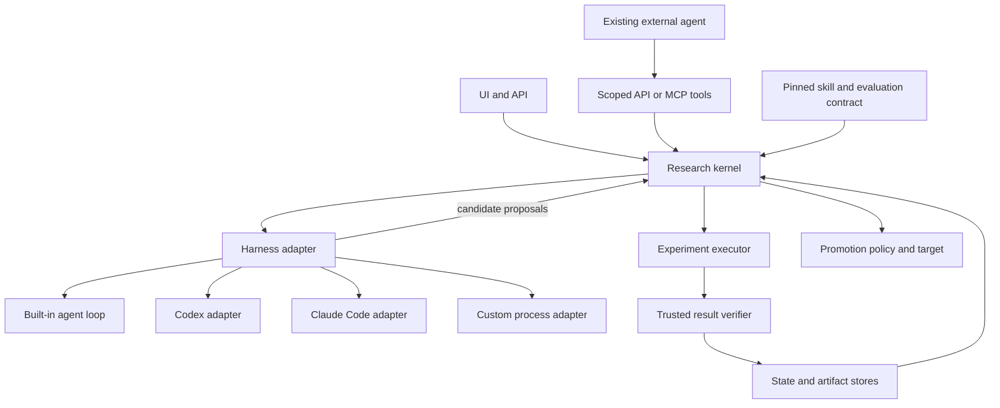

# Project Review: Universal Harness and Domain Support

Date: 2026-09-27

Reviewed commit: `1a5d54505d98976572887b6e23fdca0988902d60`

Scope: repository review, selected tests, and disposable local reproductions.

Requested outcome: support both different agent harnesses and different research domains.

## Assessment

The project has useful foundations for a universal research control plane: skill
manifests, provider adapters, persisted sessions, attempt snapshots, command
auditing, promotion targets, and a manifest-driven UI. However, it is currently
a service with its own agent harness and partially generalized domain contracts.
Changing the model provider does not replace the agent harness.

My recommendation is to retain the research control plane and make the current
agent loop one replaceable driver. Experiments, evidence validation, budgets,
and promotion decisions should remain independently enforceable by the server.
First repair the correctness and isolation findings below; otherwise additional
harnesses would inherit inconsistent guarantees.

## Findings

P1 means fix before expanding trusted execution or claiming universal support.
P2 means an implementation or contract gap that limits supported configurations.
"Reproduced" refers to a local component probe unless explicitly stated otherwise;
it does not mean a complete exploit through the deployed service was exercised.

### F01 [P1] Agent writes can replace trusted evaluator code

Evidence: [agent_tools.py](src/core/agent_tools.py#L275),
[command_policy.py](src/core/command_policy.py#L211), and
[orchestrator.py](src/core/orchestrator.py#L2894).

File tools receive the shared `settings.workspace_root`; `write_file` does not
apply the active session boundary or a candidate-file allowlist. The Python
command resolver prefers a workspace script when the declared script already
exists there, using the packaged script only as a fallback.

Reproduced: a tool call for session A modified session B's candidate. Creating
`workspace/eval/run.py` also changed an allowed evaluator invocation from the
packaged path to that writable file. Thus a script-name allowlist does not
establish trusted evaluator identity. Ordinary reads can likewise reach shared
workspace files, including evidence and other sessions' inputs.

Change: give each attempt an explicit writable candidate tree; keep evaluators,
datasets, interpreter environments, control-plane state, and evidence outside it.
Always resolve an approved evaluator to its immutable package path and digest.
Apply the same path authorization to all file tools, not just shell commands.
Test cross-session access and evaluator shadowing through the actual tool loop.

### F02 [P1] A dangling symlink bypasses write confinement

Evidence: [agent_tools.py](src/core/agent_tools.py#L169).

`_safe_write_path` rejects a symlink only when `path.exists()` is true. A dangling
symlink has `exists() == False`; `Path.write_text` subsequently follows it.

Reproduced: a symlink inside the session pointing to a nonexistent file outside
the workspace caused that outside file to be created. The prerequisite is a
workspace containing such a link, for example from supplied files or a plugin.
The possible destination remains bounded by the operating system's permissions.

Change: reject symlink leaves independently of target existence and use
descriptor-relative, no-follow file operations to avoid check/use races. Cover
dangling links, parent links, and concurrent path replacement in regressions.

### F03 [P1] The echoed nonce does not authenticate the result payload

Evidence: [output_parser.py](src/core/output_parser.py#L398),
[orchestrator.py](src/core/orchestrator.py#L841), and
[orchestrator.py](src/core/orchestrator.py#L2985).

The evaluator prints `server_nonce`; its output is returned to the model. The
verifier checks nonce equality without binding it to the metric, candidate,
attempt, or evaluator. The loop also accepts model-authored result markers and
can overwrite an already recorded iteration with their contents. A previous
turn's nonce is reusable because it is session-wide.

Reproduced: changing a payload to `primary_metric: 999` while keeping the nonce
still produced `metrics_verified`. Missing/wrong-nonce tests pass, but they do
not establish authenticity against a model that has seen a valid result.

Change: ingest authoritative results directly from a trusted evaluator channel.
Model output may propose candidates and annotate results, but must not replace
metrics, gate outcomes, or scored candidate snapshots. For remote evaluators,
authenticate a canonical envelope containing attempt ID, candidate digest,
evaluator/dataset digests, results, and replay protection. A signature alone is
insufficient if its key or evaluator is accessible to candidate code.

### F04 [P1] Plugin capabilities are not an execution sandbox

Evidence: [plugin_runner.py](src/core/plugin_runner.py#L259),
[plugin_runner.py](src/core/plugin_runner.py#L393), and
[skill_manifest.py](src/core/skill_manifest.py#L430).

The runner verifies the plugin's source path and filters environment variables,
then launches a normal subprocess. It does not enforce `fs_write` or
`network_egress` at the operating-system boundary.

Reproduced outside the review sandbox: a plugin with `fs_write: none` wrote a
file outside its workspace and returned `ok=True`. The fixture touched only a
temporary directory. Network escape was not exercised; the missing enforcement
is a code-path observation.

Resource controls also need repair: the watcher sets flags without terminating
the process immediately, while the parent checks them after `communicate`
returns. CPU accounting compares successive samples instead of cumulative CPU
time. `communicate` buffers output without a size limit.

Change: run untrusted/generated plugins in an enforced isolation backend with
read-only mounts, explicit network policy, resource limits, bounded output, and
process-tree cancellation. Until that exists, describe plugins as trusted code;
a dry-run directory and static audit do not confine their side effects.

### F05 [P1] Minimization objectives select the wrong winner

Evidence: [orchestrator.py](src/core/orchestrator.py#L3915),
[state_store.py](src/core/state_store.py#L2238), and
[postgres_state_store.py](src/core/postgres_state_store.py#L1005).

The manifest accepts `lower_is_better`, but the default keep/discard comparison
and both stores' best-result updates use `primary_metric > best_metric`.
The optional significance path knows metric direction, but it does not fix the
default path or the database update. The leaderboard's direction-aware sort
cannot repair an incorrectly selected session best.

Reproduced with a baseline of 100: 80 yields `discard`, and 120 yields `keep`.
This directly affects latency, loss, error rate, cost, and energy optimization.

Change: resolve one objective/comparison policy into the immutable run spec and
use it consistently for decisions, storage, stagnation, promotion, and ranking.
Cover minimization and maximization on SQLite and Postgres, including ties,
missing/nonfinite values, failed gates, and significance fallback.

### F06 [P1] Live command paths differ from the working demo path

Evidence: [command_policy.py](src/core/command_policy.py#L256),
[command_runner.py](src/core/command_runner.py#L375),
[skill_runtime.py](src/core/skill_runtime.py#L453), and
[db-config-tuning/SKILL.yaml](skills/db-config-tuning/SKILL.yaml).

Policy validates a bare config filename relative to the session directory,
but it does not rewrite that argument. Sequential execution uses the shared
workspace root as CWD. The bundled live experiment commands use bare filenames;
the demo commands compensate with absolute session paths.

Reproduced: the declared DB experiment command was allowed, then exited 1 with
`No such file or directory: 'db_config.yaml'`, even though that file existed in
the session workspace. A real model might repair the command, but that is not a
reliable execution contract. Relative output files can also land in the shared
root instead of the session's declared fallback location.

Change: resolve executable, argv, CWD, inputs, and outputs once into an
`ExecutionRequest`. Use identical resolution for policy, snapshots, subprocess
execution, and result ingestion. Exercise the live command template in an
offline integration test, not only the separate demo template.

### F07 [P1] Postgres does not make session admission globally safe

Evidence: [session_manager.py](src/core/session_manager.py#L366),
[session_manager.py](src/core/session_manager.py#L391), and
[postgres_state_store.py](src/core/postgres_state_store.py#L457).

Concurrency limits and duplicate skill/subject/variant checks use a manager's
local `_active` map and `asyncio.Lock`. Bundled workspace paths omit the unique
research ID. Two workers can therefore admit the same workload, derive the same
directory, and archive/bootstrap it before either creates its session row.
Postgres locks keyed by research ID do not serialize these different IDs.

This is a code-path finding; a live multi-process collision was not run.
Separately, a later fresh run reuses the logical workspace path while older
session rows retain their original paths, so continuation and artifact lookup
need careful ownership checks even with one worker.

Change: reserve work atomically in shared storage before filesystem side
effects; use unique run/attempt directories and explicit parent snapshots.
Define global versus per-worker limits. Extend fencing to evaluator writes,
artifact publication, and promotion, not only session status updates.

### F08 [P1] Continuation loses operator-supplied skill parameters

Evidence: [session_manager.py](src/core/session_manager.py#L411),
[session_manager.py](src/core/session_manager.py#L844), and
[research_manifest.py](src/core/research_manifest.py#L435).

Fresh starts put `skill_params` in the in-memory `ResearchConfig`. The persisted
manifest omits them, and continuation constructs a new config without them.
Thus the claim that continuation inherits all fixed settings is not satisfied.
For example, the prompt skill's scorer endpoint can disappear on continuation.

The manifest records a skill version and a small descriptor, but does not pin
the complete resolved skill, evaluator package, environment, and effective
harness/model settings. Runtime materialization reads the current registry.

Change: persist a canonical, resolved run spec, including nonsecret parameter
values and references to secrets. Resume from that spec and content-addressed
artifacts. Require explicit migration for incompatible skill/adapter versions;
never silently re-resolve an old run against today's defaults.

### F09 [P1] Production promotion still requires legacy domain evidence

Evidence: [config_promoter.py](src/core/config_promoter.py#L778),
[config_promoter.py](src/core/config_promoter.py#L861), and
[config_promoter.py](src/core/config_promoter.py#L1303).

The bundled non-ML skills declare production after development. The production
path instead requires development, paper, and canary records and hard-coded
evidence such as supervised feature readiness, model cards, and inference reload
parity. Manifest `prior_scopes` does not drive this path. Development promotion
has received domain-neutral handling, but that work does not generalize the
whole promotion lifecycle.

Change: compile a scope graph and evidence validators from the pinned skill
policy, subject to mandatory operator-level safeguards. Keep approval bound to
candidate and target identity. Preserve legacy policy for historical sessions.
Use canonical skill and target identity in history/rollback lookups. Test a
non-ML production preview/confirmation without fabricated ML artifacts.

### F10 [P2] Provider configuration and budgets are only partially abstracted

Evidence: [orchestrator.py](src/core/orchestrator.py#L472),
[orchestrator.py](src/core/orchestrator.py#L1548),
[orchestrator.py](src/core/orchestrator.py#L2370), and
[orchestrator.py](src/core/orchestrator.py#L2514).

The loop uses fixed Claude token rates for projected and actual cost, rather
than the selected provider's estimator. Anthropic skills do not receive their
manifest `primary_model` override through the non-Anthropic-only selection
branch. Insights use the global Anthropic insight model even through another
provider. Manifest `insight_model` and `max_output_tokens` are not applied to
these calls. Capability checks also bypass the default Anthropic path.

Change: resolve provider/model roles and capabilities before session creation.
Separate reported usage, estimated cost, actual billed cost, and unavailable
cost; unknown cost must not become zero. Account for evaluator calls as well as
agent calls when claiming a total research budget. Reserve spend before work
and reconcile afterward. Add provider-specific context/output budgeting, with
explicit unsupported-model failures rather than silent pricing assumptions.

### F11 [P2] Several accepted manifest declarations have no matching behavior

Evidence: [skill_runtime.py](src/core/skill_runtime.py#L691),
[skill_runtime.py](src/core/skill_runtime.py#L768),
[command_policy.py](src/core/command_policy.py#L69), and
[session_manager.py](src/core/session_manager.py#L622).

| Declaration | Observed implementation gap |
| --- | --- |
| Custom `iteration_marker` | Runtime notices the configured prefix but calls a parser that scans the fixed `ITERATION_RESULT:` prefix. A `CUSTOM_RESULT:` probe returned no result. |
| `required_fields`, `failure_statuses` | Not passed into result parsing/validation. A DB `bench_failed` payload retained metric 123 and was accepted without required `p99_within_slo`. |
| `allowed_executables` | Accepted but documented as a no-op. Declaring `jq` still resulted in a policy rejection. Native Node/Go/build-tool execution lacks a corresponding runner contract. |
| `phase_advancement.plugin` | The runtime returns declarative evidence keys; it does not invoke the named phase plugin. |
| `trial_identity.resolve.plugin`, `hash_fields` | Runtime calls the legacy identity builder without using the declared resolver or hash-field selection. |
| Required `local_file` preflight | Both runtime and session-start target construction skip local-file entries. |
| `metric_schema.goal: satisfice` | Schema support exists, but there is no corresponding goal-specific orchestration path in the inspected runtime. |

Change: maintain a machine-readable support matrix. Each advertised option must
have a behavioral conformance test; otherwise reject it at load/start with a
specific unsupported-capability error. Successful schema parsing should not be
treated as proof that a skill can execute.

### F12 [P2] Parameter validation and binding do not match the skill contract

Evidence: [research.py](src/api/research.py#L370),
[research.py](src/api/research.py#L652),
[skill_runtime.py](src/core/skill_runtime.py#L427), and the bundled bootstraps.

The hand-written validator checks basic types and keys but not declared numeric
bounds, enums, or nested structures. It rejects unknown keys regardless of
`additionalProperties`, and validation is skipped when `skill_params` is absent,
even for a schema declaring required fields.

Reproduced: DB parameters `target_latency_ms: -10` and `bench_duration_s: 99999`
were accepted despite their declared bounds. The DB command still hard-codes
latency 10, and its evaluator reports duration 60. The code-refactor bootstrap
always creates its sample target rather than consuming the requested target.

There is also a `prompt-engineering` ID branch in the core runtime. Its
`evaluator_command_params` values are inserted into prompt text but are not
enforced when executing model-supplied argv. Scorer/dataset/demo selection is
therefore not yet a reliable server-owned configuration boundary.

Change: validate with a standard schema implementation; materialize defaults
and bind validated parameters into execution requests and bootstrap inputs.
Protect fixed evaluator arguments from model override. Move domain-specific
bindings out of core code. Test nondefault values through API, execution,
persistence, and continuation.

## What Universal Should Mean

Use independently testable promises instead of one broad "universal" label:

| Dimension | Current position | Proposed acceptance condition |
| --- | --- | --- |
| Model provider | Anthropic/OpenAI adapters inside one loop | Supported provider/model settings and accounting are resolved consistently. |
| Agent harness | Built-in `AgentOrchestrator` only | Built-in and at least two independently implemented external drivers complete the same research lifecycle. |
| Research domain | Three bundled packages; incomplete runtime contract | A new conforming skill runs without core/UI edits; unsupported declarations fail before execution. |
| Execution environment | Local Python subprocesses and a shared workspace convention | Explicit local-isolated executor contract; other backends advertise separately tested capabilities. |
| Evidence | Snapshots and nonce-tagged output | Evaluator-authenticated results bound to immutable candidates and attempts, independent of agent prose. |
| Recovery | Persisted state and chained continuation | Effective configuration, artifacts, ownership, and native harness resume semantics survive interruption. |

Universality does not require identical tools, prompts, or native conversation
state across agents. It requires equivalent research semantics and explicit
capability differences. Likewise, arbitrary exploratory research should not be
forced into scalar optimization; support that as a separate objective type when
there is a real scenario and acceptance contract for it.

## Proposed Architecture

The following is a design proposal, not functionality present in this commit.



### Keep These Responsibilities Separate

1. **Research kernel:** session/attempt state, budgets, objective comparison,
   phase evidence, deduplication, and promotion eligibility. It should not need
   an Anthropic-shaped conversation or a particular tool name.
2. **Harness adapter:** launch/attach, instructions, native event normalization,
   candidate proposals, interruption, usage, and optional native resume.
   Harness lifecycle is distinct from `LLMProvider.messages_create`.
3. **Experiment executor:** resolve an approved evaluation request, stage inputs,
   enforce filesystem/network/resource policy, execute, and collect artifacts.
   A harness choosing to run its own shell must not bypass trusted evaluation.
4. **Skill contract:** parameter schema, candidate artifacts, evaluator,
   objectives/constraints, phase rules, and promotion policy. Model preferences
   may be defaults, but must not determine which harness can use the skill.
5. **Evidence and promotion:** store immutable results and provenance; authorize
   changes against the exact reviewed candidate/target. Reuse existing stores,
   snapshots, state-machine work, and `PromotionTarget` where possible.

Extract these responsibilities incrementally. The approximately 5,000-line
orchestrator and the runtime's callbacks into its private helpers make a single
large rewrite risky. First create a kernel-facing interface and put the existing
behavior behind a `BuiltinHarnessAdapter` with characterization tests.

### Support Two Integration Directions

**Managed driver:** this service launches an external harness in an isolated run
workspace. The adapter translates its native lifecycle and proposal artifacts
into research events. This suits unattended service operation.

**Attached driver:** an already-running agent invokes narrow research operations
through an API/CLI, with an optional MCP facade over the same implementation.
For example: create a run, inspect constraints, submit a candidate digest,
request evaluation, inspect verified results, and request promotion preview.
This suits users who already work inside a chosen harness.

Use scoped run/attempt credentials for attached agents. Do not hand them the
operator bearer token or production approver secret. Promotion approval remains
a separate authority. Imported third-party results should carry an explicit
unverified/imported status until independently validated.

MCP can expose research tools; it does not itself supply process supervision,
isolation, durable events, or trusted measurements. Both integration directions
must use the same kernel and evaluator policy.

### Minimal Adapter and Event Contracts

Define a versioned `HarnessAdapter` around `capabilities`, `start`, `events`,
`cancel`, and `close`. Make `resume`, `pause`, and mid-run input explicit optional
capabilities. An unsupported pause should be reported or implemented at a known
safe boundary; it must not be silently equated with killing the process.

Persist a resolved run specification containing:

- Skill package/version/digest and fully validated nonsecret parameters.
- Harness adapter/protocol version, effective configuration, and model roles.
- Candidate input digests, evaluator and dataset digests, and environment image
  or dependency-lock identity.
- Execution capabilities, policy version, budget dimensions, and objective.
- Parent run/checkpoint references and immutable artifact locations.

Events should have schema version, event ID, run/attempt ID, producer identity,
sequence/cursor, timestamp, and ownership epoch. Distinguish `candidate_proposed`,
`attempt_started`, `attempt_finished`, `result_verified`, `approval_required`,
`usage_reported`, and terminal lifecycle events. Preserve native event payloads
for diagnosis without letting them mutate authoritative metrics.

Ingestion must tolerate duplicate and out-of-order delivery. Reconnection should
resume from a persisted cursor. Define crash behavior for the interval between
an external effect and its acknowledgement; do not promise exactly-once effects
merely because an event has an ID. Reuse the existing fencing-token machinery
and extend it to external workers and artifact writes.

### Initial External Adapters

| Driver | Proposed first integration | Qualification boundary |
| --- | --- | --- |
| Built-in | Wrap the existing loop; keep provider adapters inside it | Reference behavior with corrected evidence and objective semantics. |
| Codex | A process adapter can consume `codex exec --json`; use App Server when bidirectional lifecycle/approval control is needed | Pin/test the chosen protocol version and cancellation/recovery behavior. |
| Claude Code | Consume programmatic JSON/stream output, or use its Agent SDK when callbacks and richer control are needed | Test permissions, usage attribution, interruption, and session handling independently. |
| Custom agent | A small versioned JSONL proposal/event contract | Require conformance, including failure and replay cases; do not scrape terminal prose. |

Official Codex documentation describes JSONL output for noninteractive runs and
App Server's bidirectional protocol, approvals, and turn interruption. These
are separate integration surfaces with different control requirements.
Sources: [Codex noninteractive mode](https://learn.chatgpt.com/docs/non-interactive-mode),
[Codex App Server](https://learn.chatgpt.com/docs/app-server).

Official Claude Code documentation describes programmatic execution with JSON
or streaming JSON, session metadata, and Agent SDK integration.
Source: [Run Claude Code programmatically](https://code.claude.com/docs/en/headless).

These sources were checked on the review date. They establish available
integration mechanisms, not compatibility of this project with those harnesses.
The adapter selection above is my design recommendation; no external harness
was installed or exercised during this review.

## Domain Contract Changes

Make skill authoring declarative where semantics are stable and use explicit,
isolated plugins only where needed. In particular:

- Separate mutable candidate files from immutable evaluation data, evaluator
  code, generated outputs, and private evidence. Support candidate artifact
  bundles/patches as well as one textual config file.
- Replace command-string interpretation with typed execution requests: runner,
  argv, CWD, mounts, environment references, resources, timeout, and outputs.
- Define finite typed metric values, units, direction, constraints, comparator,
  aggregation, and evaluation-context identity. Results from different datasets,
  scorers, fidelity levels, or environments must not share an unqualified ranking.
- Make repeat policy explicit. The blanket "never rerun an unchanged config"
  instruction in `CLAUDE.md` conflicts with replication, stochastic benchmarks,
  and uncertainty estimation. Separate candidate identity from observation ID.
- Make phase rules and promotion evidence skill-owned and executable. Unsupported
  artifact-store/git targets should remain explicit failures until implemented.
- Split common research instructions from harness-specific instruction files.
  Generate/render `CLAUDE.md` or `AGENTS.md` only where the adapter needs them;
  neither filename should define core research semantics.

The existing parameter forms and metrics UI are worth preserving. Add harness
selection, capability/status visibility, evaluator provenance, and honest usage
states. Advanced custom UI renderers currently require frontend registration;
do not imply every new visual domain representation can be installed as YAML.

## Remaining Caveats

| Area | Caveat and practical consequence |
| --- | --- |
| Domain realism | `db-config-tuning` is explicitly a simulator. `code-refactor` checks syntax, source-text needles, and lint-derived proxies; its `no_perf_regression` flag is not a measured performance test. Passing either is not evidence of real database or application improvement. |
| Evaluator independence | Keep test datasets, holdouts, and baseline definitions immutable to the candidate writer. Otherwise an optimization can improve its grade by changing the test. |
| Statistics | The significance helper can fall back to a point comparison when evidence is sparse. Separate exploratory acceptance from production qualification, with declared replication and holdout rules. |
| Distributed events | [EventBroadcaster](src/ws/events.py#L68) holds process-local clients. No cross-worker event bus or replay cursor was found; a UI socket on a different worker can miss updates. Shared database state alone does not solve this. |
| Leaderboards | [Skill rankings](src/api/skills.py#L247) aggregate session bests across subjects/variants and use a bounded recent-session query. Add comparable-evaluation groups and clarify whether ranking is global or over a window. |
| Artifacts and recovery | A database backend does not distribute local run files. Multi-host deployment needs shared/object storage, content addressing, retention, and reconciliation of incomplete writes. |
| Deployment portability | `fcntl`, POSIX signals, `.venv/bin/python`, and container paths make the current execution implementation Linux/POSIX-oriented. Universal harness support need not mean native Windows support, but publish that boundary. |
| Cost | Model-token estimates exclude other compute/service spend unless separately instrumented. Unknown external-harness costs need an explicit state and alternate time/resource caps. |
| Documentation | README scorer descriptions and some module comments describe earlier behavior or planned work. Reconcile them with supported runtime contracts and conformance tests. |
| Review coverage | This is a bounded architecture/correctness review, not an exhaustive audit of every backend/UI branch or a production security certification. |

## Recommended Work Order

These are proposed work packages. Dependencies and measurable completion gates
matter more than adding more adapters quickly.

| Order | Work package | Depends on | Completion gate |
| --- | --- | --- | --- |
| 1 | Repair trust and execution boundaries: F01-F04, F06 | None | Agent cannot change evaluator/tests/evidence or escape its writable tree; modified/replayed results are rejected; live/demo requests resolve identically. |
| 2 | Complete domain semantics: F05, F09, F11-F12 | 1 for end-to-end proof | Maximize, minimize, and declared scope/parameter/parser contracts work; every unsupported feature fails before start. |
| 3 | Persist run specification and isolate run ownership: F07-F08, F10 | 1-2 | Restart/continuation preserves settings and provenance; two workers cannot share a mutable run directory; budgets use the resolved driver/model. |
| 4 | Extract research kernel and wrap built-in harness | 1-3 | Existing qualified behavior passes through the adapter; kernel tests need no provider SDK or model transcript. |
| 5 | Add scoped attached-agent API/CLI and one managed external adapter | 4 | Same candidate/result/promotion lifecycle works through both directions; cancel, denied approval, duplicate events, and crash recovery pass. |
| 6 | Add a second independent harness and one genuinely different domain | 5 | Compatibility matrix below passes without core domain branches or weakening evidence policy. |
| 7 | Broaden execution backends and production operations | 3-6 | Shared artifacts, event replay/fan-out, resource limits, target reconciliation, and deployment-specific tests pass. |

Keep each change reviewable and preserve the existing built-in path during
migration. Introduce a new schema version where semantics change; interpret old
manifests through explicit compatibility code. Reject advertised-but-unimplemented
v1 options with actionable errors instead of silently treating them as supported.

## Acceptance Matrix

The initial qualification target should combine the built-in driver, Codex, and
Claude Code with a real prompt scorer, a real code/test workflow, and a latency
minimization workload. Run every promised combination, and publish unsupported
combinations explicitly.

Required cross-path checks:

1. Fresh start, useful candidate change, verified evaluation, and correct winner.
2. Failed evaluation, invalid/nonfinite metric, changed dataset, and forged result.
3. Minimize/maximize comparison, replication, ties, and constraints.
4. Nondefault parameters preserved through interruption and continuation.
5. Stop/pause behavior, child-process cleanup, unavailable harness, and timeout.
6. Duplicate/out-of-order events, reconnect, stale owner, and worker restart.
7. Concurrent sessions targeting the same subject with isolated artifacts.
8. Candidate-bound promotion approval, rejected stale approval, rollback, and
   remote-effect reconciliation.
9. Usage reported, estimated, and unavailable; spending/time/resource caps.
10. A newly installed skill and adapter pass a shared conformance suite without
    orchestrator or UI branches for their IDs.

Use deterministic adapter fixtures for routine CI, then a small opt-in live
qualification suite for actual harness versions. Mock-provider success is useful
integration evidence but cannot substitute for a real harness compatibility run.

## Verification Performed

The tracked worktree was clean before review. No application code was changed.

Two focused test runs completed using the existing Poetry virtual environment,
with plugin autoload disabled and `pytest_asyncio.plugin` explicitly enabled:

| Test group | Result |
| --- | --- |
| `test_llm_provider`, `test_llm_provider_openai`, `test_command_policy`, `test_skill_loader`, `test_metrics_forgery` | 132 passed in 4.33 seconds |
| `test_non_ml_session_e2e`, `test_metrics_forgery_c3`, `test_manifest_runtime_production_path`, `test_runtime_recovery` | 38 passed in 4.91 seconds; 3 HTTPX deprecation warnings |

The second group was rerun outside the restricted review sandbox after async
execution stalled inside it. The same bounded checks then completed; the sandbox
stall is not reported as a project defect. The full suite, UI build/browser
suite, Docker build, and live Postgres/distributed qualification were not run.
No live model, external harness, remote scorer, or production promotion was used.

Disposable probes under `/tmp` additionally established:

```text
cross-session candidate write: succeeded
dangling-symlink outside-workspace write: succeeded
packaged evaluator shadowed by writable workspace file: allowed
plugin with fs_write=none wrote outside workspace: succeeded
changed metric with echoed nonce: metrics_verified
latency 100 -> 80: discard; latency 100 -> 120: keep
out-of-range declared skill parameters: accepted
custom result marker: not parsed
declared failure status with metric 123 and missing required field: parsed
declared live DB command: allowed, then failed to locate session config
declared jq executable: rejected
```

The probes demonstrate gaps not covered by the passing selected tests. The
worker-admission race, continuation parameter loss, production-scope mismatch,
and ineffective resource limits were established by tracing code paths, not by
live distributed, production, or resource-exhaustion experiments.
