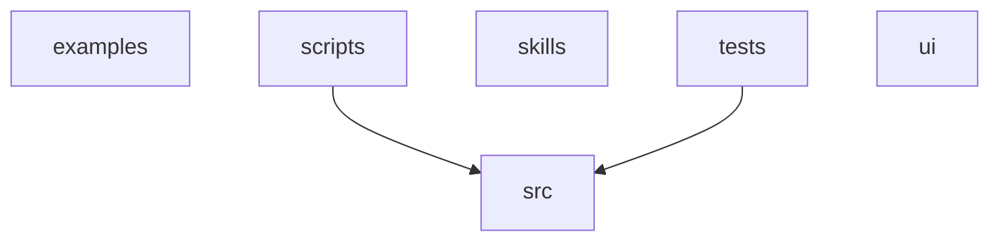

# Dependencies

Internal module dependency graph and external package reconciliation.

## Module graph

<!-- Collapsed to top-level packages; the full module list is in the Fan-in / Fan-out table below. -->

## Cycles

*No import cycles detected.*

> These groups reach each other only from inside functions or under `TYPE_CHECKING`, so nothing is imported while they load and their order is well defined. They are listed because they are cyclic on paper, not because they need fixing.

- [orchestrator](modules/orchestrator.md) ⇄ [skill_runtime](modules/skill_runtime.md)
- [preflight](modules/preflight.md) ⇄ [service_preflight](modules/service_preflight.md)
- [research_manifest](modules/research_manifest.md) ⇄ [run_spec](modules/run_spec.md)

## Fan-in / Fan-out

| Module | Fan-in | Fan-out |
|--------|--------|---------|
| [results_store](modules/results_store.md) | 54 | 1 |
| [config](modules/config.md) | 52 | 0 |
| [orchestrator](modules/orchestrator.md) | 48 | 31 |
| [skill_registry](modules/skill_registry.md) | 33 | 2 |
| [llm_provider](modules/llm_provider.md) | 27 | 1 |
| [skill_manifest](modules/skill_manifest.md) | 25 | 4 |
| [state_store](modules/state_store.md) | 25 | 5 |
| [client](modules/client.md) | 25 | 0 |
| [skill_runtime](modules/skill_runtime.md) | 24 | 13 |
| [research_phase_plan](modules/research_phase_plan.md) | 20 | 5 |
| [config_promoter](modules/config_promoter.md) | 19 | 17 |
| [session_manager](modules/session_manager.md) | 18 | 21 |
| [skill_loader](modules/skill_loader.md) | 17 | 2 |
| [events](modules/events.md) | 15 | 1 |
| [harness_contract](modules/harness_contract.md) | 14 | 0 |
| [objective_comparator](modules/objective_comparator.md) | 14 | 3 |
| [consistency_validator](modules/consistency_validator.md) | 13 | 2 |
| [iteration_snapshot](modules/iteration_snapshot.md) | 13 | 2 |
| [command_runner](modules/command_runner.md) | 12 | 5 |
| [experiment_parser](modules/experiment_parser.md) | 12 | 1 |
| [tool_access](modules/tool_access.md) | 12 | 0 |
| [research](modules/research.md) | 11 | 11 |
| [artifact_reference](modules/artifact_reference.md) | 11 | 0 |
| [gate_status](modules/gate_status.md) | 11 | 0 |
| [postgres_state_store](modules/postgres_state_store.md) | 11 | 6 |
| [promotion_target](modules/promotion_target.md) | 11 | 3 |
| [useResearch](modules/useResearch.md) | 11 | 2 |
| [promotion](modules/promotion.md) | 10 | 7 |
| [plugin_runner](modules/plugin_runner.md) | 10 | 4 |
| [research_manifest](modules/research_manifest.md) | 10 | 7 |
| [primitives](modules/primitives.md) | 10 | 0 |
| [fs_safety](modules/fs_safety.md) | 9 | 0 |
| [core_legacy_alias](modules/core_legacy_alias.md) | 9 | 1 |
| [run_spec](modules/run_spec.md) | 9 | 3 |
| [state_machine](modules/state_machine.md) | 9 | 2 |
| [auth](modules/auth.md) | 8 | 1 |
| [results](modules/results.md) | 8 | 10 |
| [agent_tools](modules/agent_tools.md) | 8 | 6 |
| [command_policy](modules/command_policy.md) | 8 | 4 |
| [research_kernel](modules/research_kernel.md) | 8 | 2 |
| [harness_adapter](modules/harness_adapter.md) | 7 | 1 |
| [iteration_context](modules/iteration_context.md) | 7 | 5 |
| [output_parser](modules/output_parser.md) | 7 | 2 |
| [result_authority](modules/result_authority.md) | 7 | 1 |
| [scoped_credentials](modules/scoped_credentials.md) | 7 | 0 |
| [service_preflight](modules/service_preflight.md) | 7 | 2 |
| [significance](modules/significance.md) | 7 | 1 |
| [skill_paths](modules/skill_paths.md) | 7 | 0 |
| [src_api_skills](modules/src_api_skills.md) | 6 | 10 |
| [observability](modules/observability.md) | 6 | 0 |
| [result_artifact](modules/result_artifact.md) | 6 | 2 |
| [development_gate_bundle](modules/development_gate_bundle.md) | 5 | 2 |
| [execution_contracts](modules/execution_contracts.md) | 5 | 1 |
| [execution_request](modules/execution_request.md) | 5 | 0 |
| [isolation](modules/isolation.md) | 5 | 0 |
| [pagination](modules/pagination.md) | 5 | 0 |
| [preflight](modules/preflight.md) | 5 | 1 |
| [promotion_approval](modules/promotion_approval.md) | 5 | 0 |
| [support_matrix](modules/support_matrix.md) | 5 | 0 |
| [useWebSocket](modules/useWebSocket.md) | 5 | 1 |
| [blocker_classifier](modules/blocker_classifier.md) | 4 | 0 |
| [claude_code_harness](modules/claude_code_harness.md) | 4 | 1 |
| [codex_harness](modules/codex_harness.md) | 4 | 1 |
| [process_limits](modules/process_limits.md) | 4 | 0 |
| [research_state](modules/research_state.md) | 4 | 8 |
| [run_restore](modules/run_restore.md) | 4 | 1 |
| [skill_params](modules/skill_params.md) | 4 | 0 |
| [trial_workspace](modules/trial_workspace.md) | 4 | 1 |
| [usage_ledger](modules/usage_ledger.md) | 4 | 1 |
| [src_main](modules/src_main.md) | 4 | 18 |
| [agent](modules/agent.md) | 3 | 4 |
| [audit](modules/audit.md) | 3 | 1 |
| [harnesses](modules/harnesses.md) | 3 | 7 |
| [subjects](modules/subjects.md) | 3 | 4 |
| [cli](modules/cli.md) | 3 | 10 |
| [bootstrap_runner](modules/bootstrap_runner.md) | 3 | 4 |
| [builtin_harness](modules/builtin_harness.md) | 3 | 2 |
| [comparison_context](modules/comparison_context.md) | 3 | 0 |
| [harness_conformance](modules/harness_conformance.md) | 3 | 2 |
| [log_writer](modules/log_writer.md) | 3 | 1 |
| [promotion_policy](modules/promotion_policy.md) | 3 | 0 |
| [run_artifacts](modules/run_artifacts.md) | 3 | 1 |
| [skill_generator](modules/skill_generator.md) | 3 | 3 |
| [test_webhook_promotion](modules/test_webhook_promotion.md) | 3 | 8 |
| [agent_cli](modules/agent_cli.md) | 2 | 1 |
| [agent_client](modules/agent_client.md) | 2 | 0 |
| [compat_legacy_alias](modules/compat_legacy_alias.md) | 2 | 0 |
| [driver_host](modules/driver_host.md) | 2 | 1 |
| [goal_semantics](modules/goal_semantics.md) | 2 | 0 |
| [http_headers](modules/http_headers.md) | 2 | 0 |
| [latency_benchmark](modules/latency_benchmark.md) | 2 | 0 |
| [output_digest](modules/output_digest.md) | 2 | 0 |
| [skill_lifecycle](modules/skill_lifecycle.md) | 2 | 0 |
| [DynamicFormFields](modules/DynamicFormFields.md) | 2 | 3 |
| [HarnessContextPanel](modules/HarnessContextPanel.md) | 2 | 1 |
| [HarnessPicker](modules/HarnessPicker.md) | 2 | 1 |
| [IterationsTable](modules/IterationsTable.md) | 2 | 1 |
| [MetricsChart](modules/MetricsChart.md) | 2 | 1 |
| [Topbar](modules/Topbar.md) | 2 | 3 |
| [Leaderboard](modules/Leaderboard.md) | 2 | 2 |
| [NewResearch](modules/NewResearch.md) | 2 | 5 |
| [registry](modules/registry.md) | 2 | 2 |
| [productionOps](modules/productionOps.md) | 2 | 0 |
| [legacy_phase_tables](modules/legacy_phase_tables.md) | 1 | 0 |
| [ml_enrichment](modules/ml_enrichment.md) | 1 | 0 |
| [code_evaluator](modules/code_evaluator.md) | 1 | 0 |
| [development_inference_validation](modules/development_inference_validation.md) | 1 | 0 |
| [development_signal_health](modules/development_signal_health.md) | 1 | 0 |
| [domain_classifier](modules/domain_classifier.md) | 1 | 2 |
| [harness_qualification](modules/harness_qualification.md) | 1 | 5 |
| [insights_feedback](modules/insights_feedback.md) | 1 | 0 |
| [instruction_assembly](modules/instruction_assembly.md) | 1 | 0 |
| [multiobjective](modules/multiobjective.md) | 1 | 0 |
| [phase_resolver](modules/phase_resolver.md) | 1 | 2 |
| [prompt_scorer](modules/prompt_scorer.md) | 1 | 2 |
| [research_resume](modules/research_resume.md) | 1 | 0 |
| [skill_host_services](modules/skill_host_services.md) | 1 | 0 |
| [test_canonical_start_wiring](modules/test_canonical_start_wiring.md) | 1 | 5 |
| [test_config_promoter_gate_bundle](modules/test_config_promoter_gate_bundle.md) | 1 | 3 |
| [test_non_ml_session_e2e](modules/test_non_ml_session_e2e.md) | 1 | 8 |
| [test_parallel_trials](modules/test_parallel_trials.md) | 1 | 6 |
| [test_postgres_state_store](modules/test_postgres_state_store.md) | 1 | 1 |
| [App](modules/App.md) | 1 | 13 |
| [AgentLog](modules/AgentLog.md) | 1 | 3 |
| [ClipboardCopy](modules/ClipboardCopy.md) | 1 | 0 |
| [ConfigDiff](modules/ConfigDiff.md) | 1 | 0 |
| [PromotionModal](modules/PromotionModal.md) | 1 | 4 |
| [SkillPicker](modules/SkillPicker.md) | 1 | 1 |
| [Dashboard](modules/Dashboard.md) | 1 | 3 |
| [History](modules/History.md) | 1 | 2 |
| [Promote](modules/Promote.md) | 1 | 3 |
| [ResearchDetail](modules/ResearchDetail.md) | 1 | 8 |
| [Settings](modules/Settings.md) | 1 | 3 |
| [ui_src_pages_Skills](modules/ui_src_pages_Skills.md) | 1 | 2 |
| [types](modules/types.md) | 1 | 1 |
| [jsonl_driver](modules/jsonl_driver.md) | 0 | 0 |
| [examples_prompt-registry_main](modules/examples_prompt-registry_main.md) | 0 | 0 |
| [check_doc_references](modules/check_doc_references.md) | 0 | 0 |
| [check_domain_coupling](modules/check_domain_coupling.md) | 0 | 0 |
| [check_execution_ledger](modules/check_execution_ledger.md) | 0 | 0 |
| [check_legacy_vocab_branching](modules/check_legacy_vocab_branching.md) | 0 | 0 |
| [ci_qualification_gates](modules/ci_qualification_gates.md) | 0 | 3 |
| [migrate_sqlite_to_postgres](modules/migrate_sqlite_to_postgres.md) | 0 | 1 |
| [run_compatibility_matrix](modules/run_compatibility_matrix.md) | 0 | 0 |
| [code-refactor_bootstrap](modules/code-refactor_bootstrap.md) | 0 | 0 |
| [code-refactor_eval_run](modules/code-refactor_eval_run.md) | 0 | 0 |
| [db-config-tuning_bootstrap](modules/db-config-tuning_bootstrap.md) | 0 | 0 |
| [db-config-tuning_eval_run](modules/db-config-tuning_eval_run.md) | 0 | 0 |
| [prompt-engineering_bootstrap](modules/prompt-engineering_bootstrap.md) | 0 | 0 |
| [dataset](modules/dataset.md) | 0 | 0 |
| [prompt-engineering_eval_run](modules/prompt-engineering_eval_run.md) | 0 | 0 |
| [tests_conftest](modules/tests_conftest.md) | 0 | 1 |
| [conformance_bootstrap](modules/conformance_bootstrap.md) | 0 | 0 |
| [conformance_eval_run](modules/conformance_eval_run.md) | 0 | 0 |
| [pricing](modules/pricing.md) | 0 | 0 |
| [totals](modules/totals.md) | 0 | 0 |
| [test_behavior](modules/test_behavior.md) | 0 | 0 |
| [phases](modules/phases.md) | 0 | 0 |
| [phases_bad_schema](modules/phases_bad_schema.md) | 0 | 0 |
| [phases_egress](modules/phases_egress.md) | 0 | 0 |
| [phases_env_spy](modules/phases_env_spy.md) | 0 | 0 |
| [phases_tamper](modules/phases_tamper.md) | 0 | 0 |
| [phases_timeout](modules/phases_timeout.md) | 0 | 0 |
| [_engine](modules/_engine.md) | 0 | 7 |
| [capture](modules/capture.md) | 0 | 0 |
| [parity_conftest](modules/parity_conftest.md) | 0 | 0 |
| [test_parity](modules/test_parity.md) | 0 | 0 |
| [test_adaptive_noop_reason_fallback](modules/test_adaptive_noop_reason_fallback.md) | 0 | 1 |
| [test_agent_api](modules/test_agent_api.md) | 0 | 5 |
| [test_agent_cli](modules/test_agent_cli.md) | 0 | 6 |
| [test_anthropic_provider](modules/test_anthropic_provider.md) | 0 | 1 |
| [test_api_auth](modules/test_api_auth.md) | 0 | 5 |
| [test_async_tool_path](modules/test_async_tool_path.md) | 0 | 4 |
| [test_auto_phase_evidence](modules/test_auto_phase_evidence.md) | 0 | 2 |
| [test_auto_promote_terminate_waiver](modules/test_auto_promote_terminate_waiver.md) | 0 | 3 |
| [test_auto_promotion_readiness](modules/test_auto_promotion_readiness.md) | 0 | 3 |
| [test_baseline_capture_dedup_bypass](modules/test_baseline_capture_dedup_bypass.md) | 0 | 3 |
| [test_bootstrap_runner](modules/test_bootstrap_runner.md) | 0 | 3 |
| [test_builtin_harness](modules/test_builtin_harness.md) | 0 | 9 |
| [test_ci_qualification_gates](modules/test_ci_qualification_gates.md) | 0 | 0 |
| [test_claude_code_harness](modules/test_claude_code_harness.md) | 0 | 4 |
| [test_cli](modules/test_cli.md) | 0 | 4 |
| [test_code_refactor_domain](modules/test_code_refactor_domain.md) | 0 | 1 |
| [test_codex_harness](modules/test_codex_harness.md) | 0 | 4 |
| [test_command_policy](modules/test_command_policy.md) | 0 | 4 |
| [test_compatibility_matrix](modules/test_compatibility_matrix.md) | 0 | 0 |
| [test_config_promoter_atomic](modules/test_config_promoter_atomic.md) | 0 | 1 |
| [test_contract_examples](modules/test_contract_examples.md) | 0 | 1 |
| [test_cross_session_digest_hint](modules/test_cross_session_digest_hint.md) | 0 | 2 |
| [test_cross_worker_control](modules/test_cross_worker_control.md) | 0 | 4 |
| [test_delete_session_hpo_cascade](modules/test_delete_session_hpo_cascade.md) | 0 | 1 |
| [test_deployment_inputs](modules/test_deployment_inputs.md) | 0 | 2 |
| [test_distributed_state_store](modules/test_distributed_state_store.md) | 0 | 4 |
| [test_domain_classifier](modules/test_domain_classifier.md) | 0 | 3 |
| [test_domain_conformance](modules/test_domain_conformance.md) | 0 | 10 |
| [test_domain_semantics_extension](modules/test_domain_semantics_extension.md) | 0 | 5 |
| [test_driver_host](modules/test_driver_host.md) | 0 | 3 |
| [test_duplicate_phase_advancement_guard](modules/test_duplicate_phase_advancement_guard.md) | 0 | 1 |
| [test_duplicate_rejection_budget](modules/test_duplicate_rejection_budget.md) | 0 | 1 |
| [test_durable_operation_qualification](modules/test_durable_operation_qualification.md) | 0 | 6 |
| [test_estimate_cost_api](modules/test_estimate_cost_api.md) | 0 | 3 |
| [test_event_broadcaster_concurrency](modules/test_event_broadcaster_concurrency.md) | 0 | 1 |
| [test_event_outbox](modules/test_event_outbox.md) | 0 | 3 |
| [test_evidence_artifact_validation](modules/test_evidence_artifact_validation.md) | 0 | 2 |
| [test_execution_concurrency](modules/test_execution_concurrency.md) | 0 | 3 |
| [test_execution_contracts](modules/test_execution_contracts.md) | 0 | 1 |
| [test_execution_isolation](modules/test_execution_isolation.md) | 0 | 4 |
| [test_execution_ledger_validator](modules/test_execution_ledger_validator.md) | 0 | 0 |
| [test_execution_request](modules/test_execution_request.md) | 0 | 8 |
| [test_experiment_parser_calibration](modules/test_experiment_parser_calibration.md) | 0 | 1 |
| [test_experiment_parser_inference_parity](modules/test_experiment_parser_inference_parity.md) | 0 | 1 |
| [test_experiment_parser_promotion_scope](modules/test_experiment_parser_promotion_scope.md) | 0 | 1 |
| [test_experiment_parser_seed_trials](modules/test_experiment_parser_seed_trials.md) | 0 | 1 |
| [test_experiment_parser_volatility_phase5](modules/test_experiment_parser_volatility_phase5.md) | 0 | 1 |
| [test_experiment_parser_volatility_phase8](modules/test_experiment_parser_volatility_phase8.md) | 0 | 1 |
| [test_exploration_markers](modules/test_exploration_markers.md) | 0 | 1 |
| [test_fencing_tokens](modules/test_fencing_tokens.md) | 0 | 4 |
| [test_fs_safety](modules/test_fs_safety.md) | 0 | 5 |
| [test_gap1_duplicate_guard](modules/test_gap1_duplicate_guard.md) | 0 | 1 |
| [test_gate_bundle_production_economics](modules/test_gate_bundle_production_economics.md) | 0 | 1 |
| [test_gate_status_contract](modules/test_gate_status_contract.md) | 0 | 3 |
| [test_generalization_falsifiability](modules/test_generalization_falsifiability.md) | 0 | 6 |
| [test_goal_phase_semantics](modules/test_goal_phase_semantics.md) | 0 | 6 |
| [test_hardening_phase1_to_5](modules/test_hardening_phase1_to_5.md) | 0 | 5 |
| [test_harness_contracts_g4](modules/test_harness_contracts_g4.md) | 0 | 8 |
| [test_harness_sdk](modules/test_harness_sdk.md) | 0 | 4 |
| [test_harnesses_api](modules/test_harnesses_api.md) | 0 | 5 |
| [test_headroom_hint](modules/test_headroom_hint.md) | 0 | 1 |
| [test_insights_feedback](modules/test_insights_feedback.md) | 0 | 1 |
| [test_issue10b_declined_outcome](modules/test_issue10b_declined_outcome.md) | 0 | 1 |
| [test_issue6_adaptive_not_attempted](modules/test_issue6_adaptive_not_attempted.md) | 0 | 2 |
| [test_issue8_consistency_blocked_outcome](modules/test_issue8_consistency_blocked_outcome.md) | 0 | 1 |
| [test_iteration_context](modules/test_iteration_context.md) | 0 | 1 |
| [test_iteration_cost_attribution](modules/test_iteration_cost_attribution.md) | 0 | 2 |
| [test_iteration_snapshot](modules/test_iteration_snapshot.md) | 0 | 1 |
| [test_iteration_snapshot_canonical_payload](modules/test_iteration_snapshot_canonical_payload.md) | 0 | 1 |
| [test_latency_benchmark](modules/test_latency_benchmark.md) | 0 | 1 |
| [test_leaderboard_api](modules/test_leaderboard_api.md) | 0 | 2 |
| [test_leaderboard_comparability](modules/test_leaderboard_comparability.md) | 0 | 3 |
| [test_llm_provider](modules/test_llm_provider.md) | 0 | 1 |
| [test_llm_provider_openai](modules/test_llm_provider_openai.md) | 0 | 1 |
| [test_log_writer](modules/test_log_writer.md) | 0 | 1 |
| [test_main_operational_endpoints](modules/test_main_operational_endpoints.md) | 0 | 3 |
| [test_manifest_runtime_production_path](modules/test_manifest_runtime_production_path.md) | 0 | 8 |
| [test_marker_file_staleness](modules/test_marker_file_staleness.md) | 0 | 2 |
| [test_metrics_forgery](modules/test_metrics_forgery.md) | 0 | 1 |
| [test_metrics_forgery_c3](modules/test_metrics_forgery_c3.md) | 0 | 6 |
| [test_migration_restore_qualification](modules/test_migration_restore_qualification.md) | 0 | 3 |
| [test_mlflow_run_id_contract](modules/test_mlflow_run_id_contract.md) | 0 | 7 |
| [test_mock_provider](modules/test_mock_provider.md) | 0 | 1 |
| [test_objective_comparator](modules/test_objective_comparator.md) | 0 | 9 |
| [test_observability](modules/test_observability.md) | 0 | 2 |
| [test_observation_identity](modules/test_observation_identity.md) | 0 | 7 |
| [test_openapi_contract](modules/test_openapi_contract.md) | 0 | 1 |
| [test_orchestrator_command_audit](modules/test_orchestrator_command_audit.md) | 0 | 2 |
| [test_orchestrator_config_snapshot_inheritance](modules/test_orchestrator_config_snapshot_inheritance.md) | 0 | 2 |
| [test_orchestrator_evidence_replay](modules/test_orchestrator_evidence_replay.md) | 0 | 5 |
| [test_orchestrator_global_stagnation](modules/test_orchestrator_global_stagnation.md) | 0 | 2 |
| [test_orchestrator_loop_guard](modules/test_orchestrator_loop_guard.md) | 0 | 3 |
| [test_orchestrator_terminal_reason](modules/test_orchestrator_terminal_reason.md) | 0 | 2 |
| [test_orchestrator_terminate_deferral](modules/test_orchestrator_terminate_deferral.md) | 0 | 2 |
| [test_orchestrator_timeout](modules/test_orchestrator_timeout.md) | 0 | 6 |
| [test_output_digest](modules/test_output_digest.md) | 0 | 1 |
| [test_output_parser](modules/test_output_parser.md) | 0 | 1 |
| [test_packaging](modules/test_packaging.md) | 0 | 1 |
| [test_pagination](modules/test_pagination.md) | 0 | 5 |
| [test_parameter_bindings](modules/test_parameter_bindings.md) | 0 | 5 |
| [test_phase_evidence_dedup_inherit](modules/test_phase_evidence_dedup_inherit.md) | 0 | 4 |
| [test_phase_genuine_dwell](modules/test_phase_genuine_dwell.md) | 0 | 1 |
| [test_phase_state_broadcast](modules/test_phase_state_broadcast.md) | 0 | 2 |
| [test_pinned_evaluators](modules/test_pinned_evaluators.md) | 0 | 8 |
| [test_plugin_runner](modules/test_plugin_runner.md) | 0 | 2 |
| [test_postgres_sqlite_parity](modules/test_postgres_sqlite_parity.md) | 0 | 2 |
| [test_preflight](modules/test_preflight.md) | 0 | 2 |
| [test_preflight_support_matrix](modules/test_preflight_support_matrix.md) | 0 | 4 |
| [test_process_limits](modules/test_process_limits.md) | 0 | 4 |
| [test_promotion_approval](modules/test_promotion_approval.md) | 0 | 3 |
| [test_promotion_diagnostics](modules/test_promotion_diagnostics.md) | 0 | 1 |
| [test_promotion_policy](modules/test_promotion_policy.md) | 0 | 8 |
| [test_promotion_target](modules/test_promotion_target.md) | 0 | 2 |
| [test_prompt_evaluation_domain](modules/test_prompt_evaluation_domain.md) | 0 | 5 |
| [test_prompt_evaluator](modules/test_prompt_evaluator.md) | 0 | 5 |
| [test_prompt_promotion_policy](modules/test_prompt_promotion_policy.md) | 0 | 3 |
| [test_provider_roles](modules/test_provider_roles.md) | 0 | 9 |
| [test_release_promotion_safety](modules/test_release_promotion_safety.md) | 0 | 8 |
| [test_replay_fixture](modules/test_replay_fixture.md) | 0 | 1 |
| [test_research_api_compat](modules/test_research_api_compat.md) | 0 | 2 |
| [test_research_api_integration](modules/test_research_api_integration.md) | 0 | 3 |
| [test_research_config](modules/test_research_config.md) | 0 | 2 |
| [test_research_kernel](modules/test_research_kernel.md) | 0 | 4 |
| [test_research_manifest](modules/test_research_manifest.md) | 0 | 3 |
| [test_research_resume](modules/test_research_resume.md) | 0 | 3 |
| [test_result_artifact_ingestion](modules/test_result_artifact_ingestion.md) | 0 | 6 |
| [test_result_authority](modules/test_result_authority.md) | 0 | 9 |
| [test_result_semantics](modules/test_result_semantics.md) | 0 | 6 |
| [test_results_api](modules/test_results_api.md) | 0 | 1 |
| [test_results_store_manifest_snapshots](modules/test_results_store_manifest_snapshots.md) | 0 | 5 |
| [test_results_store_migrations](modules/test_results_store_migrations.md) | 0 | 3 |
| [test_rl_phase_tracing](modules/test_rl_phase_tracing.md) | 0 | 2 |
| [test_run_artifacts](modules/test_run_artifacts.md) | 0 | 1 |
| [test_run_restore](modules/test_run_restore.md) | 0 | 6 |
| [test_run_spec_persistence](modules/test_run_spec_persistence.md) | 0 | 6 |
| [test_run_workspace_isolation](modules/test_run_workspace_isolation.md) | 0 | 5 |
| [test_runtime_recovery](modules/test_runtime_recovery.md) | 0 | 3 |
| [test_service_preflight](modules/test_service_preflight.md) | 0 | 4 |
| [test_session_failure_modes](modules/test_session_failure_modes.md) | 0 | 9 |
| [test_session_status_routing](modules/test_session_status_routing.md) | 0 | 3 |
| [test_significance](modules/test_significance.md) | 0 | 4 |
| [test_skill_generator](modules/test_skill_generator.md) | 0 | 2 |
| [test_skill_lifecycle](modules/test_skill_lifecycle.md) | 0 | 2 |
| [test_skill_loader](modules/test_skill_loader.md) | 0 | 3 |
| [test_skill_params_validation](modules/test_skill_params_validation.md) | 0 | 4 |
| [test_skill_paths](modules/test_skill_paths.md) | 0 | 1 |
| [test_skill_prompt_engineering_e2e](modules/test_skill_prompt_engineering_e2e.md) | 0 | 8 |
| [test_skills_api](modules/test_skills_api.md) | 0 | 3 |
| [test_skills_generate_api](modules/test_skills_generate_api.md) | 0 | 4 |
| [test_stagnation_phase_genuineness](modules/test_stagnation_phase_genuineness.md) | 0 | 2 |
| [test_state_machine](modules/test_state_machine.md) | 0 | 3 |
| [test_state_store](modules/test_state_store.md) | 0 | 2 |
| [test_store_persistence_contracts](modules/test_store_persistence_contracts.md) | 0 | 4 |
| [test_store_transaction_serialization](modules/test_store_transaction_serialization.md) | 0 | 1 |
| [test_terminal_phase_contract](modules/test_terminal_phase_contract.md) | 0 | 1 |
| [test_tool_access](modules/test_tool_access.md) | 0 | 5 |
| [test_trial_workspace](modules/test_trial_workspace.md) | 0 | 4 |
| [test_trust_boundary_qualification](modules/test_trust_boundary_qualification.md) | 0 | 8 |
| [test_usage_ledger](modules/test_usage_ledger.md) | 0 | 6 |
| [test_work_reservations](modules/test_work_reservations.md) | 0 | 3 |
| [test_ws_event_enrichment](modules/test_ws_event_enrichment.md) | 0 | 1 |
| [postcss.config](modules/postcss.config.md) | 0 | 0 |
| [run-production-ops-tests](modules/run-production-ops-tests.md) | 0 | 0 |
| [ProductionOpsPanel](modules/ProductionOpsPanel.md) | 0 | 3 |
| [ResearchStatePanel](modules/ResearchStatePanel.md) | 0 | 1 |
| [StatusBadge](modules/StatusBadge.md) | 0 | 0 |
| [DynamicFormFields.test](modules/DynamicFormFields.test.md) | 0 | 3 |
| [HarnessUI.test](modules/HarnessUI.test.md) | 0 | 3 |
| [IterationsTable.test](modules/IterationsTable.test.md) | 0 | 2 |
| [MetricsChart.test](modules/MetricsChart.test.md) | 0 | 2 |
| [PromotionModal.test](modules/PromotionModal.test.md) | 0 | 2 |
| [ui_src_main](modules/ui_src_main.md) | 0 | 1 |
| [Leaderboard.test](modules/Leaderboard.test.md) | 0 | 1 |
| [NewResearch.test](modules/NewResearch.test.md) | 0 | 1 |
| [index](modules/index.md) | 0 | 0 |
| [tailwind.config](modules/tailwind.config.md) | 0 | 0 |
| [vite.config](modules/vite.config.md) | 0 | 0 |
| [vitest.config](modules/vitest.config.md) | 0 | 0 |
| [vitest.setup](modules/vitest.setup.md) | 0 | 0 |

## External dependencies

### python

- **Used:** `aiosqlite`, `anthropic`, `asyncpg`, `calc`, `ci-qualification-gates`, `dataset`, `engine`, `eval`, `fastapi`, `httpx`, `jsonschema`, `numpy`, `openai`, `prometheus-client`, `psutil`, `pydantic`, `pydantic-settings`, `pytest`, `pyyaml`, `starlette`, `uvicorn`
- ⚠️ **Undeclared:** `aiosqlite`, `anthropic`, `calc`, `ci-qualification-gates`, `dataset`, `engine`, `eval`, `fastapi`, `jsonschema`, `psutil`, `pytest`, `starlette`, `uvicorn`
- **Unused (declared, not imported):** `requests`

### typescript

- **Used:** `@tanstack/react-query`, `@testing-library/jest-dom`, `@testing-library/react`, `@testing-library/user-event`, `@vitejs/plugin-react`, `react`, `react-dom`, `react-router-dom`, `recharts`, `vite`, `vitest`

## Notes

This page reflects statically observed imports and declared dependencies. Dynamic or conditional imports and runtime-loaded integrations may not appear in the generated sections.
