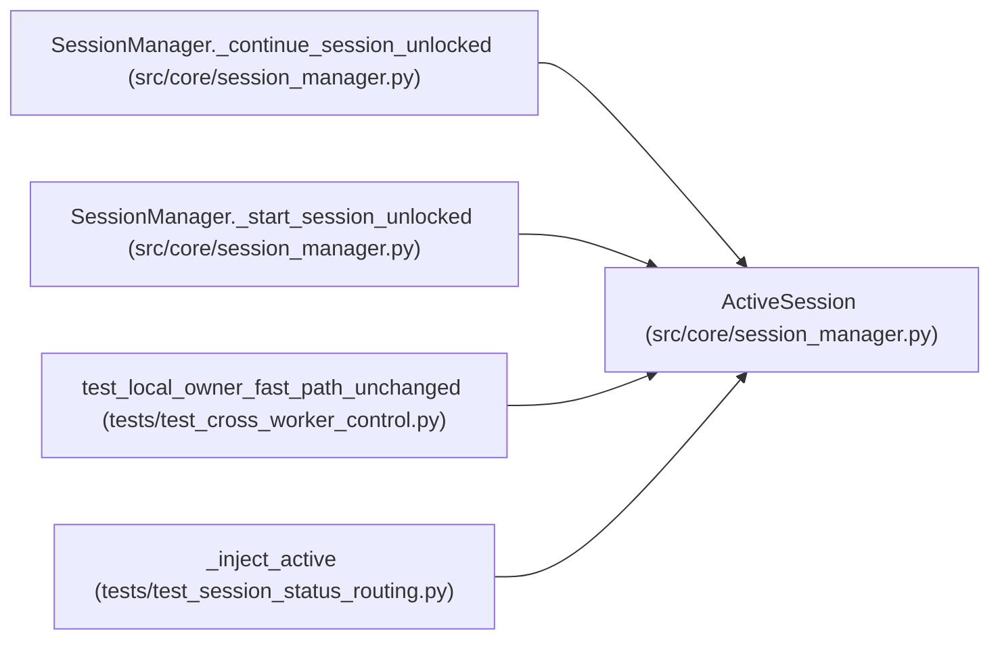

# ActiveSession

**Location:** `src/core/session_manager.py:97`
**Kind:** Class
**Bases:** —
**Module:** [session_manager](../modules/session_manager.md)

**Decorators:** `@dataclass`

## Description

_Auto-generated from `ActiveSession` in `src/core/session_manager.py`._

## Attributes

| Name | Type | Default | Description |
|------|------|---------|-------------|
| `research_id` | `str` | *required* | — |
| `task` | `asyncio.Task` | *required* | — |
| `config` | `ResearchConfig` | *required* | — |
| `started_at` | `datetime` | *required* | — |

## Methods

*No public methods. Inherits from base classes.*

## Relationships

<!-- Auto-generated relationship summary. Do not edit by hand. -->

### Summary

| Module | Methods | Attributes |
|---|---:|---|
| [session_manager](../modules/session_manager.md) | 0 | `config`, `research_id`, `started_at`, `task` |

### References

| Reference | Kind | Source | Call sites |
|---|---|---|---:|
| `SessionManager._continue_session_unlocked` | call | [session_manager](../modules/session_manager.md) | 1 |
| `SessionManager._start_session_unlocked` | call | [session_manager](../modules/session_manager.md) | 1 |
| `test_local_owner_fast_path_unchanged` | call | [test_cross_worker_control](../modules/test_cross_worker_control.md) | 1 |
| `_inject_active` | call | [test_session_status_routing](../modules/test_session_status_routing.md) | 1 |
