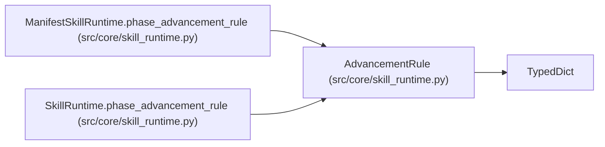

# AdvancementRule

**Location:** `src/core/skill_runtime.py:138`
**Kind:** Class
**Bases:** `TypedDict`
**Module:** [skill_runtime](../modules/skill_runtime.md)

## Description

Phase advancement evidence rule. Today advancement keys live in the
module constant ``research_phase_plan._PHASE_ADVANCEMENT_KEYS`` (a tuple of
metric-key strings per phase id). The TypedDict wraps that into a per-phase
descriptor the manifest future can express declaratively.

## Attributes

| Name | Type | Presence | Description |
|------|------|----------|-------------|
| `evidence_keys` | `tuple[str, ...]` | *optional* | — |

## Methods

*No public methods. Inherits from base classes.*

## Relationships

<!-- Auto-generated relationship summary. Do not edit by hand. -->

### Summary

| Module | Methods | Attributes |
|---|---:|---|
| [skill_runtime](../modules/skill_runtime.md) | 0 | `evidence_keys` |

### Structure

| Kind | Entity | Module |
|---|---|---|
| Base | `TypedDict` | — |

### References

| Reference | Kind | Source | Call sites |
|---|---|---|---:|
| `ManifestSkillRuntime.phase_advancement_rule` | type_reference | [skill_runtime](../modules/skill_runtime.md) | — |
| `SkillRuntime.phase_advancement_rule` | type_reference | [skill_runtime](../modules/skill_runtime.md) | — |
