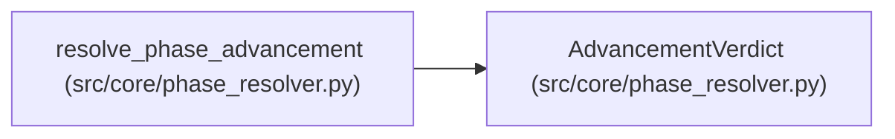

# AdvancementVerdict

**Location:** `src/core/phase_resolver.py:62`
**Kind:** Class
**Bases:** —
**Module:** [phase_resolver](../modules/phase_resolver.md)

**Decorators:** `@dataclass`

## Description

The hybrid phase-advancement verdict.

## Attributes

| Name | Type | Default | Description |
|------|------|---------|-------------|
| `advance` | `bool` | *required* | — |
| `source` | `str` | *required* | — |
| `declarative_share` | `bool` | *required* | — |
| `plugin_rule` | `Optional[str]` | `None` | — |
| `receipt` | `Optional[PluginReceipt]` | `None` | — |
| `notes` | `tuple[str, ...]` | `field(default_factory=tuple)` | — |

## Methods

*No public methods. Inherits from base classes.*

## Relationships

<!-- Auto-generated relationship summary. Do not edit by hand. -->

### Summary

| Module | Methods | Attributes |
|---|---:|---|
| [phase_resolver](../modules/phase_resolver.md) | 0 | `advance`, `declarative_share`, `notes`, `plugin_rule`, `receipt`, `source` |

### References

| Reference | Kind | Source | Call sites |
|---|---|---|---:|
| `resolve_phase_advancement` | call | [phase_resolver](../modules/phase_resolver.md) | 2 |
| `resolve_phase_advancement` | type_reference | [phase_resolver](../modules/phase_resolver.md) | — |
