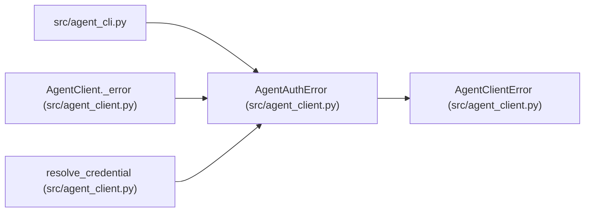

# AgentAuthError

**Location:** `src/agent_client.py:31`
**Kind:** Class
**Bases:** `AgentClientError`
**Module:** [agent_client](../modules/agent_client.md)

## Description

The scoped credential was refused (or missing).

## Attributes

*No annotated attributes found.*

## Methods

*No public methods. Inherits from base classes.*

## Relationships

<!-- Auto-generated relationship summary. Do not edit by hand. -->

### Summary

| Module | Methods | Attributes |
|---|---:|---|
| [agent_client](../modules/agent_client.md) | 0 | — |

### Structure

| Kind | Entity | Module |
|---|---|---|
| Base | `AgentClientError` | [agent_client](../modules/agent_client.md) |

### References

| Reference | Kind | Source | Call sites |
|---|---|---|---:|
| `agent_cli` | import | [agent_cli](../modules/agent_cli.md) | — |
| `AgentClient._error` | call | [agent_client](../modules/agent_client.md) | 1 |
| `resolve_credential` | call | [agent_client](../modules/agent_client.md) | 1 |
