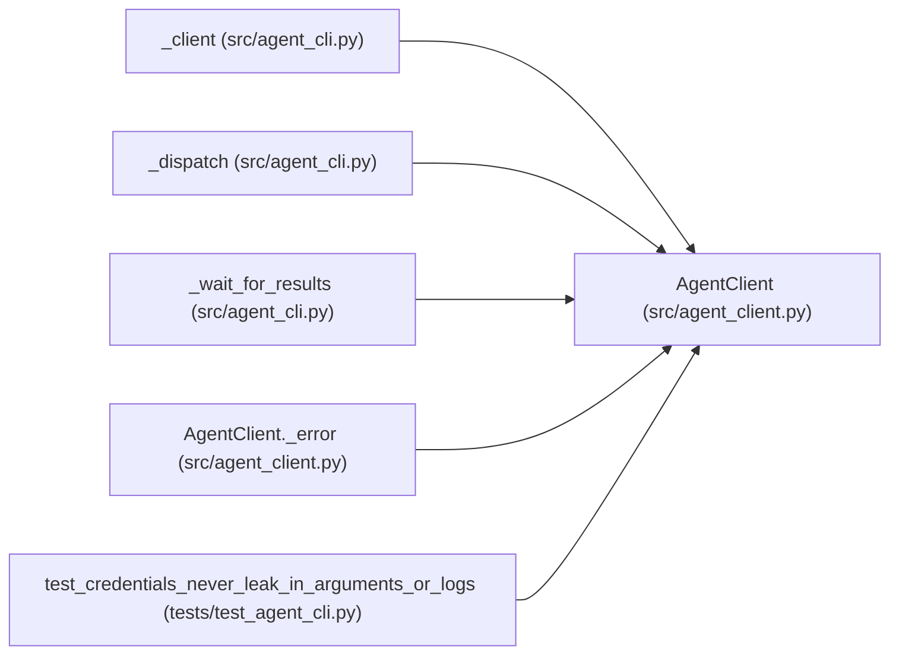

# AgentClient

**Location:** `src/agent_client.py:66`
**Kind:** Class
**Bases:** —
**Module:** [agent_client](../modules/agent_client.md)

## Description

The attached-agent API client with bounded waits.

## Attributes

*No annotated attributes found.*

## Methods

| Method | Signature | Decorators | Description |
|--------|-----------|------------|-------------|
| `__init__` | `(*, base_url: str, credential: str, timeout_s: float = DEFAULT_TIMEOUT_S, transport: Optional[httpx.BaseTransport] = None) -> None` | — | — |
| `close` | *(async)* `() -> None` | — | — |
| `create_or_attach` | *(async)* `(**body: Any) -> dict[str, Any]` | — | — |
| `constraints` | *(async)* `(run_id: str) -> dict[str, Any]` | — | — |
| `submit_candidate` | *(async)* `(run_id: str, *, content: bytes, idempotency_key: str) -> dict[str, Any]` | — | — |
| `request_evaluation` | *(async)* `(run_id: str) -> dict[str, Any]` | — | — |
| `results` | *(async)* `(run_id: str) -> dict[str, Any]` | — | — |
| `promotion_preview` | *(async)* `(run_id: str) -> dict[str, Any]` | — | — |
| `lifecycle` | *(async)* `(run_id: str, *, action: str) -> dict[str, Any]` | — | — |
| `events` | *(async)* `(run_id: str, *, cursor: int = 0) -> dict[str, Any]` | — | — |
| `_request` | *(async)* `(method: str, path: str, *, body: Optional[Mapping[str, Any]] = None, headers: Optional[Mapping[str, str]] = None, params: Optional[Mapping[str, Any]] = None) -> dict[str, Any]` | — | — |
| `_error` | `(response: httpx.Response) -> AgentClientError` | — | — |

## Relationships

<!-- Auto-generated relationship summary. Do not edit by hand. -->

### Summary

| Module | Methods | Attributes |
|---|---:|---|
| [agent_client](../modules/agent_client.md) | 12 | — |

### References

| Reference | Kind | Source | Call sites |
|---|---|---|---:|
| `_client` | call | [agent_cli](../modules/agent_cli.md) | 1 |
| `_client` | type_reference | [agent_cli](../modules/agent_cli.md) | — |
| `_dispatch` | type_reference | [agent_cli](../modules/agent_cli.md) | — |
| `_wait_for_results` | type_reference | [agent_cli](../modules/agent_cli.md) | — |
| `AgentClient._error` | type_reference | [agent_client](../modules/agent_client.md) | — |
| `test_credentials_never_leak_in_arguments_or_logs` | call | [test_agent_cli](../modules/test_agent_cli.md) | 1 |
