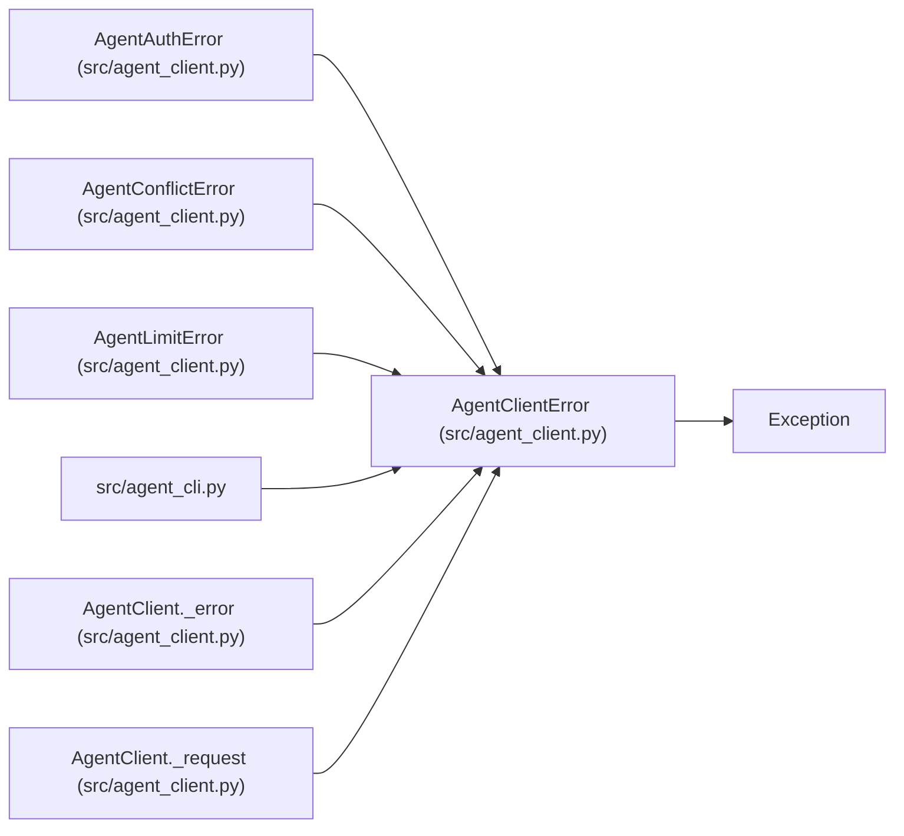

# AgentClientError

**Location:** `src/agent_client.py:23`
**Kind:** Class
**Bases:** `Exception`
**Module:** [agent_client](../modules/agent_client.md)

## Description

An API or transport failure with a stable, redacted message.

## Attributes

*No annotated attributes found.*

## Methods

| Method | Signature | Decorators | Description |
|--------|-----------|------------|-------------|
| `__init__` | `(message: str, *, status: Optional[int] = None) -> None` | — | — |

## Relationships

<!-- Auto-generated relationship summary. Do not edit by hand. -->

### Summary

| Module | Methods | Attributes |
|---|---:|---|
| [agent_client](../modules/agent_client.md) | 1 | — |

### Structure

| Kind | Entity | Module |
|---|---|---|
| Base | `Exception` | — |
| Subclass | `AgentAuthError` | [agent_client](../modules/agent_client.md) |
| Subclass | `AgentConflictError` | [agent_client](../modules/agent_client.md) |
| Subclass | `AgentLimitError` | [agent_client](../modules/agent_client.md) |

### References

| Reference | Kind | Source | Call sites |
|---|---|---|---:|
| `agent_cli` | import | [agent_cli](../modules/agent_cli.md) | — |
| `AgentClient._error` | call | [agent_client](../modules/agent_client.md) | 1 |
| `AgentClient._error` | type_reference | [agent_client](../modules/agent_client.md) | — |
| `AgentClient._request` | call | [agent_client](../modules/agent_client.md) | 1 |
