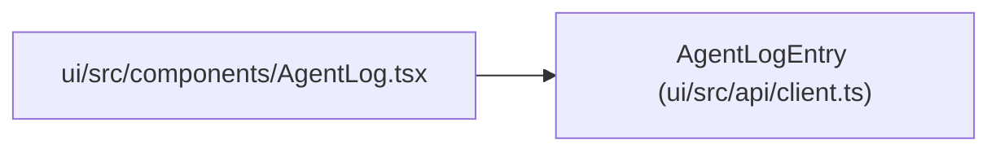

# AgentLogEntry

**Location:** `ui/src/api/client.ts:100`
**Kind:** Class
**Bases:** —
**Module:** [client](../modules/client.md)

## Description

_Auto-generated from `AgentLogEntry` in `ui/src/api/client.ts`._

## Attributes

| Name | Type | Required | Default | Description |
|------|------|----------|---------|-------------|
| `ts` | `string` | Yes | — | — |
| `turn` | `number` | Yes | — | — |
| `type` | `string` | Yes | — | — |
| `content` | `string` | Yes | — | — |
| `meta` | `Record<string, unknown>` | Yes | — | — |
| `line_number` | `number` | No | — | — |
| `research_id` | `string` | No | — | — |
| `pipeline_phase` | `string` | No | — | — |

## Methods

*No public methods. Inherits from base classes.*

## Relationships

<!-- Auto-generated relationship summary. Do not edit by hand. -->

### Summary

| Module | Methods | Attributes |
|---|---:|---|
| [client](../modules/client.md) | 0 | `content`, `line_number`, `meta`, `pipeline_phase`, `research_id`, `ts`, `turn`, `type` |

### References

| Reference | Kind | Source | Call sites |
|---|---|---|---:|
| `AgentLog` | import | [AgentLog](../modules/AgentLog.md) | — |
