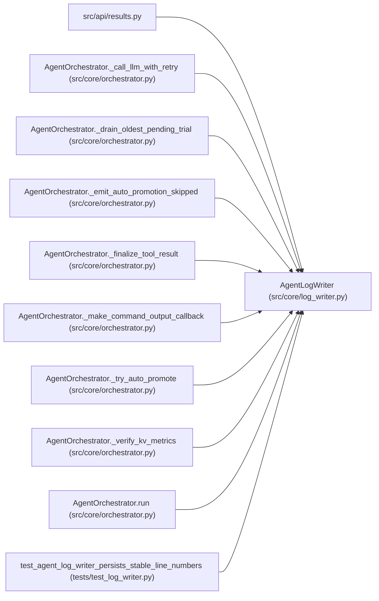

# AgentLogWriter

**Location:** `src/core/log_writer.py:31`
**Kind:** Class
**Bases:** —
**Module:** [log_writer](../modules/log_writer.md)

## Description

Append-only JSONL log writer with WebSocket broadcasting.

Each line is a JSON object:
    {"ts": str, "turn": int, "type": str, "content": str, "meta": dict}

## Attributes

*No annotated attributes found.*

## Methods

| Method | Signature | Decorators | Description |
|--------|-----------|------------|-------------|
| `__init__` | `(log_path: Path, research_id: str, *, pipeline_id: Optional[str] = None, phase: Optional[str] = None) -> None` | — | — |
| `append` | *(async)* `(entry_type: str, content: str, turn: int = -1, meta: Optional[Dict[str, Any]] = None) -> None` | — | Append one log entry to file and broadcast via WebSocket. |
| `_write_line` | `(line: str) -> None` | — | — |
| `_existing_line_count` | `(log_path: Path) -> int` | `@staticmethod` | — |
| `read_all` | `(log_path: Path) -> str` | `@staticmethod` | Read the full log and return human-readable formatted text. |
| `read_lines` | `(log_path: Path, after_line: int = 0) -> List[Dict[str, Any]]` | `@staticmethod` | Return parsed entries after the given line number (0-based). |

## Relationships

<!-- Auto-generated relationship summary. Do not edit by hand. -->

### Summary

| Module | Methods | Attributes |
|---|---:|---|
| [log_writer](../modules/log_writer.md) | 6 | — |

### References

| Reference | Kind | Source | Call sites |
|---|---|---|---:|
| `results` | import | [results](../modules/results.md) | — |
| `AgentOrchestrator._call_llm_with_retry` | type_reference | [orchestrator](../modules/orchestrator.md) | — |
| `AgentOrchestrator._drain_oldest_pending_trial` | type_reference | [orchestrator](../modules/orchestrator.md) | — |
| `AgentOrchestrator._emit_auto_promotion_skipped` | type_reference | [orchestrator](../modules/orchestrator.md) | — |
| `AgentOrchestrator._finalize_tool_result` | type_reference | [orchestrator](../modules/orchestrator.md) | — |
| `AgentOrchestrator._make_command_output_callback` | type_reference | [orchestrator](../modules/orchestrator.md) | — |
| `AgentOrchestrator._try_auto_promote` | type_reference | [orchestrator](../modules/orchestrator.md) | — |
| `AgentOrchestrator._verify_kv_metrics` | type_reference | [orchestrator](../modules/orchestrator.md) | — |
| `AgentOrchestrator.run` | call | [orchestrator](../modules/orchestrator.md) | 1 |
| `test_agent_log_writer_persists_stable_line_numbers` | call | [test_log_writer](../modules/test_log_writer.md) | 2 |
