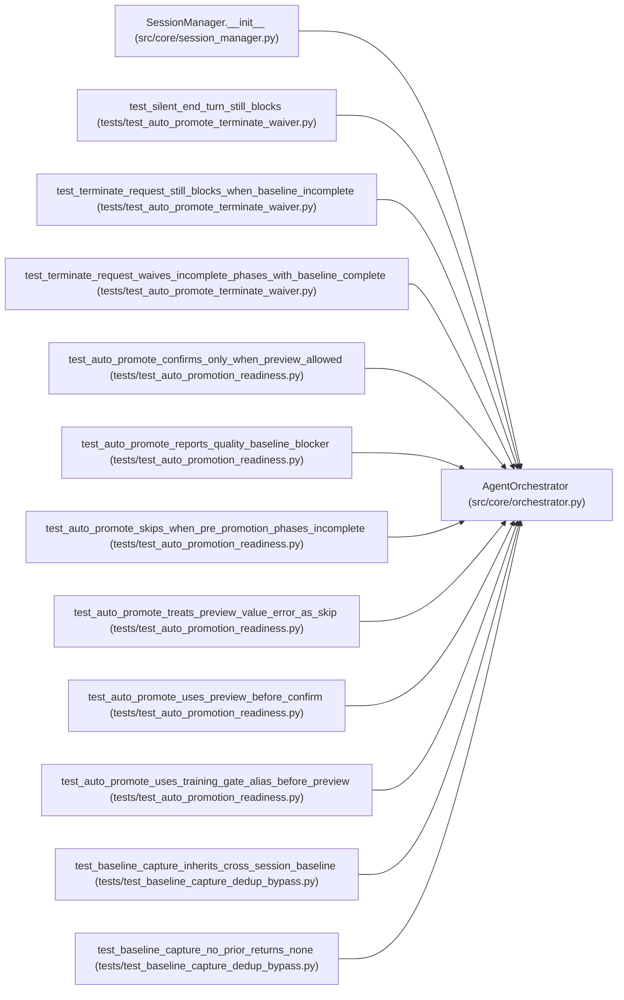

# AgentOrchestrator

**Location:** `src/core/orchestrator.py:326`
**Kind:** Class
**Bases:** —
**Module:** [orchestrator](../modules/orchestrator.md)

## Description

Runs a Claude agent session for autonomous ML experiment tuning.

## Attributes

*No annotated attributes found.*

## Methods

| Method | Signature | Decorators | Description |
|--------|-----------|------------|-------------|
| `__init__` | `(store: StateStore, *, state_machine: Optional[SessionStateMachine] = None) -> None` | — | — |
| `_make_command_output_callback` | `(*, agent_log: AgentLogWriter, loop: asyncio.AbstractEventLoop, turn: int, runtime_command_id: Optional[int]) -> OutputCallback` | — | — |
| `request_stop` | `(research_id: str) -> None` | — | — |
| `request_pause` | `(research_id: str) -> None` | — | — |
| `request_resume` | `(research_id: str) -> None` | — | — |
| `_call_llm_with_retry` | *(async)* `(*, messages: list[Message], system_prompt: str, research_id: str, agent_log: AgentLogWriter, turn: int, remaining_budget_s: Optional[float] = None) -> ProviderResponse` | — | Call ``provider.messages_create`` with loop-owned retry + backoff. |
| `_compact_messages` | `(messages: list[Message], keep_recent: int = 40) -> list[Message]` | `@staticmethod` | Bound retained conversation history to avoid unbounded memory growth. |
| `_latest_iteration_context_digest` | `(messages: list[Message]) -> Optional[str]` | `@staticmethod` | — |
| `_should_stop` | `(research_id: str) -> bool` | — | — |
| `_should_stop_cross_worker` | *(async)* `(research_id: str) -> bool` | — | Cross-worker stop check (ARC-011 P6-004 / H3). |
| `_wait_while_paused` | *(async)* `(research_id: str) -> None` | — | Block while the session is paused — locally OR DB-side. |
| `_is_paused_cross_worker` | *(async)* `(research_id: str) -> bool` | — | True when the shared DB says the session is ``paused``. |
| `_refresh_session_epoch` | *(async)* `(research_id: str) -> None` | — | Re-read and re-cache the session's lock_epoch after a local |
| `_load_claude_md_async` | *(async)* `() -> str` | — | — |
| `_drain_oldest_pending_trial` | *(async)* `(pending_trials: 'list[PendingTrial]', state: TurnTrialState, *, config: ResearchConfig, turn: int, total_cost: float, agent_log: AgentLogWriter, skill: SkillRuntime, skill_policy_extension: Mapping[str, Any], nonce_bytes: Optional[bytes], skill_nonce_field: str, skill_requires_signed: bool) -> None` | — | Await the oldest deferred trial and finalize it (block order). |
| `_finalize_tool_result` | *(async)* `(*, block: ToolUseBlock, block_index: int, tool_execution: ToolExecutionResult, tool_meta: Dict[str, Any], config: ResearchConfig, turn: int, total_cost: float, state: TurnTrialState, cmd_str: str, trial_dir: Optional[str], pending_snapshot: Optional[str], runtime_command_id: Optional[int], command_started_at: Optional[float], agent_log: AgentLogWriter, skill: SkillRuntime, skill_policy_extension: Mapping[str, Any], nonce_bytes: Optional[bytes], skill_nonce_field: str, skill_requires_signed: bool, per_trial_recording: bool = False) -> None` | — | — |
| `_read_marker_file_async` | *(async)* `(config: ResearchConfig, min_mtime: Optional[float] = None, trial_dir: Optional[str] = None) -> Optional[str]` | — | — |
| `_verify_kv_metrics` | *(async)* `(research_id: str, result: Dict[str, Any], *, turn: int, agent_log: 'AgentLogWriter', session_nonce: Optional[bytes], nonce_field: str, requires_signed: bool, source: str, pipeline_id: Optional[str] = None) -> Optional[Dict[str, Any]]` | — | W11-verify a ``---`` KV metrics block (ARC-011 review C3). |
| `_load_claude_md` | `() -> str` | — | — |
| `_read_marker_file` | `(config: ResearchConfig, min_mtime: Optional[float] = None, trial_dir: Optional[str] = None) -> Optional[str]` | — | Read and consume a marker file declared by the skill's |
| `_load_research_resume` | `(config: ResearchConfig) -> str` | — | Load the research resume for this instrument if it exists. |
| `_read_research_resume_file` | `(resume_path: str) -> str` | `@staticmethod` | — |
| `_skill_phase_plan` | `(config: ResearchConfig) -> Optional[List[Dict[str, Any]]]` | — | ARC-011 review C2-1: the session's skill-runtime phase plan. |
| `_build_phase_contract_block` | `(config: ResearchConfig) -> str` | — | F5: render the canonical phase plan for the active model_type as a |
| `_extract_session_insights` | *(async)* `(research_id: str) -> None` | — | ML-60: Use Claude to extract compact insights from a completed session. |
| `_record_command_policy_rejection` | *(async)* `(*, config: ResearchConfig, turn: int, command: str, tool_meta: Dict[str, Any]) -> None` | — | — |
| `_guard_duplicate_training_attempt` | *(async)* `(*, config: ResearchConfig, turn: int, command: str, config_snapshot: Optional[str], planned_trial: Optional[Dict[str, Any]] = None, current_phase: Optional[str] = None) -> tuple[Optional[ToolExecutionResult], Optional[Dict[str, Any]]]` | — | Reject an already-attempted config/seed/mode/split identity. |
| `_build_baseline_link` | `(*, config: ResearchConfig, turn: int, identity: Dict[str, Any], identity_hash: str, config_snapshot: Optional[str], duplicate: Dict[str, Any]) -> tuple[ToolExecutionResult, Dict[str, Any]]` | — | Inherit a cross-session baseline instead of rejecting it. |
| `_parse_metrics_json` | `(raw: Any) -> Dict[str, Any]` | `@staticmethod` | Best-effort parse of an iteration row's metrics_json into a dict. |
| `_build_phase_evidence_link` | `(*, config: ResearchConfig, turn: int, identity: Dict[str, Any], identity_hash: str, config_snapshot: Optional[str], duplicate: Dict[str, Any], current_phase: str, inherited_metrics: Dict[str, Any]) -> tuple[ToolExecutionResult, Dict[str, Any]]` | — | Inherit a noop-phase's accepted evidence on a dedup hit. |
| `_build_evidence_replay_link` | `(*, config: ResearchConfig, turn: int, identity: Dict[str, Any], identity_hash: str, config_snapshot: Optional[str], duplicate: Dict[str, Any], current_phase: str, inherited_metrics: Dict[str, Any]) -> tuple[ToolExecutionResult, Dict[str, Any]]` | — | DM-1: inherit a session-best iteration's phase evidence on dedup hit. |
| `_promotion_readiness_advisory` | *(async)* `(*, research_id: str, model_type: Optional[str], phase_state: Optional[Dict[str, Any]], actionable_blockers: Optional[Iterable[str]] = None) -> List[Dict[str, Any]]` | — | Evaluate the current best candidate against the development gate |
| `_build_iteration_context_digest` | *(async)* `(*, config: ResearchConfig, total_cost: float) -> Optional[str]` | — | Build advisory context from persisted attempts for the next turn. |
| `_append_iteration_context_digest` | *(async)* `(*, config: ResearchConfig, tool_results: list[RequestBlock], turn_recorded_iteration: bool, total_cost: float) -> None` | — | — |
| `run` | *(async)* `(config: ResearchConfig) -> None` | — | Run the autonomous research loop for a single session. |
| `_try_auto_promote` | *(async)* `(research_id: str, config: ResearchConfig, agent_log: AgentLogWriter) -> None` | — | Auto-promote the best iteration if it is promotion-ready. |
| `_auto_promotion_phase_state` | *(async)* `(*, research_id: str, session: Dict[str, Any], iterations: List[Dict[str, Any]]) -> Dict[str, Any]` | — | Return phase state for auto-promotion without mutating the session. |
| `_emit_auto_promotion_skipped` | *(async)* `(*, research_id: str, config: ResearchConfig, agent_log: AgentLogWriter, reason: str, iteration: Optional[int], terminal_reason: Optional[str], incomplete_phases: List[str], promotion_allowed: bool, blockers: List[str], collection_errors: Optional[Dict[str, str]] = None) -> None` | — | Emit structured observability for expected auto-promotion skips. |
| `_auto_promotion_preview_blockers` | `(preview: Dict[str, Any]) -> List[str]` | `@staticmethod` | — |
| `_infer_decision` | *(async)* `(research_id: str, primary_metric: Optional[float], training_gates_passed: bool, *, config_hash: Optional[str] = None) -> str` | — | Determine keep/improve/discard by comparing against session best. |
| `_significance_improved` | *(async)* `(research_id: str, primary_metric: float, config_hash: str) -> Optional[bool]` | — | Multi-seed significance verdict for one candidate (or None). |
| `_record_iteration` | *(async)* `(research_id: str, iteration: int, marker: Dict[str, Any], cumulative_cost: float, *, workspace: Optional[str] = None, turn: Optional[int] = None, command: Optional[str] = None) -> None` | — | Record an iteration and broadcast the event. |
| `_attach_consistency_report` | *(async)* `(research_id: str, iteration: int, marker: Dict[str, Any]) -> None` | — | Attach/update consistency report before overwriting an iteration. |
| `_active_phase_from_marker_or_session` | `(marker: Dict[str, Any], session: Optional[Dict[str, Any]], existing: Optional[Dict[str, Any]] = None) -> Optional[str]` | `@staticmethod` | Resolve the phase used for iteration storage and validation. |
| `_extract_terminate_request` | `(agent_text: str) -> Optional[str]` | `@staticmethod` | Return the assistant's TERMINATE_REQUEST line/body, if present. |
| `_should_defer_terminate` | *(async)* `(*, research_id: str, iteration_count: int, duplicate_rejected_count: int, config: ResearchConfig) -> Optional[Dict[str, str]]` | — | DM-2: return a deferral payload when TERMINATE_REQUEST should |
| `_refresh_phase_state` | *(async)* `(research_id: str, *, iterations_remaining: Optional[int] = None, phases: Optional[List[Dict[str, Any]]] = None) -> None` | — | DM-14: when ``iterations_remaining`` is supplied, ``build_phase_state`` |
| `_build_phase_continuation_kick` | *(async)* `(*, research_id: str, iteration_count: int, total_cost: float, config: ResearchConfig) -> Optional[Dict[str, str]]` | — | F1: decide whether an `end_turn` should be honored. |
| `_maybe_phase_cap_nudge` | *(async)* `(*, research_id: str) -> Optional[str]` | — | F7: return a system-message text when the current phase's |
| `_maybe_all_phases_complete_terminate` | *(async)* `(*, research_id: str) -> Optional[str]` | — | Fast terminal guard: once every phase is complete, instruct the |
| `_phase_advancement_is_genuine` | *(async)* `(research_id: str, current_phase: str, *, sample_size: int = 3) -> bool` | — | Return True when the current phase was reached by real agent |
| `_maybe_global_stagnation_terminate` | *(async)* `(*, research_id: str, iteration_count: int) -> Optional[str]` | — | AR-7: return a system-message text when global metric stagnation is |
| `_derive_terminal_reason` | *(async)* `(*, research_id: str, final_status: str, iteration_count: int, total_cost: float, config: ResearchConfig, timed_out: bool, policy_aborted: bool) -> str` | — | F9: produce a single structured token explaining why a session |
| `_infer_failed_attempt_status` | `(tool_result: str) -> Optional[str]` | `@staticmethod` | — |
| `_effective_tool_timeout` | `(input_data: Dict[str, Any]) -> int` | `@staticmethod` | — |
| `_runtime_command_status` | `(tool_meta: Dict[str, Any]) -> str` | `@staticmethod` | — |
| `_attach_runtime_command_metadata` | `(marker: Dict[str, Any], tool_meta: Dict[str, Any]) -> None` | `@staticmethod` | — |

## Relationships

<!-- Auto-generated relationship summary. Do not edit by hand. -->

### Summary

| Module | Methods | Attributes |
|---|---:|---|
| [orchestrator](../modules/orchestrator.md) | 57 | — |

### References

| Reference | Kind | Source | Call sites |
|---|---|---|---:|
| `SessionManager.__init__` | call | [session_manager](../modules/session_manager.md) | 1 |
| `test_silent_end_turn_still_blocks` | call | [test_auto_promote_terminate_waiver](../modules/test_auto_promote_terminate_waiver.md) | 1 |
| `test_terminate_request_still_blocks_when_baseline_incomplete` | call | [test_auto_promote_terminate_waiver](../modules/test_auto_promote_terminate_waiver.md) | 1 |
| `test_terminate_request_waives_incomplete_phases_with_baseline_complete` | call | [test_auto_promote_terminate_waiver](../modules/test_auto_promote_terminate_waiver.md) | 1 |
| `test_auto_promote_confirms_only_when_preview_allowed` | call | [test_auto_promotion_readiness](../modules/test_auto_promotion_readiness.md) | 1 |
| `test_auto_promote_reports_quality_baseline_blocker` | call | [test_auto_promotion_readiness](../modules/test_auto_promotion_readiness.md) | 1 |
| `test_auto_promote_skips_when_pre_promotion_phases_incomplete` | call | [test_auto_promotion_readiness](../modules/test_auto_promotion_readiness.md) | 1 |
| `test_auto_promote_treats_preview_value_error_as_skip` | call | [test_auto_promotion_readiness](../modules/test_auto_promotion_readiness.md) | 1 |
| `test_auto_promote_uses_preview_before_confirm` | call | [test_auto_promotion_readiness](../modules/test_auto_promotion_readiness.md) | 1 |
| `test_auto_promote_uses_training_gate_alias_before_preview` | call | [test_auto_promotion_readiness](../modules/test_auto_promotion_readiness.md) | 1 |
| `test_baseline_capture_inherits_cross_session_baseline` | call | [test_baseline_capture_dedup_bypass](../modules/test_baseline_capture_dedup_bypass.md) | 1 |
| `test_baseline_capture_no_prior_returns_none` | call | [test_baseline_capture_dedup_bypass](../modules/test_baseline_capture_dedup_bypass.md) | 1 |

> References: showing 12 of 103 logical references; 91 omitted by the 12-row generated summary limit.
