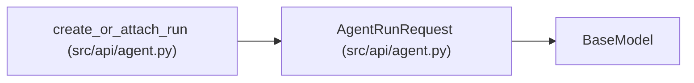

# AgentRunRequest

**Location:** `src/api/agent.py:101`
**Kind:** Pydantic model
**Bases:** `BaseModel`
**Module:** [agent](../modules/agent.md)

## Description

_Auto-generated from `AgentRunRequest` in `src/api/agent.py`._

## Model Configuration

| Setting | Value | Source |
|---------|-------|--------|
| `extra` | `'forbid'` | model_config |

## Attributes

| Name | Type | Wire name | Required | Nullable | Default | Constraints | Examples | Description |
|------|------|-----------|----------|----------|---------|-------------|-------------|----------|
| `mode` | `str` | `mode` | No | No | `'create'` | — | — | create or attach |
| `instrument` | `str` | `instrument` | No | No | `'EURUSD'` | — | — | — |
| `timeframe` | `str` | `timeframe` | No | No | `'1h'` | — | — | — |
| `tag` | `str` | `tag` | No | No | `''` | — | — | — |
| `max_iterations` | `int` | `max_iterations` | No | No | `3` | — | — | — |
| `max_budget_usd` | `float` | `max_budget_usd` | No | No | `7.5` | — | — | — |

## Methods

*No public methods. Inherits from base classes.*

## Relationships

<!-- Auto-generated relationship summary. Do not edit by hand. -->

### Summary

| Module | Methods | Attributes |
|---|---:|---|
| [agent](../modules/agent.md) | 0 | `instrument`, `max_budget_usd`, `max_iterations`, `mode`, `tag`, `timeframe` |

### Structure

| Kind | Entity | Module |
|---|---|---|
| Base | `BaseModel` | — |

### References

| Reference | Kind | Source | Call sites |
|---|---|---|---:|
| `create_or_attach_run` | type_reference | [agent](../modules/agent.md) | — |
