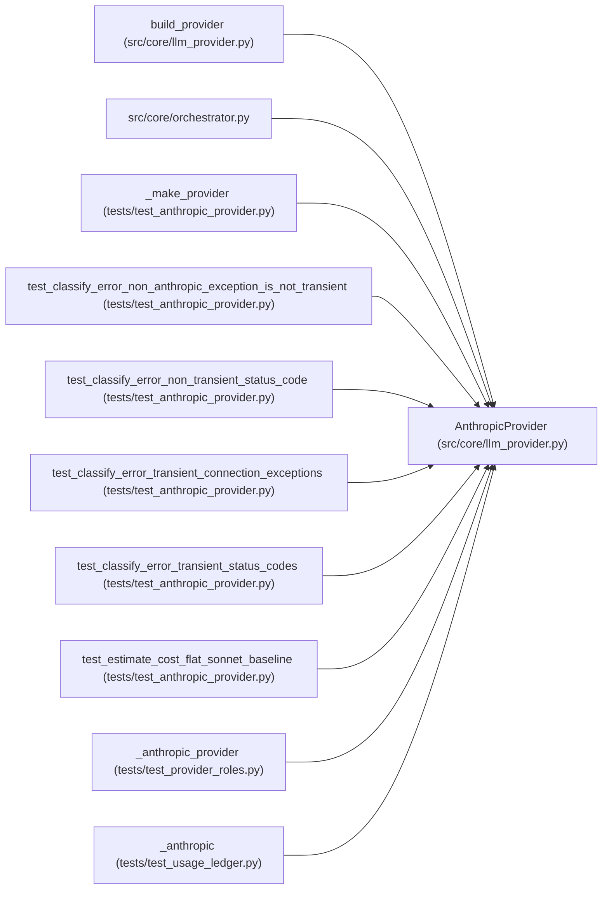

# AnthropicProvider

**Location:** `src/core/llm_provider.py:533`
**Kind:** Class
**Bases:** —
**Module:** [llm_provider](../modules/llm_provider.md)

## Description

``LLMProvider`` adapter over the Anthropic SDK (ARC-011 P1-002).

A 1:1 boundary translator: normalized ``Message``/``ToolDef``/``system``
become Anthropic ``messages.create`` kwargs (byte-identical to the
pre-refactor orchestrator call), and the raw ``anthropic.types.Message``
becomes a normalized ``ProviderResponse``. The provider owns no retry —
loop-owned retry (``orchestrator.py`` ``_call_llm_with_retry``) reads
``classify_error`` and decides backoff + the budget-aware skip.

## Attributes

*No annotated attributes found.*

## Methods

| Method | Signature | Decorators | Description |
|--------|-----------|------------|-------------|
| `__init__` | `(*, base_url: str, api_key: str, timeout_s: float) -> None` | — | — |
| `messages_create` | *(async)* `(*, model: str, system: str, messages: list[Message], tools: list[ToolDef], max_tokens: int, temperature: float \| None = None, stop_sequences: list[str] \| None = None) -> ProviderResponse` | — | One model turn via ``messages.create`` (replaces the orchestrator call). |
| `complete` | *(async)* `(*, model: str, prompt: str, max_tokens: int, system: str \| None = None) -> str` | — | One-shot text completion (insights / Haiku path). |
| `stream` | *(async)* `(**kwargs: Any) -> AsyncIterator[StreamDelta]` | — | Token streaming (OPTIONAL in v1; D-stream). Not implemented for Anthropic. |
| `estimate_cost` | `(model: str, usage: Usage) -> float` | — | Flat Sonnet-3.5-baseline USD cost (parity with pre-refactor accounting). |
| `price_quote` | `(model: str, usage: Usage) -> CostEstimate` | — | Basis-snapshotted Anthropic cost: flat baseline plus cache tokens. |
| `capabilities` | `() -> ProviderCapabilities` | — | — |
| `classify_error` | `(exc: Exception) -> ErrorClass` | — | Classify an SDK exception for loop-owned retry. |

## Relationships

<!-- Auto-generated relationship summary. Do not edit by hand. -->

### Summary

| Module | Methods | Attributes |
|---|---:|---|
| [llm_provider](../modules/llm_provider.md) | 8 | — |

### References

| Reference | Kind | Source | Call sites |
|---|---|---|---:|
| `build_provider` | call | [llm_provider](../modules/llm_provider.md) | 1 |
| `orchestrator` | import | [orchestrator](../modules/orchestrator.md) | — |
| `_make_provider` | call | [test_anthropic_provider](../modules/test_anthropic_provider.md) | 1 |
| `_make_provider` | type_reference | [test_anthropic_provider](../modules/test_anthropic_provider.md) | — |
| `test_classify_error_non_anthropic_exception_is_not_transient` | call | [test_anthropic_provider](../modules/test_anthropic_provider.md) | 1 |
| `test_classify_error_non_transient_status_code` | call | [test_anthropic_provider](../modules/test_anthropic_provider.md) | 1 |
| `test_classify_error_transient_connection_exceptions` | call | [test_anthropic_provider](../modules/test_anthropic_provider.md) | 1 |
| `test_classify_error_transient_status_codes` | call | [test_anthropic_provider](../modules/test_anthropic_provider.md) | 1 |
| `test_estimate_cost_flat_sonnet_baseline` | call | [test_anthropic_provider](../modules/test_anthropic_provider.md) | 1 |
| `_anthropic_provider` | call | [test_provider_roles](../modules/test_provider_roles.md) | 1 |
| `_anthropic` | call | [test_usage_ledger](../modules/test_usage_ledger.md) | 1 |
| `_anthropic` | type_reference | [test_usage_ledger](../modules/test_usage_ledger.md) | — |
