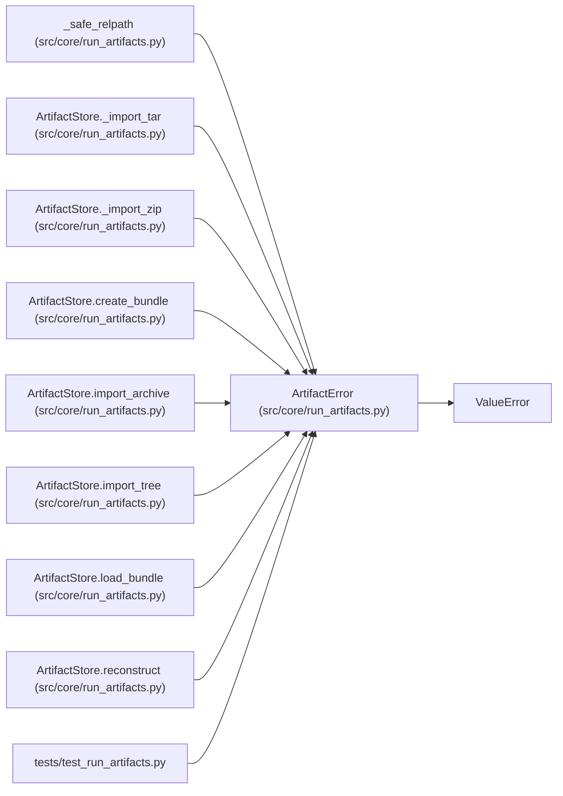

# ArtifactError

**Location:** `src/core/run_artifacts.py:40`
**Kind:** Class
**Bases:** `ValueError`
**Module:** [run_artifacts](../modules/run_artifacts.md)

## Description

Raised when an artifact violates the store's safety contract.

## Attributes

*No annotated attributes found.*

## Methods

*No public methods. Inherits from base classes.*

## Relationships

<!-- Auto-generated relationship summary. Do not edit by hand. -->

### Summary

| Module | Methods | Attributes |
|---|---:|---|
| [run_artifacts](../modules/run_artifacts.md) | 0 | — |

### Structure

| Kind | Entity | Module |
|---|---|---|
| Base | `ValueError` | — |

### References

| Reference | Kind | Source | Call sites |
|---|---|---|---:|
| `_safe_relpath` | call | [run_artifacts](../modules/run_artifacts.md) | 2 |
| `ArtifactStore._import_tar` | call | [run_artifacts](../modules/run_artifacts.md) | 6 |
| `ArtifactStore._import_zip` | call | [run_artifacts](../modules/run_artifacts.md) | 5 |
| `ArtifactStore.create_bundle` | call | [run_artifacts](../modules/run_artifacts.md) | 3 |
| `ArtifactStore.import_archive` | call | [run_artifacts](../modules/run_artifacts.md) | 2 |
| `ArtifactStore.import_tree` | call | [run_artifacts](../modules/run_artifacts.md) | 5 |
| `ArtifactStore.load_bundle` | call | [run_artifacts](../modules/run_artifacts.md) | 2 |
| `ArtifactStore.reconstruct` | call | [run_artifacts](../modules/run_artifacts.md) | 2 |
| `test_run_artifacts` | import | [test_run_artifacts](../modules/test_run_artifacts.md) | — |
