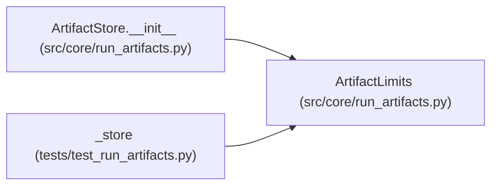

# ArtifactLimits

**Location:** `src/core/run_artifacts.py:45`
**Kind:** Class
**Bases:** —
**Module:** [run_artifacts](../modules/run_artifacts.md)

**Decorators:** `@dataclass(frozen=True)`

## Description

Bounds every import respects; a limit violation is an error.

## Attributes

| Name | Type | Default | Description |
|------|------|---------|-------------|
| `max_files` | `int` | `10000` | — |
| `max_bytes` | `int` | `512 * 1024 * 1024` | — |
| `max_file_bytes` | `int` | `64 * 1024 * 1024` | — |

## Methods

*No public methods. Inherits from base classes.*

## Relationships

<!-- Auto-generated relationship summary. Do not edit by hand. -->

### Summary

| Module | Methods | Attributes |
|---|---:|---|
| [run_artifacts](../modules/run_artifacts.md) | 0 | `max_bytes`, `max_file_bytes`, `max_files` |

### References

| Reference | Kind | Source | Call sites |
|---|---|---|---:|
| `ArtifactStore.__init__` | type_reference | [run_artifacts](../modules/run_artifacts.md) | — |
| `_store` | call | [test_run_artifacts](../modules/test_run_artifacts.md) | 1 |
