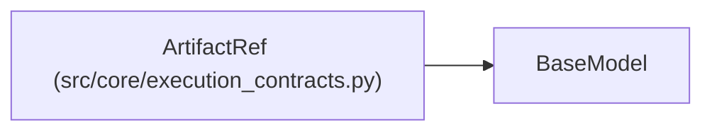

# ArtifactRef

**Location:** `src/core/execution_contracts.py:230`
**Kind:** Pydantic model
**Bases:** `BaseModel`
**Module:** [execution_contracts](../modules/execution_contracts.md)

## Description

An immutable artifact location bound by content digest.

## Model Configuration

| Setting | Value | Source |
|---------|-------|--------|
| `extra` | `'forbid'` | model_config |

## Validators

| Method | Scope | Fields | Mode | Options |
|--------|-------|--------|------|---------|
| `_digest_shape` | field | digest | after | — |

## Attributes

| Name | Type | Wire name | Required | Nullable | Default | Constraints | Examples | Description |
|------|------|-----------|----------|----------|---------|-------------|-------------|----------|
| `name` | `str` | `name` | Yes | No | — | min_length=1 | — | — |
| `digest` | `str` | `digest` | Yes | No | — | — | — | — |
| `path` | `Optional[str]` | `path` | No | Yes | `None` | — | — | — |

## Methods

| Method | Signature | Decorators | Description |
|--------|-----------|------------|-------------|
| `_digest_shape` | `(value: str) -> str` | `@field_validator('digest')`, `@classmethod` | — |

## Relationships

<!-- Auto-generated relationship summary. Do not edit by hand. -->

### Summary

| Module | Methods | Attributes |
|---|---:|---|
| [execution_contracts](../modules/execution_contracts.md) | 1 | `digest`, `name`, `path` |

### Structure

| Kind | Entity | Module |
|---|---|---|
| Base | `BaseModel` | — |
