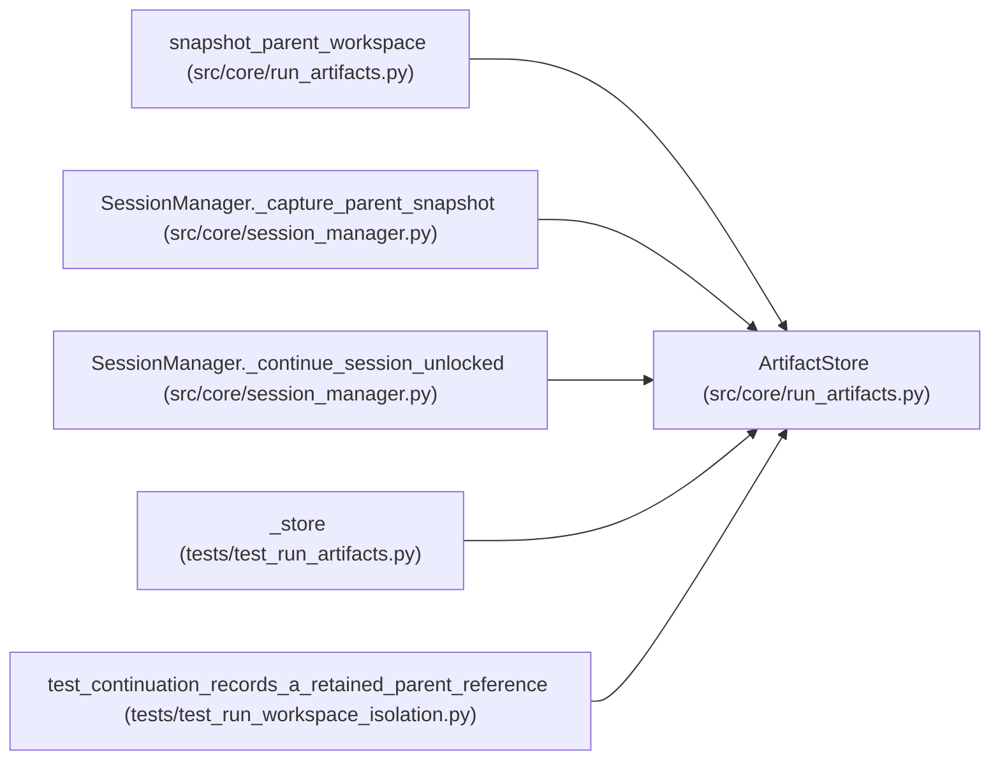

# ArtifactStore

**Location:** `src/core/run_artifacts.py:102`
**Kind:** Class
**Bases:** —
**Module:** [run_artifacts](../modules/run_artifacts.md)

## Description

Content-addressed bundles over a local root.

## Attributes

*No annotated attributes found.*

## Methods

| Method | Signature | Decorators | Description |
|--------|-----------|------------|-------------|
| `__init__` | `(root: Path \| str, *, limits: ArtifactLimits = DEFAULT_LIMITS)` | — | — |
| `create_bundle` | `(files: Mapping[str, Any]) -> Dict[str, Any]` | — | Publish a bundle from ``{relpath: bytes \| Path}`` inputs. |
| `import_tree` | `(source_root: Path \| str, *, includes: Optional[Iterable[str]] = None) -> Dict[str, Any]` | — | Bundle a directory tree, confined to its own root. |
| `import_archive` | `(archive_path: Path \| str) -> Dict[str, Any]` | — | Bundle a tar/zip archive with traversal and link safety. |
| `_import_tar` | `(path: Path) -> Dict[str, Any]` | — | — |
| `_import_zip` | `(path: Path) -> Dict[str, Any]` | — | — |
| `load_bundle` | `(digest: str) -> Dict[str, Any]` | — | — |
| `verify_bundle` | `(digest: str) -> bool` | — | True when the descriptor and every object match their digests. |
| `reconstruct` | `(digest: str, dest: Path \| str) -> Dict[str, str]` | — | Materialize a bundle at ``dest`` with per-file digest verification. |
| `cleanup_partial` | `(*, max_age_s: float = 0.0) -> List[str]` | — | Remove abandoned staging writes; live objects are never touched. |
| `gc` | `(live_digests: Iterable[str]) -> Dict[str, int]` | — | Delete bundles and objects outside the live reference set. |

## Relationships

<!-- Auto-generated relationship summary. Do not edit by hand. -->

### Summary

| Module | Methods | Attributes |
|---|---:|---|
| [run_artifacts](../modules/run_artifacts.md) | 11 | — |

### References

| Reference | Kind | Source | Call sites |
|---|---|---|---:|
| `snapshot_parent_workspace` | type_reference | [run_artifacts](../modules/run_artifacts.md) | — |
| `SessionManager._capture_parent_snapshot` | call | [session_manager](../modules/session_manager.md) | 1 |
| `SessionManager._continue_session_unlocked` | call | [session_manager](../modules/session_manager.md) | 1 |
| `_store` | call | [test_run_artifacts](../modules/test_run_artifacts.md) | 1 |
| `_store` | type_reference | [test_run_artifacts](../modules/test_run_artifacts.md) | — |
| `test_continuation_records_a_retained_parent_reference` | call | [test_run_workspace_isolation](../modules/test_run_workspace_isolation.md) | 1 |
