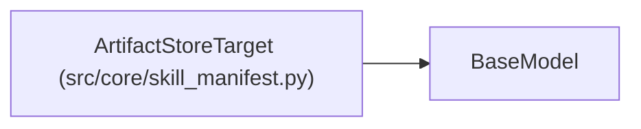

# ArtifactStoreTarget

**Location:** `src/core/skill_manifest.py:817`
**Kind:** Pydantic model
**Bases:** `BaseModel`
**Module:** [skill_manifest](../modules/skill_manifest.md)

## Description

``kind: artifact_store`` — promote a multi-file artifact bundle (G10).

## Model Configuration

| Setting | Value | Source |
|---------|-------|--------|
| `extra` | `'forbid'` | model_config |

## Attributes

| Name | Type | Wire name | Required | Nullable | Default | Constraints | Examples | Description |
|------|------|-----------|----------|----------|---------|-------------|-------------|----------|
| `kind` | `Literal['artifact_store']` | `kind` | No | No | `'artifact_store'` | — | — | — |
| `path_template` | `str` | `path_template` | Yes | No | — | — | — | — |
| `atomic_write` | `bool` | `atomic_write` | No | No | `True` | — | — | — |
| `bundle_manifest` | `Optional[str]` | `bundle_manifest` | No | Yes | `None` | — | — | — |
| `bundle_artifacts` | `list[str]` | `bundle_artifacts` | No | No | factory: `list` | — | — | — |

## Methods

*No public methods. Inherits from base classes.*

## Relationships

<!-- Auto-generated relationship summary. Do not edit by hand. -->

### Summary

| Module | Methods | Attributes |
|---|---:|---|
| [skill_manifest](../modules/skill_manifest.md) | 0 | `atomic_write`, `bundle_artifacts`, `bundle_manifest`, `kind`, `path_template` |

### Structure

| Kind | Entity | Module |
|---|---|---|
| Base | `BaseModel` | — |
