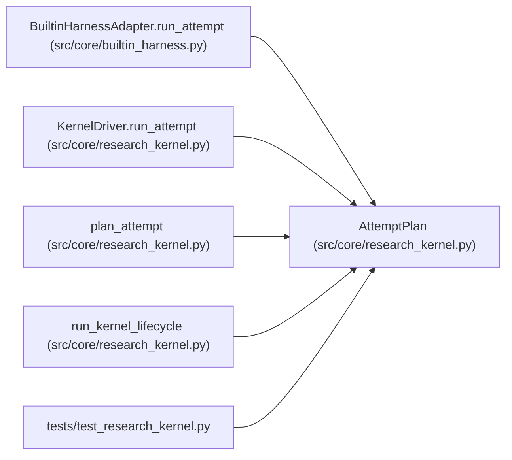

# AttemptPlan

**Location:** `src/core/research_kernel.py:28`
**Kind:** Class
**Bases:** —
**Module:** [research_kernel](../modules/research_kernel.md)

**Decorators:** `@dataclass(frozen=True)`

## Description

The kernel's scheduling decision for the next attempt slot.

## Attributes

| Name | Type | Default | Description |
|------|------|---------|-------------|
| `action` | `str` | *required* | — |
| `attempt_index` | `int` | *required* | — |
| `wait_seconds` | `float` | `0.0` | — |
| `reason` | `str` | `''` | — |

## Methods

*No public methods. Inherits from base classes.*

## Relationships

<!-- Auto-generated relationship summary. Do not edit by hand. -->

### Summary

| Module | Methods | Attributes |
|---|---:|---|
| [research_kernel](../modules/research_kernel.md) | 0 | `action`, `attempt_index`, `reason`, `wait_seconds` |

### References

| Reference | Kind | Source | Call sites |
|---|---|---|---:|
| `BuiltinHarnessAdapter.run_attempt` | type_reference | [builtin_harness](../modules/builtin_harness.md) | — |
| `KernelDriver.run_attempt` | type_reference | [research_kernel](../modules/research_kernel.md) | — |
| `plan_attempt` | call | [research_kernel](../modules/research_kernel.md) | 5 |
| `plan_attempt` | type_reference | [research_kernel](../modules/research_kernel.md) | — |
| `run_kernel_lifecycle` | call | [research_kernel](../modules/research_kernel.md) | 2 |
| `test_research_kernel` | import | [test_research_kernel](../modules/test_research_kernel.md) | — |
