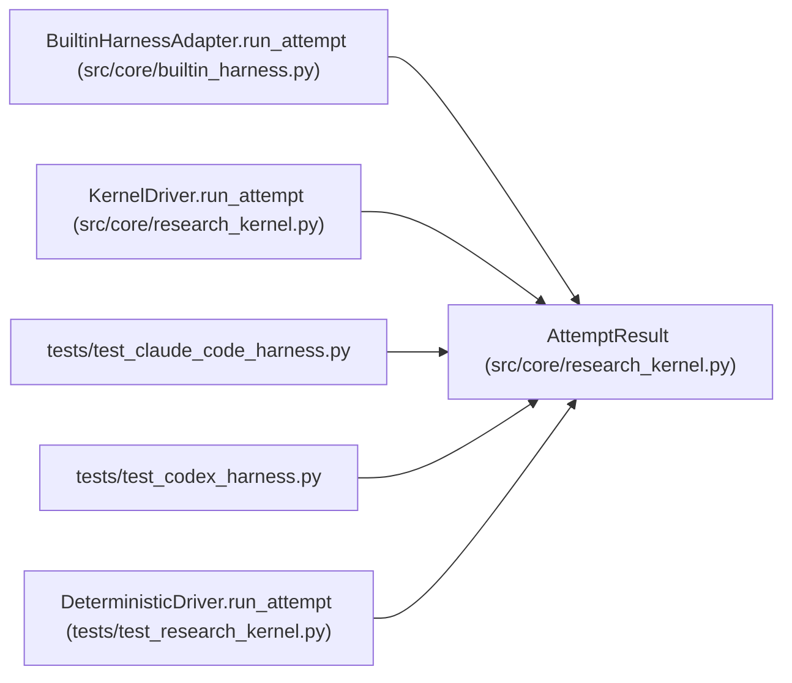

# AttemptResult

**Location:** `src/core/research_kernel.py:76`
**Kind:** Class
**Bases:** —
**Module:** [research_kernel](../modules/research_kernel.md)

**Decorators:** `@dataclass(frozen=True)`

## Description

What a driver reports back for one attempt — stable and harness-free.

## Attributes

| Name | Type | Default | Description |
|------|------|---------|-------------|
| `iteration` | `int` | *required* | — |
| `outcome` | `str` | *required* | — |
| `metric` | `Optional[float]` | `None` | — |
| `metrics` | `Mapping[str, Any]` | `field(default_factory=dict)` | — |
| `verdict` | `str` | `''` | — |
| `gate_passed` | `bool` | `False` | — |
| `duplicate_of` | `Optional[int]` | `None` | — |
| `phase_id` | `Optional[str]` | `None` | — |
| `phase_advanced` | `Optional[bool]` | `None` | — |

## Methods

*No public methods. Inherits from base classes.*

## Relationships

<!-- Auto-generated relationship summary. Do not edit by hand. -->

### Summary

| Module | Methods | Attributes |
|---|---:|---|
| [research_kernel](../modules/research_kernel.md) | 0 | `duplicate_of`, `gate_passed`, `iteration`, `metric`, `metrics`, `outcome`, `phase_advanced`, `phase_id`, `verdict` |

### References

| Reference | Kind | Source | Call sites |
|---|---|---|---:|
| `BuiltinHarnessAdapter.run_attempt` | call | [builtin_harness](../modules/builtin_harness.md) | 1 |
| `BuiltinHarnessAdapter.run_attempt` | type_reference | [builtin_harness](../modules/builtin_harness.md) | — |
| `KernelDriver.run_attempt` | type_reference | [research_kernel](../modules/research_kernel.md) | — |
| `test_claude_code_harness` | import | [test_claude_code_harness](../modules/test_claude_code_harness.md) | — |
| `test_codex_harness` | import | [test_codex_harness](../modules/test_codex_harness.md) | — |
| `DeterministicDriver.run_attempt` | call | [test_research_kernel](../modules/test_research_kernel.md) | 1 |
