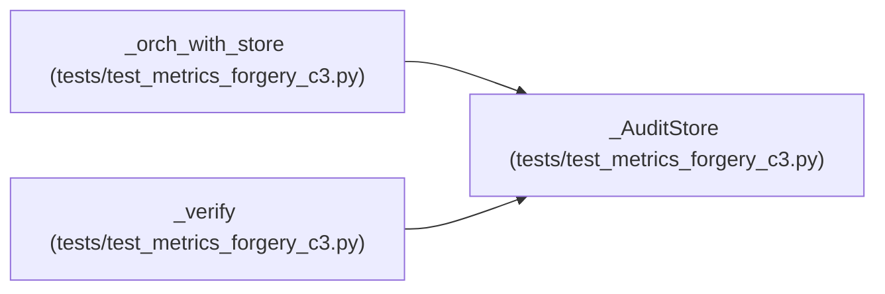

# _AuditStore

**Location:** `tests/test_metrics_forgery_c3.py:64`
**Kind:** Class
**Bases:** —
**Module:** [test_metrics_forgery_c3](../modules/test_metrics_forgery_c3.md)

## Description

_Auto-generated from `_AuditStore` in `tests/test_metrics_forgery_c3.py`._

## Attributes

*No annotated attributes found.*

## Methods

| Method | Signature | Decorators | Description |
|--------|-----------|------------|-------------|
| `__init__` | `() -> None` | — | — |
| `record_audit_event` | *(async)* `(**kwargs: Any) -> Dict[str, Any]` | — | — |

## Relationships

<!-- Auto-generated relationship summary. Do not edit by hand. -->

### Summary

| Module | Methods | Attributes |
|---|---:|---|
| [test_metrics_forgery_c3](../modules/test_metrics_forgery_c3.md) | 2 | — |

### References

| Reference | Kind | Source | Call sites |
|---|---|---|---:|
| `_orch_with_store` | type_reference | [test_metrics_forgery_c3](../modules/test_metrics_forgery_c3.md) | — |
| `_verify` | call | [test_metrics_forgery_c3](../modules/test_metrics_forgery_c3.md) | 1 |
