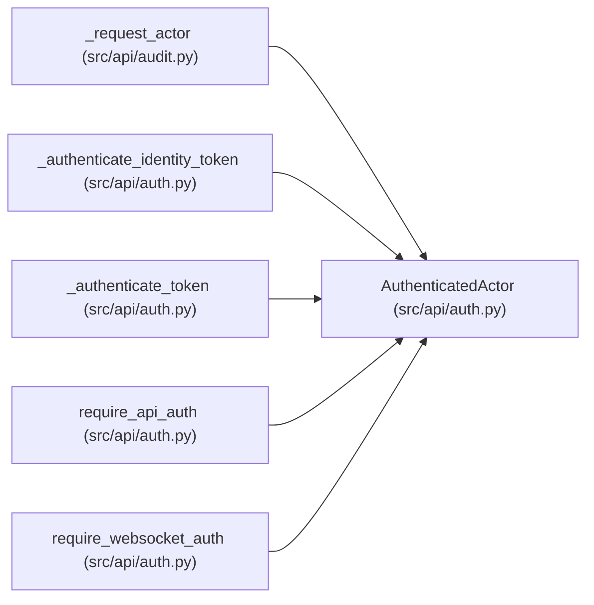

# AuthenticatedActor

**Location:** `src/api/auth.py:53`
**Kind:** Class
**Bases:** —
**Module:** [auth](../modules/auth.md)

**Decorators:** `@dataclass(frozen=True)`

## Description

Authenticated caller context used for audit metadata.

## Attributes

| Name | Type | Default | Description |
|------|------|---------|-------------|
| `subject` | `str` | *required* | — |
| `actor_id` | `str` | *required* | — |
| `mechanism` | `str` | *required* | — |
| `websocket_subprotocol` | `str \| None` | `None` | — |
| `roles` | `tuple[str, ...]` | `()` | — |

## Methods

*No public methods. Inherits from base classes.*

## Relationships

<!-- Auto-generated relationship summary. Do not edit by hand. -->

### Summary

| Module | Methods | Attributes |
|---|---:|---|
| [auth](../modules/auth.md) | 0 | `actor_id`, `mechanism`, `roles`, `subject`, `websocket_subprotocol` |

### References

| Reference | Kind | Source | Call sites |
|---|---|---|---:|
| `_request_actor` | type_reference | [audit](../modules/audit.md) | — |
| `_authenticate_identity_token` | call | [auth](../modules/auth.md) | 1 |
| `_authenticate_identity_token` | type_reference | [auth](../modules/auth.md) | — |
| `_authenticate_token` | call | [auth](../modules/auth.md) | 1 |
| `_authenticate_token` | type_reference | [auth](../modules/auth.md) | — |
| `require_api_auth` | type_reference | [auth](../modules/auth.md) | — |
| `require_websocket_auth` | type_reference | [auth](../modules/auth.md) | — |
