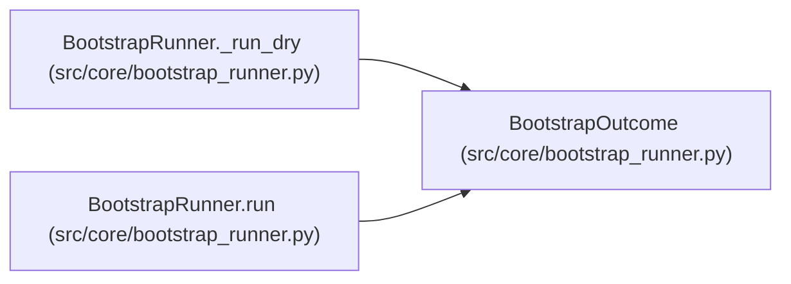

# BootstrapOutcome

**Location:** `src/core/bootstrap_runner.py:74`
**Kind:** Class
**Bases:** —
**Module:** [bootstrap_runner](../modules/bootstrap_runner.md)

**Decorators:** `@dataclass(frozen=True)`

## Description

Result of a bootstrap run, including the resolved artifact.

## Attributes

| Name | Type | Default | Description |
|------|------|---------|-------------|
| `ok` | `bool` | *required* | — |
| `artifact` | `Optional['SessionBootstrapArtifact']` | `None` | — |
| `error` | `Optional[str]` | `None` | — |
| `duration_s` | `float` | `0.0` | — |
| `dry` | `bool` | `False` | — |
| `bootstrapped_dir` | `Optional[Path]` | `None` | — |

## Methods

*No public methods. Inherits from base classes.*

## Relationships

<!-- Auto-generated relationship summary. Do not edit by hand. -->

### Summary

| Module | Methods | Attributes |
|---|---:|---|
| [bootstrap_runner](../modules/bootstrap_runner.md) | 0 | `artifact`, `bootstrapped_dir`, `dry`, `duration_s`, `error`, `ok` |

### References

| Reference | Kind | Source | Call sites |
|---|---|---|---:|
| `BootstrapRunner._run_dry` | call | [bootstrap_runner](../modules/bootstrap_runner.md) | 2 |
| `BootstrapRunner._run_dry` | type_reference | [bootstrap_runner](../modules/bootstrap_runner.md) | — |
| `BootstrapRunner.run` | call | [bootstrap_runner](../modules/bootstrap_runner.md) | 4 |
| `BootstrapRunner.run` | type_reference | [bootstrap_runner](../modules/bootstrap_runner.md) | — |
