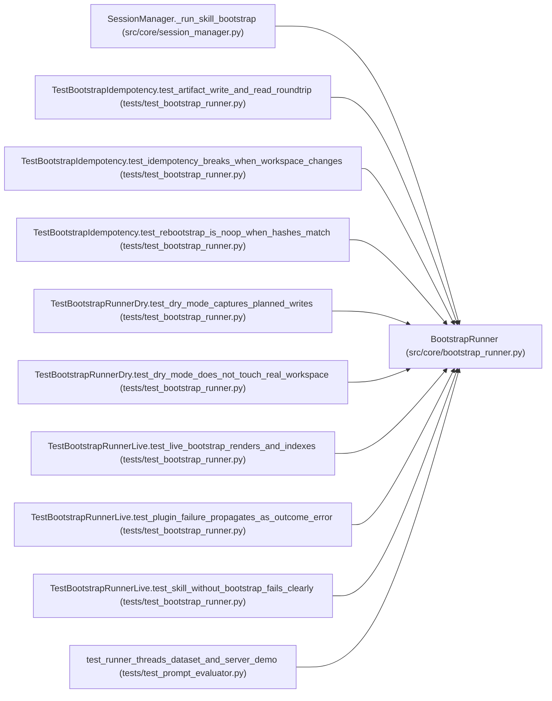

# BootstrapRunner

**Location:** `src/core/bootstrap_runner.py:228`
**Kind:** Class
**Bases:** —
**Module:** [bootstrap_runner](../modules/bootstrap_runner.md)

## Description

Run a skill's ``bootstrap.py`` once at session start (P5-005).

Parameters
----------
plugin_runner:
    The governed-subprocess runner (X-004 §6). Injected for testability;
    production wires a single shared instance.
skills_root:
    Optional skills root for path confinement (forwarded to PluginRunner).

## Attributes

*No annotated attributes found.*

## Methods

| Method | Signature | Decorators | Description |
|--------|-----------|------------|-------------|
| `__init__` | `(*, plugin_runner: Optional[PluginRunner] = None, skills_root: Optional[Path] = None) -> None` | — | — |
| `run` | *(async)* `(*, skill_dir: Path, layout: SkillLayout, manifest: ResearchSkillManifest, workspace: Path, skill_params: Optional[dict[str, Any]] = None, system_prompt: Optional[str] = None, tool_config: Optional[dict[str, Any]] = None, seed_search: Optional[dict[str, Any]] = None, dry: bool = False, timeout_s: Optional[float] = None) -> BootstrapOutcome` | — | Execute the skill's ``bootstrap.py`` and write the artifact. |
| `_run_dry` | *(async)* `(*, skill_dir: Path, plugin: str, manifest: ResearchSkillManifest, workspace: Path, caps: PluginCaps, skill_params: Optional[dict[str, Any]], system_prompt: Optional[str], tool_config: Optional[dict[str, Any]], seed_search: Optional[dict[str, Any]], timeout_s: Optional[float]) -> BootstrapOutcome` | — | X-004 D5(b) overlay dry mode (P5-008). |
| `is_idempotent` | `(*, existing_artifact: SessionBootstrapArtifact, workspace: Path) -> bool` | — | P5-009 idempotency: True if the workspace's current hashes match the |

## Relationships

<!-- Auto-generated relationship summary. Do not edit by hand. -->

### Summary

| Module | Methods | Attributes |
|---|---:|---|
| [bootstrap_runner](../modules/bootstrap_runner.md) | 4 | — |

### References

| Reference | Kind | Source | Call sites |
|---|---|---|---:|
| `SessionManager._run_skill_bootstrap` | call | [session_manager](../modules/session_manager.md) | 1 |
| `TestBootstrapIdempotency.test_artifact_write_and_read_roundtrip` | call | [test_bootstrap_runner](../modules/test_bootstrap_runner.md) | 1 |
| `TestBootstrapIdempotency.test_idempotency_breaks_when_workspace_changes` | call | [test_bootstrap_runner](../modules/test_bootstrap_runner.md) | 1 |
| `TestBootstrapIdempotency.test_rebootstrap_is_noop_when_hashes_match` | call | [test_bootstrap_runner](../modules/test_bootstrap_runner.md) | 1 |
| `TestBootstrapRunnerDry.test_dry_mode_captures_planned_writes` | call | [test_bootstrap_runner](../modules/test_bootstrap_runner.md) | 1 |
| `TestBootstrapRunnerDry.test_dry_mode_does_not_touch_real_workspace` | call | [test_bootstrap_runner](../modules/test_bootstrap_runner.md) | 1 |
| `TestBootstrapRunnerLive.test_live_bootstrap_renders_and_indexes` | call | [test_bootstrap_runner](../modules/test_bootstrap_runner.md) | 1 |
| `TestBootstrapRunnerLive.test_plugin_failure_propagates_as_outcome_error` | call | [test_bootstrap_runner](../modules/test_bootstrap_runner.md) | 1 |
| `TestBootstrapRunnerLive.test_skill_without_bootstrap_fails_clearly` | call | [test_bootstrap_runner](../modules/test_bootstrap_runner.md) | 1 |
| `test_runner_threads_dataset_and_server_demo` | call | [test_prompt_evaluator](../modules/test_prompt_evaluator.md) | 1 |
