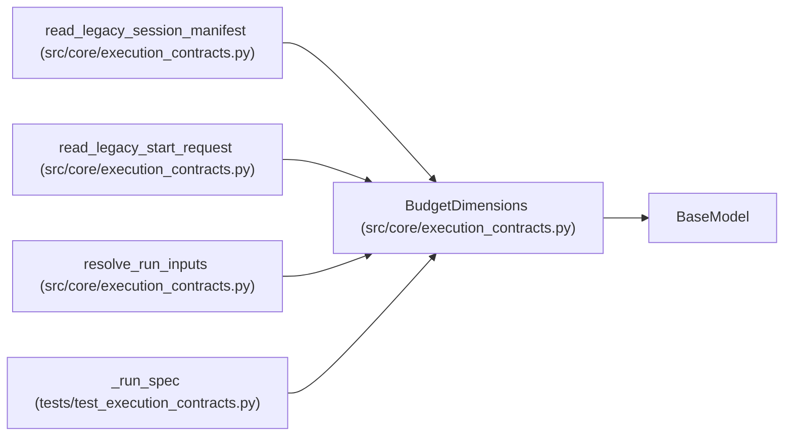

# BudgetDimensions

**Location:** `src/core/execution_contracts.py:810`
**Kind:** Pydantic model
**Bases:** `BaseModel`
**Module:** [execution_contracts](../modules/execution_contracts.md)

## Description

Spend ceilings for a run; every dimension is explicit.

## Model Configuration

| Setting | Value | Source |
|---------|-------|--------|
| `extra` | `'forbid'` | model_config |
| `allow_inf_nan` | `False` | model_config |

## Attributes

| Name | Type | Wire name | Required | Nullable | Default | Constraints | Examples | Description |
|------|------|-----------|----------|----------|---------|-------------|-------------|----------|
| `max_iterations` | `int` | `max_iterations` | Yes | No | — | ge=1 | — | — |
| `max_budget_usd` | `float` | `max_budget_usd` | Yes | No | — | ge=0.0 | — | — |
| `timeout_s` | `int` | `timeout_s` | Yes | No | — | ge=1 | — | — |
| `max_concurrency` | `int` | `max_concurrency` | No | No | `1` | ge=1 | — | — |

## Methods

*No public methods. Inherits from base classes.*

## Relationships

<!-- Auto-generated relationship summary. Do not edit by hand. -->

### Summary

| Module | Methods | Attributes |
|---|---:|---|
| [execution_contracts](../modules/execution_contracts.md) | 0 | `max_budget_usd`, `max_concurrency`, `max_iterations`, `timeout_s` |

### Structure

| Kind | Entity | Module |
|---|---|---|
| Base | `BaseModel` | — |

### References

| Reference | Kind | Source | Call sites |
|---|---|---|---:|
| `read_legacy_session_manifest` | call | [execution_contracts](../modules/execution_contracts.md) | 1 |
| `read_legacy_start_request` | call | [execution_contracts](../modules/execution_contracts.md) | 1 |
| `resolve_run_inputs` | call | [execution_contracts](../modules/execution_contracts.md) | 1 |
| `_run_spec` | call | [test_execution_contracts](../modules/test_execution_contracts.md) | 1 |
