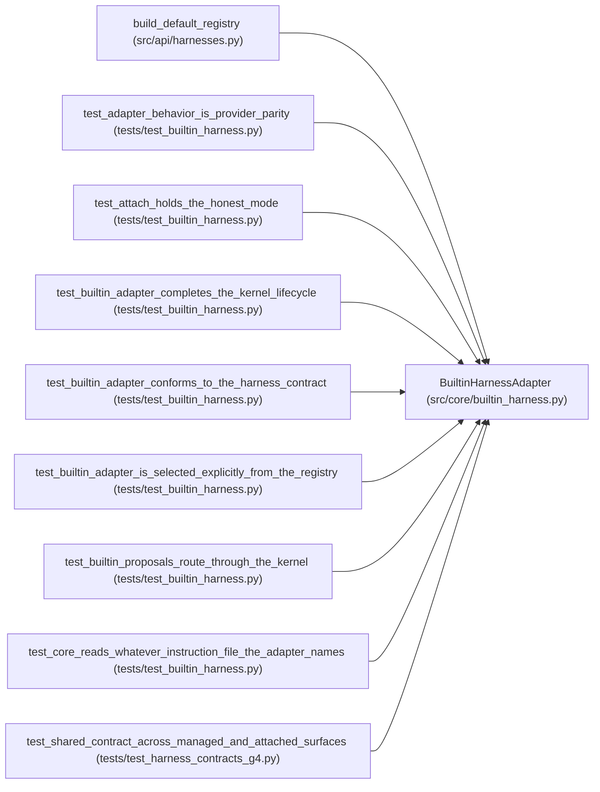

# BuiltinHarnessAdapter

**Location:** `src/core/builtin_harness.py:38`
**Kind:** Class
**Bases:** —
**Module:** [builtin_harness](../modules/builtin_harness.md)

## Description

The built-in loop behind the harness contract and kernel driver.

## Attributes

*No annotated attributes found.*

## Methods

| Method | Signature | Decorators | Description |
|--------|-----------|------------|-------------|
| `__init__` | `(*, orchestrator: Any = None, attempt_fn: Optional[AttemptFn] = None, name: str = BUILTIN_HARNESS_NAME, version: str = '1.0.0') -> None` | — | — |
| `preflight` | `() -> dict[str, Any]` | — | Diagnostics for capability/preflight surfaces (no authority). |
| `identity` | `() -> HarnessIdentity` | — | — |
| `capabilities` | `() -> frozenset[str]` | — | — |
| `start` | `(request: Mapping[str, Any]) -> Mapping[str, Any]` | — | — |
| `attach` | `(request: Mapping[str, Any]) -> Mapping[str, Any]` | — | — |
| `events` | `(handle: str) -> Iterator[Mapping[str, Any]]` | — | — |
| `cancel` | `(handle: str) -> None` | — | — |
| `pause` | `(handle: str) -> None` | — | — |
| `resume` | `(handle: str) -> None` | — | — |
| `close` | `(handle: str) -> None` | — | — |
| `run_attempt` | `(plan: AttemptPlan, *, attempt_index: int, context: Mapping[str, Any]) -> AttemptResult` | — | Execute one attempt through the built-in loop and report back. |
| `route_proposal` | `(proposal: HarnessProposal, *, metric: Optional[float] = None, best_metric: Optional[float] = None, direction: str = 'maximize') -> ObjectiveDecision` | — | Route a harness proposal through the kernel's decisions. |
| `_new_handle` | `(research_id: str, request: Mapping[str, Any]) -> str` | — | — |
| `_require_open` | `(handle: str, op: str) -> dict[str, Any]` | — | — |

## Relationships

<!-- Auto-generated relationship summary. Do not edit by hand. -->

### Summary

| Module | Methods | Attributes |
|---|---:|---|
| [builtin_harness](../modules/builtin_harness.md) | 15 | — |

### References

| Reference | Kind | Source | Call sites |
|---|---|---|---:|
| `build_default_registry` | call | [harnesses](../modules/harnesses.md) | 1 |
| `test_adapter_behavior_is_provider_parity` | call | [test_builtin_harness](../modules/test_builtin_harness.md) | 2 |
| `test_attach_holds_the_honest_mode` | call | [test_builtin_harness](../modules/test_builtin_harness.md) | 1 |
| `test_builtin_adapter_completes_the_kernel_lifecycle` | call | [test_builtin_harness](../modules/test_builtin_harness.md) | 1 |
| `test_builtin_adapter_conforms_to_the_harness_contract` | call | [test_builtin_harness](../modules/test_builtin_harness.md) | 1 |
| `test_builtin_adapter_is_selected_explicitly_from_the_registry` | call | [test_builtin_harness](../modules/test_builtin_harness.md) | 1 |
| `test_builtin_proposals_route_through_the_kernel` | call | [test_builtin_harness](../modules/test_builtin_harness.md) | 1 |
| `test_core_reads_whatever_instruction_file_the_adapter_names` | call | [test_builtin_harness](../modules/test_builtin_harness.md) | 1 |
| `test_shared_contract_across_managed_and_attached_surfaces` | call | [test_harness_contracts_g4](../modules/test_harness_contracts_g4.md) | 1 |
