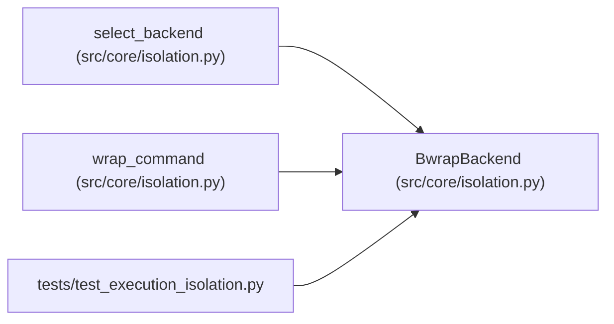

# BwrapBackend

**Location:** `src/core/isolation.py:94`
**Kind:** Class
**Bases:** —
**Module:** [isolation](../modules/isolation.md)

**Decorators:** `@dataclass(frozen=True)`

## Description

The selected isolation backend (bubblewrap 0.11.1).

## Attributes

| Name | Type | Default | Description |
|------|------|---------|-------------|
| `name` | `str` | `'bwrap'` | — |

## Methods

| Method | Signature | Decorators | Description |
|--------|-----------|------------|-------------|
| `wrap` | `(argv: Sequence[str], *, policy: IsolationPolicy) -> list[str]` | — | Return the sandboxed command line enforcing ``policy``. |

## Relationships

<!-- Auto-generated relationship summary. Do not edit by hand. -->

### Summary

| Module | Methods | Attributes |
|---|---:|---|
| [isolation](../modules/isolation.md) | 1 | `name` |

### References

| Reference | Kind | Source | Call sites |
|---|---|---|---:|
| `select_backend` | call | [isolation](../modules/isolation.md) | 1 |
| `select_backend` | type_reference | [isolation](../modules/isolation.md) | — |
| `wrap_command` | type_reference | [isolation](../modules/isolation.md) | — |
| `test_execution_isolation` | import | [test_execution_isolation](../modules/test_execution_isolation.md) | — |
