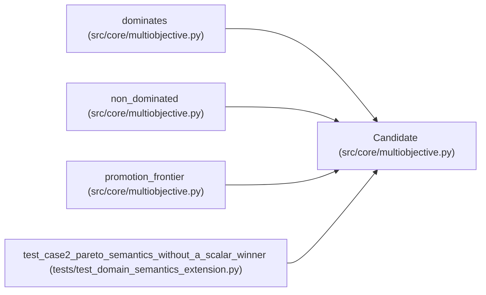

# Candidate

**Location:** `src/core/multiobjective.py:44`
**Kind:** Class
**Bases:** —
**Module:** [multiobjective](../modules/multiobjective.md)

**Decorators:** `@dataclass(frozen=True)`

## Description

One measured candidate: identity + per-metric values.

## Attributes

| Name | Type | Default | Description |
|------|------|---------|-------------|
| `candidate_id` | `str` | *required* | — |
| `values` | `Mapping[str, Optional[float]]` | *required* | — |

## Methods

*No public methods. Inherits from base classes.*

## Relationships

<!-- Auto-generated relationship summary. Do not edit by hand. -->

### Summary

| Module | Methods | Attributes |
|---|---:|---|
| [multiobjective](../modules/multiobjective.md) | 0 | `candidate_id`, `values` |

### References

| Reference | Kind | Source | Call sites |
|---|---|---|---:|
| `dominates` | type_reference | [multiobjective](../modules/multiobjective.md) | — |
| `non_dominated` | type_reference | [multiobjective](../modules/multiobjective.md) | — |
| `promotion_frontier` | type_reference | [multiobjective](../modules/multiobjective.md) | — |
| `test_case2_pareto_semantics_without_a_scalar_winner` | call | [test_domain_semantics_extension](../modules/test_domain_semantics_extension.md) | 5 |
