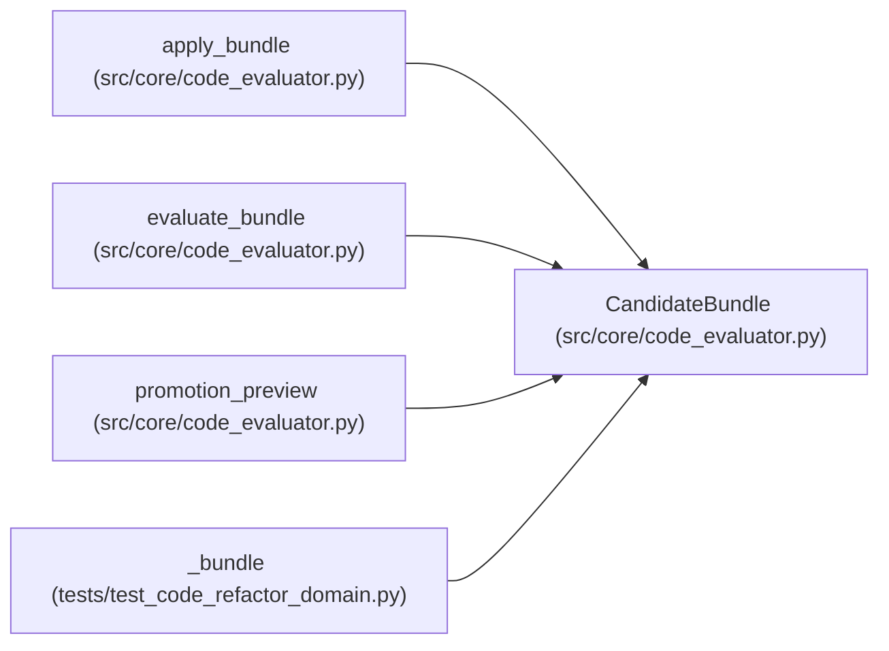

# CandidateBundle

**Location:** `src/core/code_evaluator.py:32`
**Kind:** Class
**Bases:** —
**Module:** [code_evaluator](../modules/code_evaluator.md)

**Decorators:** `@dataclass(frozen=True)`

## Description

A multi-file candidate: named target files with full contents.

## Attributes

| Name | Type | Default | Description |
|------|------|---------|-------------|
| `candidate_id` | `str` | *required* | — |
| `files` | `Mapping[str, str]` | *required* | — |

## Methods

| Method | Signature | Decorators | Description |
|--------|-----------|------------|-------------|
| `digest` | `() -> str` | — | — |

## Relationships

<!-- Auto-generated relationship summary. Do not edit by hand. -->

### Summary

| Module | Methods | Attributes |
|---|---:|---|
| [code_evaluator](../modules/code_evaluator.md) | 1 | `candidate_id`, `files` |

### References

| Reference | Kind | Source | Call sites |
|---|---|---|---:|
| `apply_bundle` | type_reference | [code_evaluator](../modules/code_evaluator.md) | — |
| `evaluate_bundle` | type_reference | [code_evaluator](../modules/code_evaluator.md) | — |
| `promotion_preview` | type_reference | [code_evaluator](../modules/code_evaluator.md) | — |
| `_bundle` | call | [test_code_refactor_domain](../modules/test_code_refactor_domain.md) | 1 |
