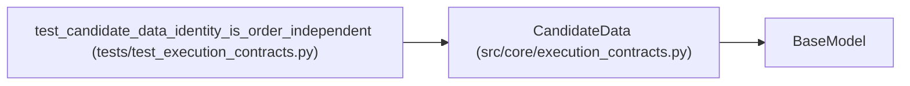

# CandidateData

**Location:** `src/core/execution_contracts.py:267`
**Kind:** Pydantic model
**Bases:** `BaseModel`
**Module:** [execution_contracts](../modules/execution_contracts.md)

## Description

The mutable candidate payload — deliberately outside run contracts.

Only :class:`CandidateIdentity` (digests and immutable artifact refs)
enters :class:`RunSpec` / :class:`ExecutionRequest`; payloads live in the
writable candidate tree and are bound at attempt start.

## Model Configuration

| Setting | Value | Source |
|---------|-------|--------|
| `extra` | `'forbid'` | model_config |

## Attributes

| Name | Type | Wire name | Required | Nullable | Default | Constraints | Examples | Description |
|------|------|-----------|----------|----------|---------|-------------|-------------|----------|
| `payload` | `dict[str, Any]` | `payload` | Yes | No | — | — | — | — |

## Methods

| Method | Signature | Decorators | Description |
|--------|-----------|------------|-------------|
| `identity` | `(candidate_id: str) -> CandidateIdentity` | — | Derive the immutable identity for this payload's current content. |

## Relationships

<!-- Auto-generated relationship summary. Do not edit by hand. -->

### Summary

| Module | Methods | Attributes |
|---|---:|---|
| [execution_contracts](../modules/execution_contracts.md) | 1 | `payload` |

### Structure

| Kind | Entity | Module |
|---|---|---|
| Base | `BaseModel` | — |

### References

| Reference | Kind | Source | Call sites |
|---|---|---|---:|
| `test_candidate_data_identity_is_order_independent` | call | [test_execution_contracts](../modules/test_execution_contracts.md) | 3 |
