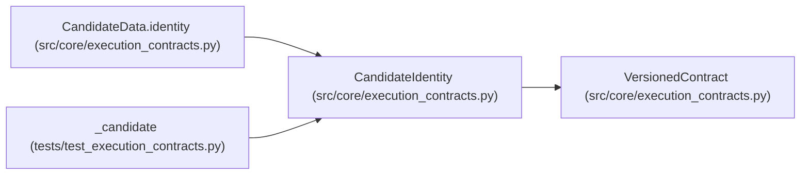

# CandidateIdentity

**Location:** `src/core/execution_contracts.py:243`
**Kind:** Pydantic model
**Bases:** `VersionedContract`
**Module:** [execution_contracts](../modules/execution_contracts.md)

## Description

Immutable identity of a proposed candidate.

Identity is the content digest: mutable candidate data may change on
disk, but every contract that binds a candidate references this digest,
never the payload.

## Model Configuration

| Setting | Value | Source |
|---------|-------|--------|
| `extra` | `'forbid'` | model_config |

## Validators

| Method | Scope | Fields | Mode | Options |
|--------|-------|--------|------|---------|
| `_digest_shape` | field | digest, parent_digest | after | — |

## Attributes

| Name | Type | Wire name | Required | Nullable | Default | Constraints | Examples | Description |
|------|------|-----------|----------|----------|---------|-------------|-------------|----------|
| `schema_version` | `str` | `schema_version` | No | No | `CANDIDATE_IDENTITY_SCHEMA_VERSION` | — | — | — |
| `candidate_id` | `str` | `candidate_id` | Yes | No | — | min_length=1 | — | — |
| `digest` | `str` | `digest` | Yes | No | — | — | — | — |
| `parent_digest` | `Optional[str]` | `parent_digest` | No | Yes | `None` | — | — | — |
| `artifacts` | `list[ArtifactRef]` | `artifacts` | No | No | factory: `list` | — | — | — |

## Methods

| Method | Signature | Decorators | Description |
|--------|-----------|------------|-------------|
| `_digest_shape` | `(value: Optional[str]) -> Optional[str]` | `@field_validator('digest', 'parent_digest')`, `@classmethod` | — |

## Relationships

<!-- Auto-generated relationship summary. Do not edit by hand. -->

### Summary

| Module | Methods | Attributes |
|---|---:|---|
| [execution_contracts](../modules/execution_contracts.md) | 1 | `artifacts`, `candidate_id`, `digest`, `parent_digest`, `schema_version` |

### Structure

| Kind | Entity | Module |
|---|---|---|
| Base | `VersionedContract` | [execution_contracts](../modules/execution_contracts.md) |

### References

| Reference | Kind | Source | Call sites |
|---|---|---|---:|
| `CandidateData.identity` | call | [execution_contracts](../modules/execution_contracts.md) | 1 |
| `CandidateData.identity` | type_reference | [execution_contracts](../modules/execution_contracts.md) | — |
| `_candidate` | call | [test_execution_contracts](../modules/test_execution_contracts.md) | 1 |
