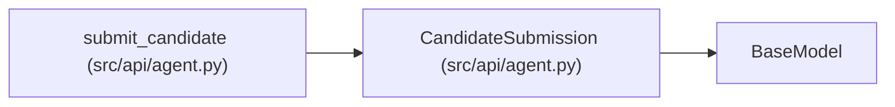

# CandidateSubmission

**Location:** `src/api/agent.py:178`
**Kind:** Pydantic model
**Bases:** `BaseModel`
**Module:** [agent](../modules/agent.md)

## Description

_Auto-generated from `CandidateSubmission` in `src/api/agent.py`._

## Model Configuration

| Setting | Value | Source |
|---------|-------|--------|
| `extra` | `'forbid'` | model_config |

## Attributes

| Name | Type | Wire name | Required | Nullable | Default | Constraints | Examples | Description |
|------|------|-----------|----------|----------|---------|-------------|-------------|----------|
| `digest` | `str` | `digest` | Yes | No | — | — | — | sha256 of the submitted content |
| `content` | `str` | `content` | No | No | `''` | — | — | — |

## Methods

*No public methods. Inherits from base classes.*

## Relationships

<!-- Auto-generated relationship summary. Do not edit by hand. -->

### Summary

| Module | Methods | Attributes |
|---|---:|---|
| [agent](../modules/agent.md) | 0 | `content`, `digest` |

### Structure

| Kind | Entity | Module |
|---|---|---|
| Base | `BaseModel` | — |

### References

| Reference | Kind | Source | Call sites |
|---|---|---|---:|
| `submit_candidate` | type_reference | [agent](../modules/agent.md) | — |
