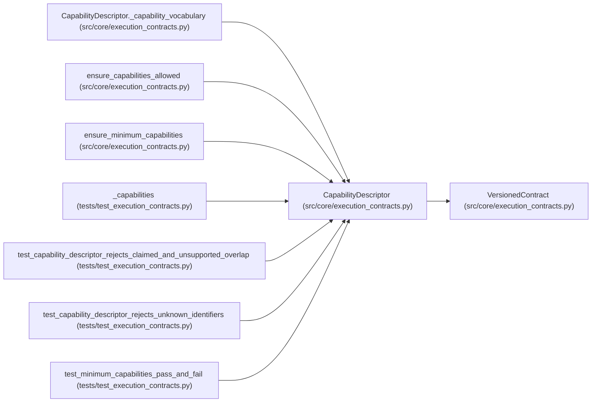

# CapabilityDescriptor

**Location:** `src/core/execution_contracts.py:444`
**Kind:** Pydantic model
**Bases:** `VersionedContract`
**Module:** [execution_contracts](../modules/execution_contracts.md)

## Description

What a harness/driver can do — with explicit gaps, never silent ones.

``capabilities`` names what is supported; ``unsupported`` names what is
not, with a reason. Optional behaviors (pause, resume, mid-run input)
are absent from ``capabilities`` unless genuinely available: an
unsupported pause must not be equated with killing the process.

## Model Configuration

| Setting | Value | Source |
|---------|-------|--------|
| `extra` | `'forbid'` | model_config |

## Validators

| Method | Scope | Fields | Mode | Options |
|--------|-------|--------|------|---------|
| `_capability_vocabulary` | model | — | after | — |

## Attributes

| Name | Type | Wire name | Required | Nullable | Default | Constraints | Examples | Description |
|------|------|-----------|----------|----------|---------|-------------|-------------|----------|
| `schema_version` | `str` | `schema_version` | No | No | `CAPABILITY_DESCRIPTOR_SCHEMA_VERSION` | — | — | — |
| `integration` | `IntegrationDirection` | `integration` | Yes | No | — | — | — | — |
| `adapter_id` | `str` | `adapter_id` | Yes | No | — | min_length=1 | — | — |
| `protocol_version` | `str` | `protocol_version` | Yes | No | — | min_length=1 | — | — |
| `capabilities` | `list[str]` | `capabilities` | No | No | factory: `list` | — | — | — |
| `unsupported` | `dict[str, str]` | `unsupported` | No | No | factory: `dict` | — | — | — |

## Methods

| Method | Signature | Decorators | Description |
|--------|-----------|------------|-------------|
| `_capability_vocabulary` | `() -> 'CapabilityDescriptor'` | `@model_validator(mode='after')` | — |

## Relationships

<!-- Auto-generated relationship summary. Do not edit by hand. -->

### Summary

| Module | Methods | Attributes |
|---|---:|---|
| [execution_contracts](../modules/execution_contracts.md) | 1 | `adapter_id`, `capabilities`, `integration`, `protocol_version`, `schema_version`, `unsupported` |

### Structure

| Kind | Entity | Module |
|---|---|---|
| Base | `VersionedContract` | [execution_contracts](../modules/execution_contracts.md) |

### References

| Reference | Kind | Source | Call sites |
|---|---|---|---:|
| `CapabilityDescriptor._capability_vocabulary` | type_reference | [execution_contracts](../modules/execution_contracts.md) | — |
| `ensure_capabilities_allowed` | type_reference | [execution_contracts](../modules/execution_contracts.md) | — |
| `ensure_minimum_capabilities` | type_reference | [execution_contracts](../modules/execution_contracts.md) | — |
| `_capabilities` | call | [test_execution_contracts](../modules/test_execution_contracts.md) | 1 |
| `test_capability_descriptor_rejects_claimed_and_unsupported_overlap` | call | [test_execution_contracts](../modules/test_execution_contracts.md) | 1 |
| `test_capability_descriptor_rejects_unknown_identifiers` | call | [test_execution_contracts](../modules/test_execution_contracts.md) | 1 |
| `test_minimum_capabilities_pass_and_fail` | call | [test_execution_contracts](../modules/test_execution_contracts.md) | 1 |
