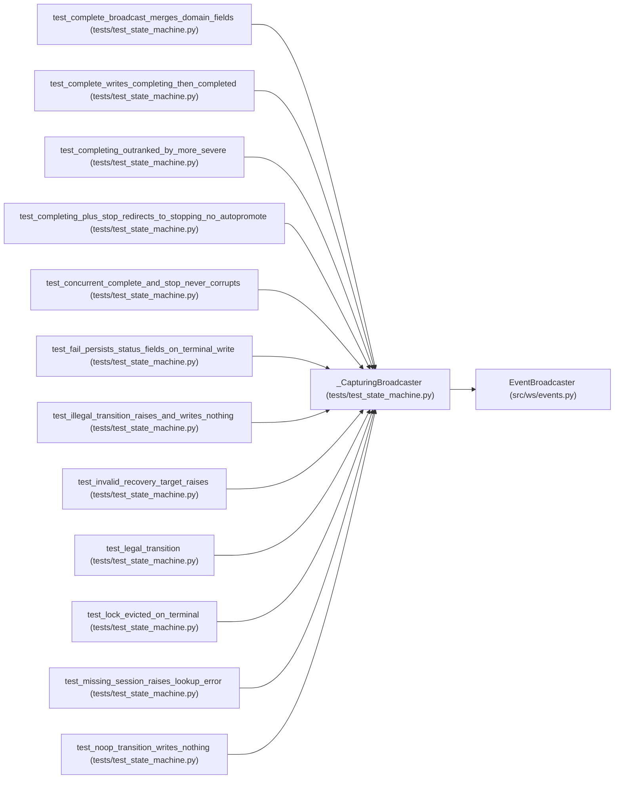

# _CapturingBroadcaster

**Location:** `tests/test_state_machine.py:39`
**Kind:** Class
**Bases:** `EventBroadcaster`
**Module:** [test_state_machine](../modules/test_state_machine.md)

## Description

An ``EventBroadcaster`` that records broadcasts instead of sending them.

## Attributes

*No annotated attributes found.*

## Methods

| Method | Signature | Decorators | Description |
|--------|-----------|------------|-------------|
| `__init__` | `() -> None` | — | — |
| `broadcast` | *(async)* `(event: Dict[str, Any]) -> None` | — | — |

## Relationships

<!-- Auto-generated relationship summary. Do not edit by hand. -->

### Summary

| Module | Methods | Attributes |
|---|---:|---|
| [test_state_machine](../modules/test_state_machine.md) | 2 | — |

### Structure

| Kind | Entity | Module |
|---|---|---|
| Base | `EventBroadcaster` | [events](../modules/events.md) |

### References

| Reference | Kind | Source | Call sites |
|---|---|---|---:|
| `test_complete_broadcast_merges_domain_fields` | call | [test_state_machine](../modules/test_state_machine.md) | 1 |
| `test_complete_writes_completing_then_completed` | call | [test_state_machine](../modules/test_state_machine.md) | 1 |
| `test_completing_outranked_by_more_severe` | call | [test_state_machine](../modules/test_state_machine.md) | 1 |
| `test_completing_plus_stop_redirects_to_stopping_no_autopromote` | call | [test_state_machine](../modules/test_state_machine.md) | 1 |
| `test_concurrent_complete_and_stop_never_corrupts` | call | [test_state_machine](../modules/test_state_machine.md) | 1 |
| `test_fail_persists_status_fields_on_terminal_write` | call | [test_state_machine](../modules/test_state_machine.md) | 1 |
| `test_illegal_transition_raises_and_writes_nothing` | call | [test_state_machine](../modules/test_state_machine.md) | 1 |
| `test_invalid_recovery_target_raises` | call | [test_state_machine](../modules/test_state_machine.md) | 1 |
| `test_legal_transition` | call | [test_state_machine](../modules/test_state_machine.md) | 1 |
| `test_lock_evicted_on_terminal` | call | [test_state_machine](../modules/test_state_machine.md) | 1 |
| `test_missing_session_raises_lookup_error` | call | [test_state_machine](../modules/test_state_machine.md) | 1 |
| `test_noop_transition_writes_nothing` | call | [test_state_machine](../modules/test_state_machine.md) | 1 |

> References: showing 12 of 15 logical references; 3 omitted by the 12-row generated summary limit.
