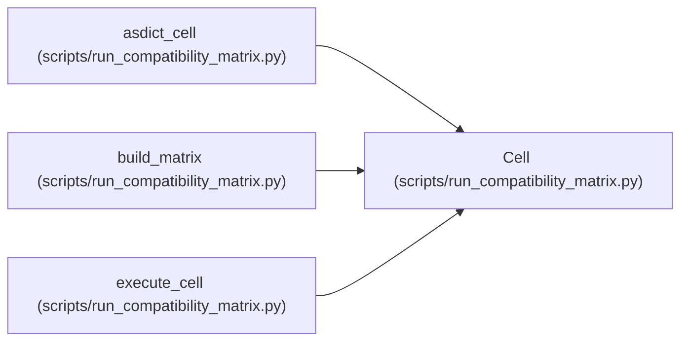

# Cell

**Location:** `scripts/run_compatibility_matrix.py:199`
**Kind:** Class
**Bases:** —
**Module:** [run_compatibility_matrix](../modules/run_compatibility_matrix.md)

**Decorators:** `@dataclass`

## Description

_Auto-generated from `Cell` in `scripts/run_compatibility_matrix.py`._

## Attributes

| Name | Type | Default | Description |
|------|------|---------|-------------|
| `cell_id` | `str` | *required* | — |
| `harness` | `str` | *required* | — |
| `domain` | `str` | *required* | — |
| `backend` | `str` | *required* | — |
| `status` | `str` | `'PENDING'` | — |
| `reason` | `str` | `''` | — |
| `command` | `str` | `''` | — |
| `evidence` | `list[str]` | `field(default_factory=list)` | — |
| `duration_s` | `float` | `0.0` | — |

## Methods

*No public methods. Inherits from base classes.*

## Relationships

<!-- Auto-generated relationship summary. Do not edit by hand. -->

### Summary

| Module | Methods | Attributes |
|---|---:|---|
| [run_compatibility_matrix](../modules/run_compatibility_matrix.md) | 0 | `backend`, `cell_id`, `command`, `domain`, `duration_s`, `evidence`, `harness`, `reason`, `status` |

### References

| Reference | Kind | Source | Call sites |
|---|---|---|---:|
| `asdict_cell` | type_reference | [run_compatibility_matrix](../modules/run_compatibility_matrix.md) | — |
| `build_matrix` | call | [run_compatibility_matrix](../modules/run_compatibility_matrix.md) | 1 |
| `execute_cell` | type_reference | [run_compatibility_matrix](../modules/run_compatibility_matrix.md) | — |
