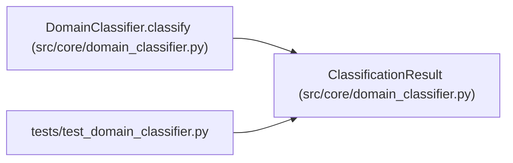

# ClassificationResult

**Location:** `src/core/domain_classifier.py:193`
**Kind:** Class
**Bases:** —
**Module:** [domain_classifier](../modules/domain_classifier.md)

**Decorators:** `@dataclass(frozen=True)`

## Description

Outcome of ``DomainClassifier.classify`` (P5-016 / P5-018).

## Attributes

| Name | Type | Default | Description |
|------|------|---------|-------------|
| `goal` | `str` | *required* | — |
| `matched_skills` | `list[SkillMatch]` | *required* | — |
| `threshold` | `float` | *required* | — |
| `auto_selected` | `Optional[str]` | *required* | — |

## Methods

| Method | Signature | Decorators | Description |
|--------|-----------|------------|-------------|
| `confidence` | `() -> str` | `@property` | — |
| `to_audit_dict` | `() -> dict[str, Any]` | — | Shape for the ``skill.classify`` audit_events row (P5-018). |

## Relationships

<!-- Auto-generated relationship summary. Do not edit by hand. -->

### Summary

| Module | Methods | Attributes |
|---|---:|---|
| [domain_classifier](../modules/domain_classifier.md) | 2 | `auto_selected`, `goal`, `matched_skills`, `threshold` |

### References

| Reference | Kind | Source | Call sites |
|---|---|---|---:|
| `DomainClassifier.classify` | call | [domain_classifier](../modules/domain_classifier.md) | 1 |
| `DomainClassifier.classify` | type_reference | [domain_classifier](../modules/domain_classifier.md) | — |
| `test_domain_classifier` | import | [test_domain_classifier](../modules/test_domain_classifier.md) | — |
