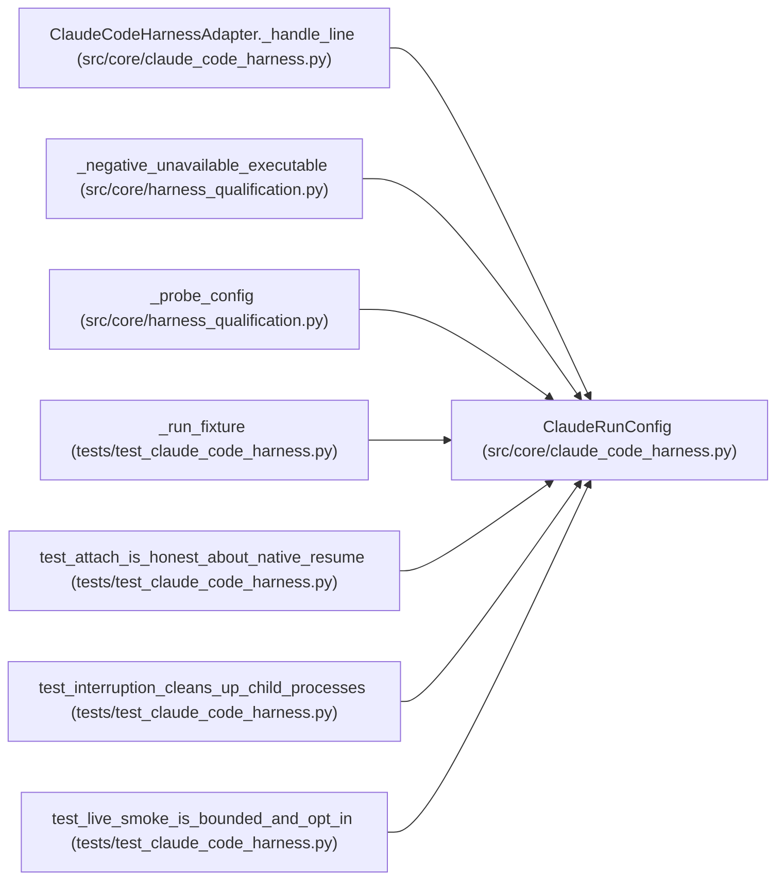

# ClaudeRunConfig

**Location:** `src/core/claude_code_harness.py:59`
**Kind:** Class
**Bases:** —
**Module:** [claude_code_harness](../modules/claude_code_harness.md)

**Decorators:** `@dataclass`

## Description

One supervised ``claude -p`` run.

## Attributes

| Name | Type | Default | Description |
|------|------|---------|-------------|
| `prompt` | `str` | *required* | — |
| `workspace` | `str` | *required* | — |
| `config_dir` | `str` | *required* | — |
| `executable` | `tuple[str, ...]` | `('claude', '-p', '--output-format', 'stream-json')` | — |
| `allowed_tools` | `str` | `'Read'` | — |
| `permission_mode` | `str` | `'default'` | — |
| `auth_env` | `Mapping[str, str]` | `field(default_factory=dict)` | — |
| `max_event_bytes` | `int` | `MAX_EVENT_BYTES` | — |
| `cleanup_deadline_s` | `float` | `CLEANUP_DEADLINE_S` | — |
| `resume_session_id` | `Optional[str]` | `None` | — |

## Methods

*No public methods. Inherits from base classes.*

## Relationships

<!-- Auto-generated relationship summary. Do not edit by hand. -->

### Summary

| Module | Methods | Attributes |
|---|---:|---|
| [claude_code_harness](../modules/claude_code_harness.md) | 0 | `allowed_tools`, `auth_env`, `cleanup_deadline_s`, `config_dir`, `executable`, `max_event_bytes`, `permission_mode`, `prompt`, `resume_session_id`, `workspace` |

### References

| Reference | Kind | Source | Call sites |
|---|---|---|---:|
| `ClaudeCodeHarnessAdapter._handle_line` | type_reference | [claude_code_harness](../modules/claude_code_harness.md) | — |
| `_negative_unavailable_executable` | call | [harness_qualification](../modules/harness_qualification.md) | 1 |
| `_probe_config` | call | [harness_qualification](../modules/harness_qualification.md) | 1 |
| `_run_fixture` | call | [test_claude_code_harness](../modules/test_claude_code_harness.md) | 1 |
| `test_attach_is_honest_about_native_resume` | call | [test_claude_code_harness](../modules/test_claude_code_harness.md) | 1 |
| `test_interruption_cleans_up_child_processes` | call | [test_claude_code_harness](../modules/test_claude_code_harness.md) | 1 |
| `test_live_smoke_is_bounded_and_opt_in` | call | [test_claude_code_harness](../modules/test_claude_code_harness.md) | 1 |
