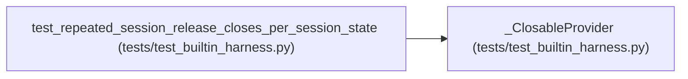

# _ClosableProvider

**Location:** `tests/test_builtin_harness.py:173`
**Kind:** Class
**Bases:** —
**Module:** [test_builtin_harness](../modules/test_builtin_harness.md)

## Description

_Auto-generated from `_ClosableProvider` in `tests/test_builtin_harness.py`._

## Attributes

*No annotated attributes found.*

## Methods

| Method | Signature | Decorators | Description |
|--------|-----------|------------|-------------|
| `__init__` | `()` | — | — |
| `close` | `()` | — | — |

## Relationships

<!-- Auto-generated relationship summary. Do not edit by hand. -->

### Summary

| Module | Methods | Attributes |
|---|---:|---|
| [test_builtin_harness](../modules/test_builtin_harness.md) | 2 | — |

### References

| Reference | Kind | Source | Call sites |
|---|---|---|---:|
| `test_repeated_session_release_closes_per_session_state` | call | [test_builtin_harness](../modules/test_builtin_harness.md) | 1 |
