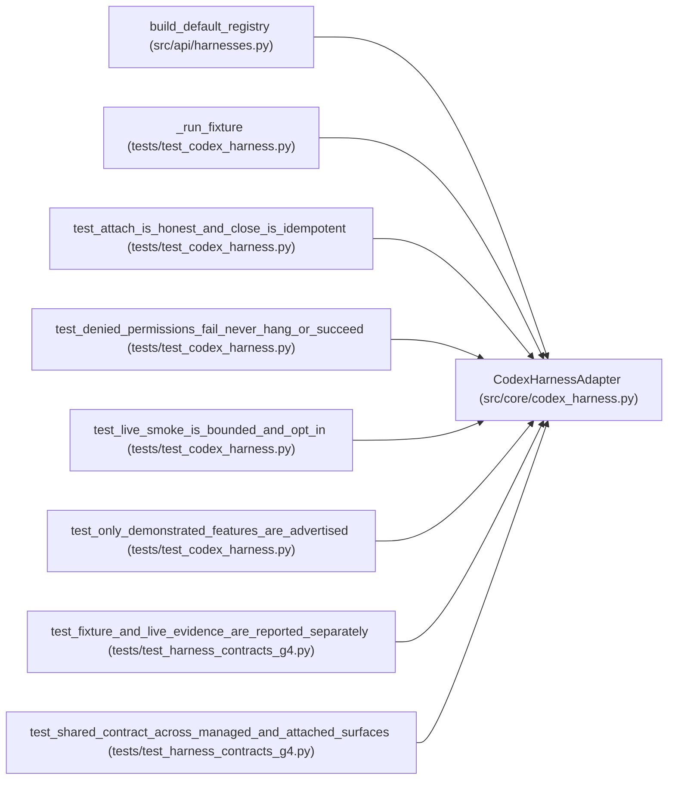

# CodexHarnessAdapter

**Location:** `src/core/codex_harness.py:170`
**Kind:** Class
**Bases:** —
**Module:** [codex_harness](../modules/codex_harness.md)

## Description

The Codex harness behind the common contracts.

## Attributes

*No annotated attributes found.*

## Methods

| Method | Signature | Decorators | Description |
|--------|-----------|------------|-------------|
| `__init__` | `(*, name: str = 'codex', version: str = '1.0.0') -> None` | — | — |
| `preflight` | `() -> dict[str, Any]` | — | Diagnostics for capability/preflight surfaces (no authority). |
| `identity` | `() -> HarnessIdentity` | — | — |
| `capabilities` | `() -> frozenset[str]` | — | — |
| `start` | `(request: Mapping[str, Any]) -> Mapping[str, Any]` | — | — |
| `attach` | `(request: Mapping[str, Any]) -> Mapping[str, Any]` | — | — |
| `events` | `(handle: str) -> Iterator[Mapping[str, Any]]` | — | — |
| `cancel` | `(handle: str) -> None` | — | — |
| `close` | `(handle: str) -> None` | — | — |
| `proposals` | `(handle: str) -> list[dict[str, Any]]` | — | — |
| `usage` | `(handle: str) -> list[dict[str, Any]]` | — | — |
| `record_permission_denial` | `(handle: str, detail: str) -> None` | — | A denied permission is an explicit failure, never success. |
| `attempt_outcome` | `(handle: str) -> str` | — | The run's outcome in the kernel's vocabulary. |
| `_launch` | `(state: dict[str, Any]) -> None` | — | — |
| `_read_stream` | `(process: Any, state: dict[str, Any]) -> None` | — | — |
| `_handle_line` | `(line: bytes, state: dict[str, Any], config: CodexRunConfig) -> None` | — | — |
| `_kill_group` | `(process: Any, deadline_s: float) -> None` | — | — |
| `_require_open` | `(handle: str, op: str) -> dict[str, Any]` | — | — |

## Relationships

<!-- Auto-generated relationship summary. Do not edit by hand. -->

### Summary

| Module | Methods | Attributes |
|---|---:|---|
| [codex_harness](../modules/codex_harness.md) | 18 | — |

### References

| Reference | Kind | Source | Call sites |
|---|---|---|---:|
| `build_default_registry` | call | [harnesses](../modules/harnesses.md) | 1 |
| `_run_fixture` | call | [test_codex_harness](../modules/test_codex_harness.md) | 1 |
| `test_attach_is_honest_and_close_is_idempotent` | call | [test_codex_harness](../modules/test_codex_harness.md) | 1 |
| `test_denied_permissions_fail_never_hang_or_succeed` | call | [test_codex_harness](../modules/test_codex_harness.md) | 1 |
| `test_live_smoke_is_bounded_and_opt_in` | call | [test_codex_harness](../modules/test_codex_harness.md) | 1 |
| `test_only_demonstrated_features_are_advertised` | call | [test_codex_harness](../modules/test_codex_harness.md) | 1 |
| `test_fixture_and_live_evidence_are_reported_separately` | call | [test_harness_contracts_g4](../modules/test_harness_contracts_g4.md) | 1 |
| `test_shared_contract_across_managed_and_attached_surfaces` | call | [test_harness_contracts_g4](../modules/test_harness_contracts_g4.md) | 1 |
