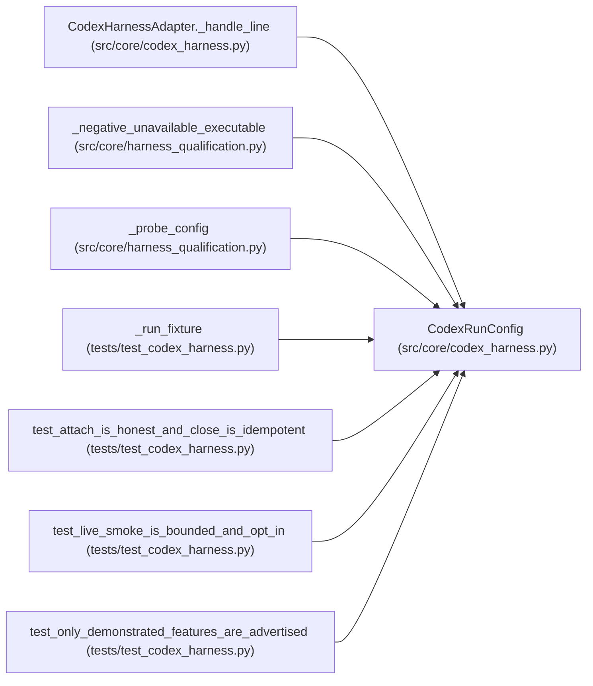

# CodexRunConfig

**Location:** `src/core/codex_harness.py:75`
**Kind:** Class
**Bases:** —
**Module:** [codex_harness](../modules/codex_harness.md)

**Decorators:** `@dataclass`

## Description

One supervised ``codex exec`` run.

## Attributes

| Name | Type | Default | Description |
|------|------|---------|-------------|
| `prompt` | `str` | *required* | — |
| `workspace` | `str` | *required* | — |
| `executable` | `tuple[str, ...]` | `('codex', 'exec', '--json')` | — |
| `sandbox` | `str` | `'read-only'` | — |
| `version` | `str` | `'unrecorded'` | — |
| `auth_mode` | `str` | `'unrecorded'` | — |
| `max_event_bytes` | `int` | `MAX_EVENT_BYTES` | — |
| `cleanup_deadline_s` | `float` | `CLEANUP_DEADLINE_S` | — |
| `env` | `Mapping[str, str]` | `field(default_factory=dict)` | — |

## Methods

*No public methods. Inherits from base classes.*

## Relationships

<!-- Auto-generated relationship summary. Do not edit by hand. -->

### Summary

| Module | Methods | Attributes |
|---|---:|---|
| [codex_harness](../modules/codex_harness.md) | 0 | `auth_mode`, `cleanup_deadline_s`, `env`, `executable`, `max_event_bytes`, `prompt`, `sandbox`, `version`, `workspace` |

### References

| Reference | Kind | Source | Call sites |
|---|---|---|---:|
| `CodexHarnessAdapter._handle_line` | type_reference | [codex_harness](../modules/codex_harness.md) | — |
| `_negative_unavailable_executable` | call | [harness_qualification](../modules/harness_qualification.md) | 1 |
| `_probe_config` | call | [harness_qualification](../modules/harness_qualification.md) | 1 |
| `_run_fixture` | call | [test_codex_harness](../modules/test_codex_harness.md) | 1 |
| `test_attach_is_honest_and_close_is_idempotent` | call | [test_codex_harness](../modules/test_codex_harness.md) | 1 |
| `test_live_smoke_is_bounded_and_opt_in` | call | [test_codex_harness](../modules/test_codex_harness.md) | 1 |
| `test_only_demonstrated_features_are_advertised` | call | [test_codex_harness](../modules/test_codex_harness.md) | 1 |
