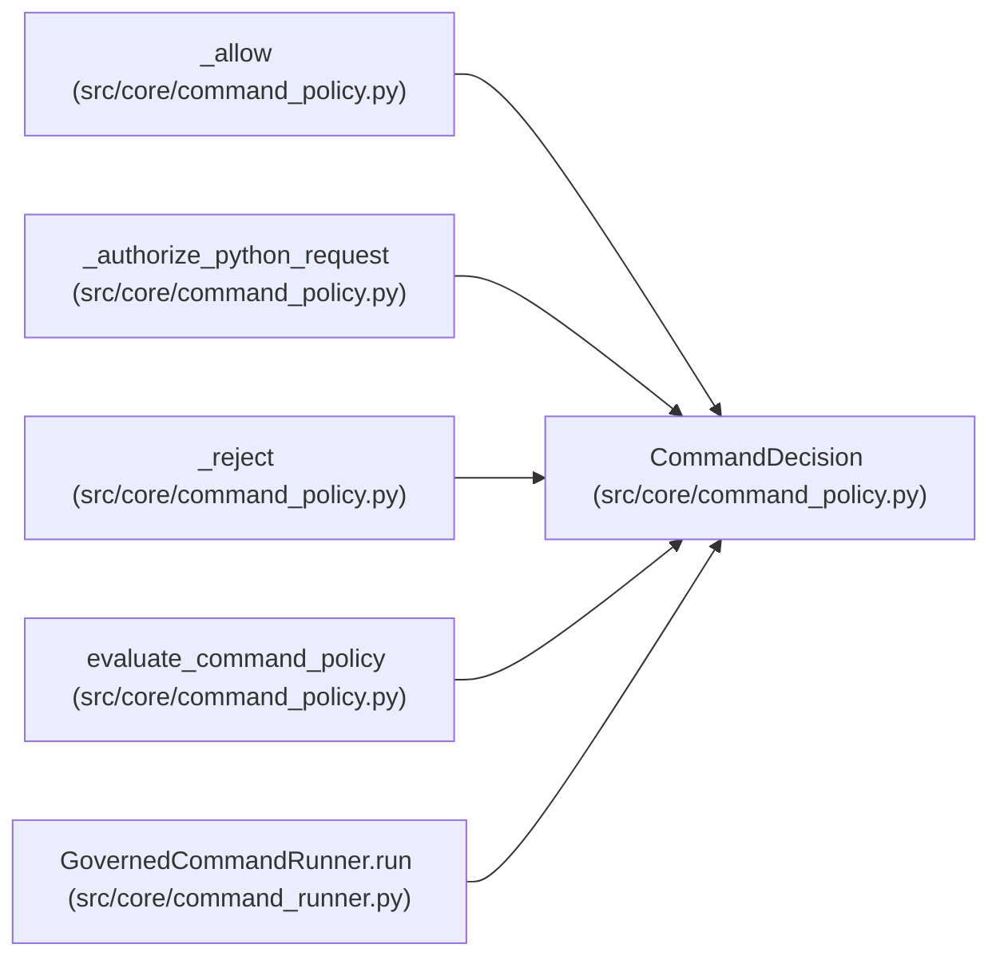

# CommandDecision

**Location:** `src/core/command_policy.py:45`
**Kind:** Class
**Bases:** —
**Module:** [command_policy](../modules/command_policy.md)

**Decorators:** `@dataclass(frozen=True)`

## Description

_Auto-generated from `CommandDecision` in `src/core/command_policy.py`._

## Attributes

| Name | Type | Default | Description |
|------|------|---------|-------------|
| `allowed` | `bool` | *required* | — |
| `argv` | `list[str]` | `field(default_factory=list)` | — |
| `normalized_command` | `str` | `''` | — |
| `operation` | `str` | `''` | — |
| `reason` | `str \| None` | `None` | — |
| `execution_identity` | `dict[str, Any] \| None` | `None` | — |
| `request` | `ExecutionRequest \| None` | `None` | — |

## Methods

*No public methods. Inherits from base classes.*

## Relationships

<!-- Auto-generated relationship summary. Do not edit by hand. -->

### Summary

| Module | Methods | Attributes |
|---|---:|---|
| [command_policy](../modules/command_policy.md) | 0 | `allowed`, `argv`, `execution_identity`, `normalized_command`, `operation`, `reason`, `request` |

### References

| Reference | Kind | Source | Call sites |
|---|---|---|---:|
| `_allow` | call | [command_policy](../modules/command_policy.md) | 1 |
| `_allow` | type_reference | [command_policy](../modules/command_policy.md) | — |
| `_authorize_python_request` | type_reference | [command_policy](../modules/command_policy.md) | — |
| `_reject` | call | [command_policy](../modules/command_policy.md) | 1 |
| `_reject` | type_reference | [command_policy](../modules/command_policy.md) | — |
| `evaluate_command_policy` | type_reference | [command_policy](../modules/command_policy.md) | — |
| `GovernedCommandRunner.run` | type_reference | [command_runner](../modules/command_runner.md) | — |
