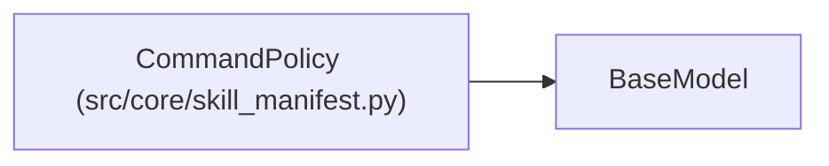

# CommandPolicy

**Location:** `src/core/skill_manifest.py:478`
**Kind:** Pydantic model
**Bases:** `BaseModel`
**Module:** [skill_manifest](../modules/skill_manifest.md)

## Description

Allowed scripts / executables / files for the skill (ARC-011 §9
``command_policy``). The orchestrator's domain-neutral base policy
(``_ALLOWED_PYTHON``, ``_DISALLOWED_EXECUTABLES``, ``_FORBIDDEN_*``,
``_SECRET_MARKERS``) is merged with this per-skill extension.

## Model Configuration

| Setting | Value | Source |
|---------|-------|--------|
| `extra` | `'forbid'` | model_config |

## Attributes

| Name | Type | Wire name | Required | Nullable | Default | Constraints | Examples | Description |
|------|------|-----------|----------|----------|---------|-------------|-------------|----------|
| `allowed_python` | `list[str]` | `allowed_python` | No | No | factory: `list` | — | — | — |
| `allowed_scripts` | `list[str]` | `allowed_scripts` | No | No | factory: `list` | — | — | — |
| `allowed_executables` | `list[str]` | `allowed_executables` | No | No | factory: `list` | — | — | — |
| `copyable_files` | `list[str]` | `copyable_files` | No | No | factory: `list` | — | — | — |
| `readable_files` | `list[str]` | `readable_files` | No | No | factory: `list` | — | — | — |
| `write_protected_files` | `list[str]` | `write_protected_files` | No | No | factory: `list` | — | — | — |
| `forbidden_tokens` | `list[str]` | `forbidden_tokens` | No | No | factory: `list` | — | — | — |
| `forbidden_substrings` | `list[str]` | `forbidden_substrings` | No | No | factory: `list` | — | — | — |
| `secret_markers` | `list[str]` | `secret_markers` | No | No | factory: `list` | — | — | — |
| `config_flag` | `Optional[str]` | `config_flag` | No | Yes | `None` | — | — | — |

## Methods

*No public methods. Inherits from base classes.*

## Relationships

<!-- Auto-generated relationship summary. Do not edit by hand. -->

### Summary

| Module | Methods | Attributes |
|---|---:|---|
| [skill_manifest](../modules/skill_manifest.md) | 0 | `allowed_executables`, `allowed_python`, `allowed_scripts`, `config_flag`, `copyable_files`, `forbidden_substrings`, `forbidden_tokens`, `readable_files`, `secret_markers`, `write_protected_files` |

### Structure

| Kind | Entity | Module |
|---|---|---|
| Base | `BaseModel` | — |
