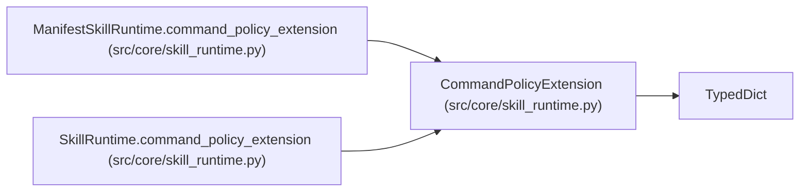

# CommandPolicyExtension

**Location:** `src/core/skill_runtime.py:96`
**Kind:** Class
**Bases:** `TypedDict`
**Module:** [skill_runtime](../modules/skill_runtime.md)

## Description

Per-skill extension to the orchestrator's base command policy.

Today the orchestrator has one global ``_ALLOWED_SCRIPTS`` allow-list
(``command_policy.py``); the manifest-driven future (P2-023) lets each skill
declare its own allowed scripts/executables/copyable-files/readable-files.
The transitional runtimes (P1-024..026) return the model-type-relevant
subset of the current global allow-list.

``script_paths`` (ARC-011 review C4): declared-name → absolute packaged-
path resolution. Skill manifests declare scripts workspace-relative
(``eval/run.py``); the runtime resolves each to the read-only packaged
``skills/<id>/`` tree so the governed command can execute it (the
session workspace is deliberately NOT used — it is agent-writable).

## Attributes

| Name | Type | Presence | Description |
|------|------|----------|-------------|
| `allowed_scripts` | `list[str]` | *optional* | — |
| `allowed_executables` | `list[str]` | *optional* | — |
| `copyable_files` | `list[str]` | *optional* | — |
| `readable_files` | `list[str]` | *optional* | — |
| `write_protected_files` | `list[str]` | *optional* | — |
| `script_paths` | `dict[str, str]` | *optional* | — |
| `script_digests` | `dict[str, str]` | *optional* | — |
| `config_flag` | `str` | *optional* | — |

## Methods

*No public methods. Inherits from base classes.*

## Relationships

<!-- Auto-generated relationship summary. Do not edit by hand. -->

### Summary

| Module | Methods | Attributes |
|---|---:|---|
| [skill_runtime](../modules/skill_runtime.md) | 0 | `allowed_executables`, `allowed_scripts`, `config_flag`, `copyable_files`, `readable_files`, `script_digests`, `script_paths`, `write_protected_files` |

### Structure

| Kind | Entity | Module |
|---|---|---|
| Base | `TypedDict` | — |

### References

| Reference | Kind | Source | Call sites |
|---|---|---|---:|
| `ManifestSkillRuntime.command_policy_extension` | type_reference | [skill_runtime](../modules/skill_runtime.md) | — |
| `SkillRuntime.command_policy_extension` | type_reference | [skill_runtime](../modules/skill_runtime.md) | — |
