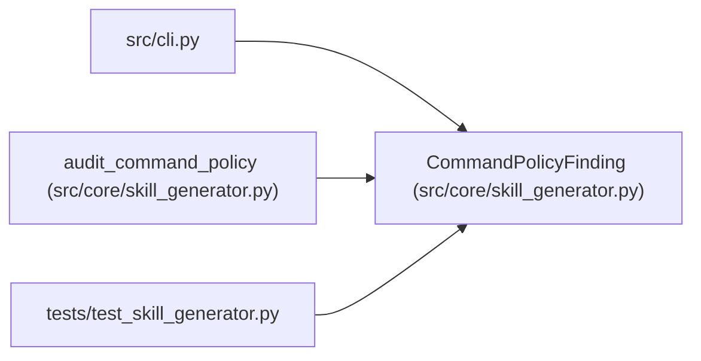

# CommandPolicyFinding

**Location:** `src/core/skill_generator.py:66`
**Kind:** Class
**Bases:** —
**Module:** [skill_generator](../modules/skill_generator.md)

**Decorators:** `@dataclass(frozen=True)`

## Description

One over-permissiveness finding from the P5-026 audit.

## Attributes

| Name | Type | Default | Description |
|------|------|---------|-------------|
| `severity` | `str` | *required* | — |
| `pattern` | `str` | *required* | — |
| `reason` | `str` | *required* | — |
| `location` | `str` | *required* | — |

## Methods

*No public methods. Inherits from base classes.*

## Relationships

<!-- Auto-generated relationship summary. Do not edit by hand. -->

### Summary

| Module | Methods | Attributes |
|---|---:|---|
| [skill_generator](../modules/skill_generator.md) | 0 | `location`, `pattern`, `reason`, `severity` |

### References

| Reference | Kind | Source | Call sites |
|---|---|---|---:|
| `cli` | import | [cli](../modules/cli.md) | — |
| `audit_command_policy` | call | [skill_generator](../modules/skill_generator.md) | 2 |
| `audit_command_policy` | type_reference | [skill_generator](../modules/skill_generator.md) | — |
| `test_skill_generator` | import | [test_skill_generator](../modules/test_skill_generator.md) | — |
