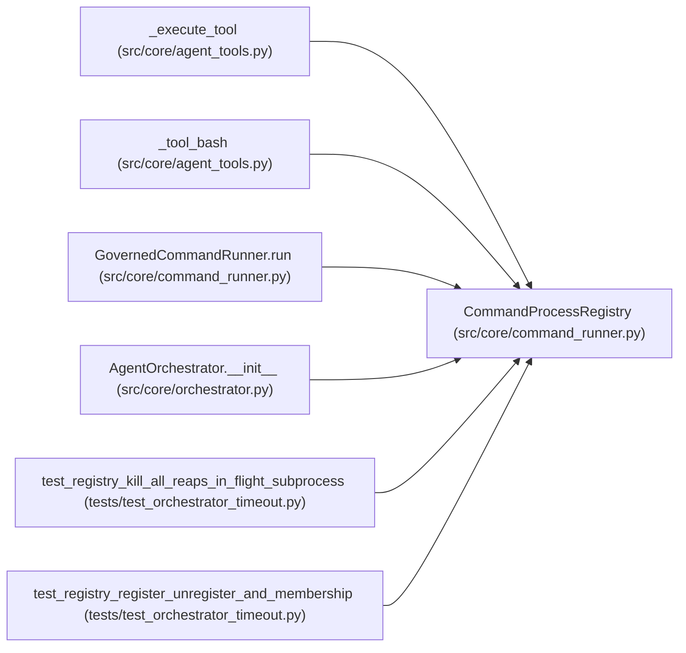

# CommandProcessRegistry

**Location:** `src/core/command_runner.py:275`
**Kind:** Class
**Bases:** —
**Module:** [command_runner](../modules/command_runner.md)

## Description

Thread-safe registry of in-flight governed subprocesses, keyed by session.

ARC-011 P0-006: ``GovernedCommandRunner.run`` executes inside a worker
thread (via ``asyncio.to_thread``), so cancelling the awaiting task on a
hard-timeout or operator stop cannot interrupt the poll loop that owns the
``Popen`` handle. The orchestrator's cancel handler therefore calls
``kill_all`` to reap the process tree through the existing psutil
SIGTERM->SIGKILL path (``_terminate_process_group_without_communicate``)
rather than letting the child leak until its own per-command timeout.

Written from worker threads (``register``/``unregister``) and read + killed
from the event-loop thread (``kill_all``); a ``threading.Lock`` serializes
the dict mutation across both.

## Attributes

*No annotated attributes found.*

## Methods

| Method | Signature | Decorators | Description |
|--------|-----------|------------|-------------|
| `__init__` | `() -> None` | — | — |
| `register` | `(research_id: str, proc: subprocess.Popen[str]) -> None` | — | — |
| `unregister` | `(research_id: str, proc: subprocess.Popen[str]) -> None` | — | — |
| `size` | `() -> int` | `@property` | Number of sessions with at least one registered subprocess. |
| `kill_all` | `(research_id: str) -> None` | — | Best-effort terminate every still-running subprocess tree for a session. |

## Relationships

<!-- Auto-generated relationship summary. Do not edit by hand. -->

### Summary

| Module | Methods | Attributes |
|---|---:|---|
| [command_runner](../modules/command_runner.md) | 5 | — |

### References

| Reference | Kind | Source | Call sites |
|---|---|---|---:|
| `_execute_tool` | type_reference | [agent_tools](../modules/agent_tools.md) | — |
| `_tool_bash` | type_reference | [agent_tools](../modules/agent_tools.md) | — |
| `GovernedCommandRunner.run` | type_reference | [command_runner](../modules/command_runner.md) | — |
| `AgentOrchestrator.__init__` | call | [orchestrator](../modules/orchestrator.md) | 1 |
| `test_registry_kill_all_reaps_in_flight_subprocess` | call | [test_orchestrator_timeout](../modules/test_orchestrator_timeout.md) | 1 |
| `test_registry_register_unregister_and_membership` | call | [test_orchestrator_timeout](../modules/test_orchestrator_timeout.md) | 1 |
