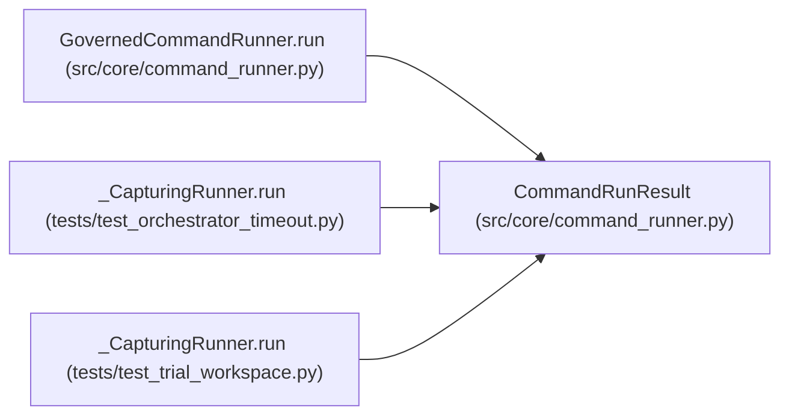

# CommandRunResult

**Location:** `src/core/command_runner.py:254`
**Kind:** Class
**Bases:** —
**Module:** [command_runner](../modules/command_runner.md)

**Decorators:** `@dataclass(frozen=True)`

## Description

_Auto-generated from `CommandRunResult` in `src/core/command_runner.py`._

## Attributes

| Name | Type | Default | Description |
|------|------|---------|-------------|
| `output` | `str` | *required* | — |
| `decision` | `CommandDecision` | *required* | — |
| `returncode` | `int \| None` | `None` | — |
| `timed_out` | `bool` | `False` | — |
| `log_path` | `str \| None` | `None` | — |
| `log_truncated` | `bool` | `False` | — |

## Methods

| Method | Signature | Decorators | Description |
|--------|-----------|------------|-------------|
| `rejected` | `() -> bool` | `@property` | — |

## Relationships

<!-- Auto-generated relationship summary. Do not edit by hand. -->

### Summary

| Module | Methods | Attributes |
|---|---:|---|
| [command_runner](../modules/command_runner.md) | 1 | `decision`, `log_path`, `log_truncated`, `output`, `returncode`, `timed_out` |

### References

| Reference | Kind | Source | Call sites |
|---|---|---|---:|
| `GovernedCommandRunner.run` | call | [command_runner](../modules/command_runner.md) | 3 |
| `GovernedCommandRunner.run` | type_reference | [command_runner](../modules/command_runner.md) | — |
| `_CapturingRunner.run` | call | [test_orchestrator_timeout](../modules/test_orchestrator_timeout.md) | 1 |
| `_CapturingRunner.run` | type_reference | [test_orchestrator_timeout](../modules/test_orchestrator_timeout.md) | — |
| `_CapturingRunner.run` | call | [test_trial_workspace](../modules/test_trial_workspace.md) | 1 |
