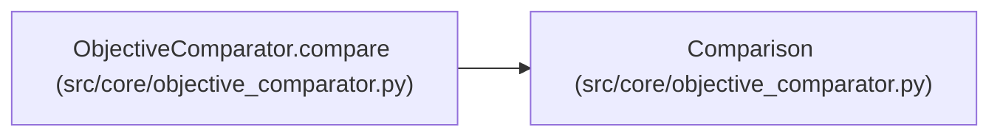

# Comparison

**Location:** `src/core/objective_comparator.py:37`
**Kind:** Type alias
**Bases:** —
**Module:** [objective_comparator](../modules/objective_comparator.md)
**Target:** `Literal['better', 'tie', 'worse', 'incomparable']`

## Description

_Auto-generated from `Comparison` in `src/core/objective_comparator.py`._

## Attributes

*No annotated attributes found.*

## Methods

*No public methods. Inherits from base classes.*

## Relationships

<!-- Auto-generated relationship summary. Do not edit by hand. -->

### Summary

| Module | Methods | Attributes |
|---|---:|---|
| [objective_comparator](../modules/objective_comparator.md) | 0 | — |

### References

| Reference | Kind | Source | Call sites |
|---|---|---|---:|
| `ObjectiveComparator.compare` | type_reference | [objective_comparator](../modules/objective_comparator.md) | — |
