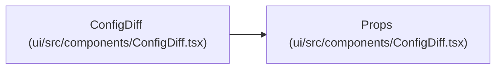

# Props

**Location:** `ui/src/components/ConfigDiff.tsx:1`
**Kind:** Class
**Bases:** —
**Module:** [ConfigDiff](../modules/ConfigDiff.md)

## Description

_Auto-generated from `Props` in `ui/src/components/ConfigDiff.tsx`._

## Attributes

| Name | Type | Required | Default | Description |
|------|------|----------|---------|-------------|
| `current` | `string \| null` | Yes | — | — |
| `proposed` | `string` | Yes | — | — |

## Methods

*No public methods. Inherits from base classes.*

## Relationships

<!-- Auto-generated relationship summary. Do not edit by hand. -->

### Summary

| Module | Methods | Attributes |
|---|---:|---|
| [ConfigDiff](../modules/ConfigDiff.md) | 0 | `current`, `proposed` |

### References

| Reference | Kind | Source | Call sites |
|---|---|---|---:|
| `ConfigDiff` | type_reference | [ConfigDiff](../modules/ConfigDiff.md) | — |
