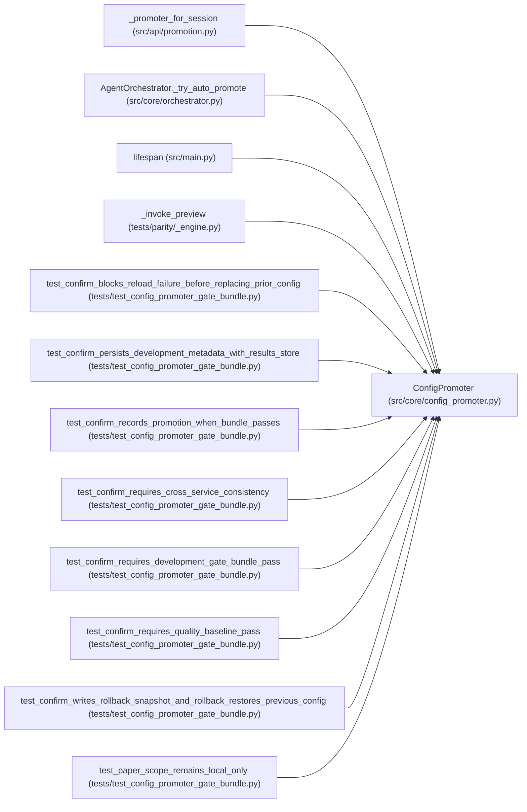

# ConfigPromoter

**Location:** `src/core/config_promoter.py:131`
**Kind:** Class
**Bases:** —
**Module:** [config_promoter](../modules/config_promoter.md)

## Description

Handles preview and confirmation of config promotion to host.

## Attributes

*No annotated attributes found.*

## Methods

| Method | Signature | Decorators | Description |
|--------|-----------|------------|-------------|
| `__init__` | `(store: StateStore, target: Optional['PromotionTarget'] = None) -> None` | — | — |
| `_target_descriptor` | `(path: str) -> Dict[str, Any]` | — | — |
| `preview` | *(async)* `(research_id: str, *, scope: str = DEVELOPMENT_PROMOTION_SCOPE, approval: Optional[Dict[str, Any]] = None) -> Dict[str, Any]` | — | Dry-run promotion: returns the diff/preview without writing. |
| `confirm` | *(async)* `(research_id: str, *, scope: str = DEVELOPMENT_PROMOTION_SCOPE, approval: Optional[Dict[str, Any]] = None) -> Dict[str, Any]` | — | Execute the promotion: write best config to host bind mount. |
| `_confirm_scoped_promotion` | *(async)* `(research_id: str, *, scope: str, approval: Optional[Dict[str, Any]]) -> Dict[str, Any]` | — | Record a paper/canary/production stage decision without rewriting dev config. |
| `_model_version_components` | `(metrics_payload: Dict[str, Any]) -> tuple[str \| None, Any]` | `@staticmethod` | — |
| `_model_version_tag` | `(metrics_payload: Dict[str, Any]) -> str` | `@classmethod` | — |
| `_build_scoped_promotion_metadata` | *(async)* `(*, preview: Dict[str, Any], session: Dict[str, Any], metrics_payload: Dict[str, Any], scope: str, approval: Optional[Dict[str, Any]]) -> Dict[str, Any]` | — | Create an auditable decision artifact for non-development scopes. |
| `rollback` | *(async)* `(*, model_type: str, instrument: str, timeframe: str, reason: Optional[str] = None) -> Dict[str, Any]` | — | Restore the latest development promotion for an instrument/timeframe. |
| `_build_development_promotion_metadata` | `(*, research_id: str, iteration: int, model_type: str, instrument: str, timeframe: str, target_path: str, best_iteration: Dict[str, Any], metrics_payload: Dict[str, Any], gates_passed: bool, training_gates_passed: bool, development_gate_bundle_passed: bool, consistency_report_passed: bool, quality_baseline_passed: bool, gate_bundle_evaluation: Dict[str, Any], candidate_pool_record: Dict[str, Any], promotion_allowed: bool, rollback_readiness: Dict[str, Any], smoke_validation: Dict[str, Any], signal_health: Dict[str, Any], inference_reload_validation: Dict[str, Any], consistency_report: Dict[str, Any], quality_baseline_evaluation: Dict[str, Any]) -> Dict[str, Any]` | — | Create the auditable development promotion decision artifact. |
| `_finalize_development_promotion_metadata` | `(*, metadata: Dict[str, Any], metadata_path: str, promotion_record_created: bool) -> Dict[str, Any]` | — | — |
| `_finalize_scoped_promotion_metadata` | `(*, metadata: Dict[str, Any], metadata_path: str, promotion_record_created: bool) -> Dict[str, Any]` | — | — |
| `_normalize_promotion_scope` | `(scope: str \| None) -> str` | `@staticmethod` | — |
| `_required_prior_scopes` | `(scope: str) -> list[str]` | `@staticmethod` | — |
| `_latest_promotion_record` | *(async)* `(*, model_type: str, instrument: str, timeframe: str, scope: str) -> Optional[Dict[str, Any]]` | — | — |
| `_compact_promotion_record` | `(promotion: Optional[Dict[str, Any]]) -> Optional[Dict[str, Any]]` | `@staticmethod` | — |
| `_decision_chain` | `(*, development_metadata: Dict[str, Any], prior_promotions: Dict[str, Optional[Dict[str, Any]]], current_scope: str, current_allowed: bool, current_blockers: list[str]) -> list[Dict[str, Any]]` | — | — |
| `_rollback_targets` | `(*, prior_promotions: Dict[str, Optional[Dict[str, Any]]], current_scope: str, current_target: Optional[str]) -> Dict[str, Optional[str]]` | — | — |
| `_approval_record` | `(approval: Optional[Dict[str, Any]], *, scope: str) -> Dict[str, Any]` | `@staticmethod` | — |
| `_production_gate_bundle_summary` | `(scope: str) -> Dict[str, Any]` | `@staticmethod` | — |
| `_promotion_scope_evidence` | `(*, metrics_payload: Dict[str, Any], development_metadata: Dict[str, Any], production_bundle: Dict[str, Any]) -> Dict[str, Any]` | — | — |
| `_promotion_evidence_container` | `(metrics_payload: Dict[str, Any]) -> Dict[str, Any]` | `@staticmethod` | — |
| `_first_mapping` | `(*values: Any) -> Dict[str, Any]` | `@staticmethod` | — |
| `_truthy_status` | `(container: Dict[str, Any]) -> bool` | `@staticmethod` | — |
| `_model_card_evidence` | `(metrics_payload: Dict[str, Any], evidence: Dict[str, Any]) -> Dict[str, Any]` | `@staticmethod` | — |
| `_feature_readiness_evidence` | `(metrics_payload: Dict[str, Any], evidence: Dict[str, Any]) -> Dict[str, Any]` | `@staticmethod` | — |
| `_paper_validation_evidence` | `(metrics_payload: Dict[str, Any], evidence: Dict[str, Any]) -> Dict[str, Any]` | `@staticmethod` | — |
| `_canary_validation_evidence` | `(metrics_payload: Dict[str, Any], evidence: Dict[str, Any], *, production_bundle: Dict[str, Any]) -> Dict[str, Any]` | `@staticmethod` | — |
| `_inference_scope_evidence` | `(development_metadata: Dict[str, Any]) -> Dict[str, Any]` | `@staticmethod` | — |
| `_live_risk_limits_evidence` | `(metrics_payload: Dict[str, Any], evidence: Dict[str, Any]) -> Dict[str, Any]` | `@staticmethod` | — |
| `_monitoring_alerts_evidence` | `(metrics_payload: Dict[str, Any], evidence: Dict[str, Any]) -> Dict[str, Any]` | `@staticmethod` | — |
| `_rl_oos_scope_evidence` | `(metrics_payload: Dict[str, Any], development_metadata: Dict[str, Any]) -> Dict[str, Any]` | `@staticmethod` | — |
| `_rl_economic_replay_scope_evidence` | `(metrics_payload: Dict[str, Any]) -> Dict[str, Any]` | `@staticmethod` | — |
| `_numeric_value` | `(*values: Any) -> Optional[float]` | `@staticmethod` | — |
| `_best_iteration_payload` | `(best_iteration: Dict[str, Any]) -> Dict[str, Any]` | `@staticmethod` | — |
| `_attempt_snapshot_payload` | `(best_iteration: Dict[str, Any], metrics_payload: Dict[str, Any]) -> Dict[str, Any]` | `@staticmethod` | — |
| `_live_production_requested` | `(payload: Dict[str, Any]) -> bool` | `@staticmethod` | — |
| `_check_statuses` | `(gate_bundle_evaluation: Dict[str, Any], *prefixes: str) -> list[dict[str, Any]]` | `@staticmethod` | — |
| `_registry_metadata` | `(best_iteration: Dict[str, Any], metrics_payload: Dict[str, Any]) -> Dict[str, Any]` | `@staticmethod` | — |
| `_composite_metadata` | `(metrics_payload: Dict[str, Any]) -> Dict[str, Any]` | `@staticmethod` | — |
| `_metadata_sidecar_path` | `(target_path: str, iteration: int, *, scope: str = DEVELOPMENT_PROMOTION_SCOPE) -> str` | — | — |
| `_rollback_snapshot_path` | `(*, target_path: str, research_id: str, iteration: int) -> str` | — | — |
| `_rollback_metadata_sidecar_path` | `(target_path: str, promotion_id: int) -> str` | — | — |
| `_sha256_text` | `(value: str) -> str` | `@staticmethod` | — |
| `_write_text_file` | *(async)* `(path: str, content: str) -> None` | — | Atomic write: tmp file → fsync → os.replace. |
| `_build_rollback_readiness` | `(*, research_id: str, iteration: int, model_type: str, instrument: str, timeframe: str, target_path: str, previous_yaml: Optional[str], metrics_payload: Dict[str, Any]) -> Dict[str, Any]` | — | — |
| `_build_smoke_validation` | `(*, best_yaml: str, metrics_payload: Dict[str, Any], rollback_readiness: Dict[str, Any]) -> Dict[str, Any]` | — | — |
| `_best_iteration_with_preflight` | `(best_iteration: Dict[str, Any], *, rollback_readiness: Dict[str, Any], smoke_validation: Dict[str, Any], signal_health: Dict[str, Any], inference_reload_validation: Dict[str, Any]) -> Dict[str, Any]` | — | — |
| `_inference_payload` | `(metrics_payload: Dict[str, Any]) -> Dict[str, Any]` | `@staticmethod` | — |
| `_tsfm_fallback_validation` | `(metrics_payload: Dict[str, Any]) -> Dict[str, Any]` | — | — |
| `_build_quality_baseline_evaluation` | *(async)* `(*, research_id: str, best_iteration: Dict[str, Any], model_type: str, instrument: str, timeframe: str) -> Dict[str, Any]` | — | — |
| `_latest_eligible_development_baseline` | *(async)* `(*, model_type: str, instrument: str, timeframe: str) -> Optional[Dict[str, Any]]` | — | — |
| `_development_baseline_matches` | `(promotion: Dict[str, Any], *, model_type: str, instrument: str, timeframe: str) -> bool` | `@classmethod` | — |
| `_development_baseline_eligible` | `(promotion: Dict[str, Any]) -> bool` | `@classmethod` | — |
| `_promotion_metadata` | `(promotion: Dict[str, Any]) -> Dict[str, Any]` | `@staticmethod` | — |
| `_promotion_best_metric` | `(promotion: Dict[str, Any]) -> Optional[float]` | `@classmethod` | — |
| `_promotion_metric_name` | `(promotion: Dict[str, Any]) -> Optional[str]` | `@classmethod` | — |
| `_baseline_explicitly_unusable` | `(metadata: Dict[str, Any]) -> bool` | `@staticmethod` | — |
| `_number` | `(*values: Any) -> Optional[float]` | `@staticmethod` | — |
| `_clean_metric_name` | `(value: Any) -> Optional[str]` | `@staticmethod` | — |
| `_formula_version` | `(payload: Dict[str, Any]) -> Optional[str]` | `@classmethod` | composite_formula_version from a metrics payload (top-level mirror |
| `_promotion_formula_version` | `(promotion: Dict[str, Any]) -> Optional[str]` | `@classmethod` | — |
| `_promotion_iterations` | *(async)* `(research_id: str, best_iteration: Dict[str, Any]) -> list[Dict[str, Any]]` | — | — |
| `_with_blocker_details` | `(evaluation: Dict[str, Any], *, metrics_payload: Dict[str, Any], phase_state: Dict[str, Any], source: str) -> Dict[str, Any]` | `@staticmethod` | — |
| `_merge_blocker_details` | `(*detail_groups: Any) -> list[Dict[str, Any]]` | `@staticmethod` | — |
| `_merge_blockers` | `(*blocker_groups: Any) -> list[str]` | `@staticmethod` | — |
| `_evaluate_gate_bundle` | `(model_type: str, best_iteration: Dict[str, Any], *, instrument: Optional[str] = None, timeframe: Optional[str] = None) -> Dict[str, Any]` | — | Evaluate the best iteration against the development gate bundle. |
| `_apply_pipeline_feature_replay_policy` | `(*, session: Dict[str, Any], model_type: str, gate_bundle_evaluation: Dict[str, Any], consistency_report: Dict[str, Any]) -> tuple[Dict[str, Any], Dict[str, Any]]` | `@staticmethod` | Do not require standalone economic replay for pipeline feature phases. |
| `_waive_missing_replay_check` | `(check: Dict[str, Any]) -> Dict[str, Any]` | `@staticmethod` | — |
| `_warn_missing_replay_check` | `(check: Dict[str, Any]) -> Dict[str, Any]` | `@staticmethod` | — |
| `_resolve_artifacts_dir` | `(workspace_path: str, model_type: str, instrument: str, timeframe: str, *, metrics_payload: Optional[Dict[str, Any]] = None, attempt_snapshot: Optional[Dict[str, Any]] = None) -> Optional[str]` | — | Find the directory containing trained model .pkl files. |
| `_artifacts_dir_from_payload` | `(payload: Dict[str, Any]) -> Optional[str]` | `@staticmethod` | — |
| `_get_target_path` | `(model_type: str, instrument: str, timeframe: str, skill_id: str = '') -> str` | — | Determine the host config file path for promotion. |

## Relationships

<!-- Auto-generated relationship summary. Do not edit by hand. -->

### Summary

| Module | Methods | Attributes |
|---|---:|---|
| [config_promoter](../modules/config_promoter.md) | 73 | — |

### References

| Reference | Kind | Source | Call sites |
|---|---|---|---:|
| `_promoter_for_session` | call | [promotion](../modules/promotion.md) | 1 |
| `AgentOrchestrator._try_auto_promote` | call | [orchestrator](../modules/orchestrator.md) | 2 |
| `lifespan` | call | [src_main](../modules/src_main.md) | 1 |
| `_invoke_preview` | call | [_engine](../modules/_engine.md) | 1 |
| `test_confirm_blocks_reload_failure_before_replacing_prior_config` | call | [test_config_promoter_gate_bundle](../modules/test_config_promoter_gate_bundle.md) | 1 |
| `test_confirm_persists_development_metadata_with_results_store` | call | [test_config_promoter_gate_bundle](../modules/test_config_promoter_gate_bundle.md) | 1 |
| `test_confirm_records_promotion_when_bundle_passes` | call | [test_config_promoter_gate_bundle](../modules/test_config_promoter_gate_bundle.md) | 1 |
| `test_confirm_requires_cross_service_consistency` | call | [test_config_promoter_gate_bundle](../modules/test_config_promoter_gate_bundle.md) | 2 |
| `test_confirm_requires_development_gate_bundle_pass` | call | [test_config_promoter_gate_bundle](../modules/test_config_promoter_gate_bundle.md) | 1 |
| `test_confirm_requires_quality_baseline_pass` | call | [test_config_promoter_gate_bundle](../modules/test_config_promoter_gate_bundle.md) | 1 |
| `test_confirm_writes_rollback_snapshot_and_rollback_restores_previous_config` | call | [test_config_promoter_gate_bundle](../modules/test_config_promoter_gate_bundle.md) | 2 |
| `test_paper_scope_remains_local_only` | call | [test_config_promoter_gate_bundle](../modules/test_config_promoter_gate_bundle.md) | 1 |

> References: showing 12 of 57 logical references; 45 omitted by the 12-row generated summary limit.
