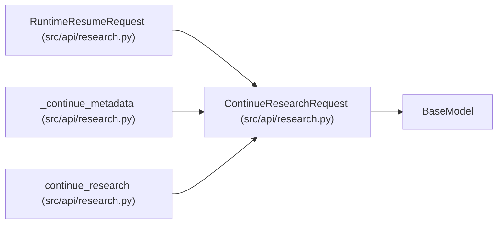

# ContinueResearchRequest

**Location:** `src/api/research.py:873`
**Kind:** Pydantic model
**Bases:** `BaseModel`
**Module:** [research](../modules/research.md)

## Description

Request body for continuing a timed-out/completed session.

## Model Configuration

| Setting | Value | Source |
|---------|-------|--------|
| `extra` | `'forbid'` | model_config |

## Attributes

| Name | Type | Wire name | Required | Nullable | Default | Constraints | Examples | Description |
|------|------|-----------|----------|----------|---------|-------------|-------------|----------|
| `max_iterations` | `Optional[int]` | `max_iterations` | No | Yes | `None` | ge=1; le=500 | — | — |
| `max_budget_usd` | `Optional[float]` | `max_budget_usd` | No | Yes | `None` | ge=0.1; le=500.0 | — | — |
| `timeout_minutes` | `Optional[int]` | `timeout_minutes` | No | Yes | `None` | ge=30; le=1440 | — | Session timeout in minutes |
| `focus_hint` | `Optional[str]` | `focus_hint` | No | Yes | `None` | max_length=1000 | — | Optional hint for what to focus on in the continuation |

## Methods

*No public methods. Inherits from base classes.*

## Relationships

<!-- Auto-generated relationship summary. Do not edit by hand. -->

### Summary

| Module | Methods | Attributes |
|---|---:|---|
| [research](../modules/research.md) | 0 | `focus_hint`, `max_budget_usd`, `max_iterations`, `timeout_minutes` |

### Structure

| Kind | Entity | Module |
|---|---|---|
| Base | `BaseModel` | — |
| Subclass | `RuntimeResumeRequest` | [research](../modules/research.md) |

### References

| Reference | Kind | Source | Call sites |
|---|---|---|---:|
| `_continue_metadata` | type_reference | [research](../modules/research.md) | — |
| `continue_research` | call | [research](../modules/research.md) | 1 |
| `continue_research` | type_reference | [research](../modules/research.md) | — |
